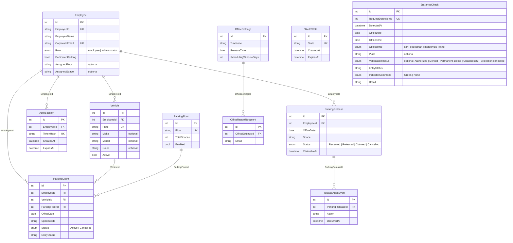

# Approval: Build every operation of the locked API contract in contracts/openapi.

Run 20261013-folio3-parking-app-introductio-e8ef · risk **high** · feature · size L · cost so far $0.29

## Your request (word for word)
> Folio3 Parking App
> 
> Introduction
> 
> Folio3 has a fixed number of parking spaces available at its office premises, while the number of
> employees commuting to the office by car is greater than the available parking capacity.
> Dedicated parking spaces are currently assigned to employees based on defined organizational criteria,
> including seniority, designation, and other relevant factors. Employees with dedicated parking are issued
> a vehicle sticker, allowing security personnel to identify vehicles that are authorized to enter and use the
> office parking area.
> 
> However, dedicated parking spaces often remain unused when the assigned employee is on leave,
> working from home, travelling, or otherwise not visiting the office. At the same time, other employees
> who commute by car may be required to park outside the office despite parking spaces being
> temporarily available inside the premises.
> 
> To improve the utilization of available parking spaces, Folio3 plans to introduce a mobile application
> through which employees with dedicated parking can release their parking space when they do not
> intend to use it. The released spaces can then be made available to other eligible employees through a
> transparent and controlled process.
> 
> The application will be available on both iOS and Android platforms.
> 
> Problem Statement
> 
> The current parking allocation process does not provide visibility into whether an assigned
> parking space will be used on a particular day.
> 
> As a result:
> 
> ● Dedicated parking spaces may remain vacant for the entire day.
> ● Employees without dedicated parking may have to park on nearby roads.
> ● Security personnel do not have real-time information about released or temporarily
> reassigned parking spaces.
> ● Parking availability is managed through informal communication or is not managed at all.
> ● The organization is unable to measure parking demand, utilization, or recurring
> availability.
> 
> A centralized parking management application is required to enable parking holders to release
> unused spaces and allow those spaces to be allocated temporarily to other employees.
> 
> Solution Overview
> 
> The proposed solution will consist of a mobile application available for both iOS and Android,
> supported by a centralized backend system and a camera-based vehicle verification system at
> the office entrance.
> 
> Employees will log in using their Folio3 Google account (Gmail). The system will automatically
> identify the employee and retrieve their profile information using their corporate email address.
> 
> For employees with dedicated parking, the system will already maintain information such as:
> 
> ● Employee ID
> ● Employee Name
> ● Assigned Parking Status
> ● Registered Vehicle License Plate Number
> 
> Employees using the application for the first time who do not have a registered vehicle will be
> prompted to enter their vehicle's license plate number. This information will be stored for future
> parking requests.
> 
> By default, the system will assume that employees with dedicated parking will use their
> assigned parking space on each working day. If they do not intend to come to the office, they
> can release their parking space through a single action in the mobile application for the current
> day or schedule future releases using a calendar for up to 30 days.
> 
> Once a parking space is released, it becomes available to employees without dedicated
> parking. Eligible employees will receive a push notification and can claim the available space on
> a first-come, first-served basis.
> 
> At the office entrance, vehicles with permanent parking stickers will continue to follow the
> existing process. Vehicles without stickers will be verified using a license plate recognition
> camera. The system will validate the vehicle against the temporary parking allocation for that
> day and, if authorized, activate a green indicator for the security guard to allow entry.
> 
> User Roles
> 
> Dedicated Parking Holder
> 
> An employee with a permanently assigned parking space who can release their parking when it
> will not be used.
> 
> Temporary Parking User
> 
> An employee without a dedicated parking space who can claim an available parking spot on a
> first-come, first-served basis.
> 
> Security Guard
> 
> A security staff member responsible for verifying vehicle entry based on parking stickers or
> system authorization.
> 
> Parking Administrator
> 
> An authorized administrator responsible for managing parking assignments, employee records,
> system configuration, and parking reports.
> 
> User Stories
> 
> US-001: Login with Folio3 Account
> 
> User Story
> 
> As an employee, I want to sign in using my Folio3 Google account so that I can securely access
> the parking management application.
> 
> Description
> 
> The application shall support authentication using Folio3 Google Workspace accounts only.
> Personal Gmail accounts or other email providers shall not be permitted.
> 
> Upon successful login, the system shall identify the employee using their corporate email
> address and retrieve their profile information.
> 
> For employees with dedicated parking, the system shall automatically import and maintain the
> following information:
> 
> ● Employee ID
> ● Employee Name
> ● Assigned Parking Status
> ● One or more registered vehicle license plate numbers
> ● Assigned parking floor
> ● Vehicle make
> ● Vehicle model
> 
> ● Vehicle color
> 
> Employees without dedicated parking will be required to complete their vehicle profile during
> their first login by registering at least one license plate number. The remaining employee
> information shall be retrieved automatically from the corporate directory.
> 
> Acceptance Criteria
> 
> ● Employee can log in using a Folio3 Google account.
> ● Only authorized Folio3 employees can access the application.
> ● Employees with dedicated parking have their profile populated automatically after login.
> ● A dedicated parking holder may have one or more registered vehicles.
> ● Employees without dedicated parking are prompted to register at least one vehicle
> during their first login.
> ● A vehicle profile includes the license plate number and optionally the vehicle make,
> model, and color.
> ● Returning users are taken directly to the application dashboard after successful
> authentication.
> 
> S-002: Release Parking for Today
> 
> User Story
> 
> As an employee with a dedicated parking space, I want to release my parking for the current
> day with a single tap so that another employee can use it if I am not coming to the office.
> 
> Description
> 
> Employees with dedicated parking shall be able to release their assigned parking space for the
> current day directly from the home screen.
> 
> The action should require a single tap (with an optional confirmation prompt) to make the
> process quick and convenient. Once the parking is released, the space shall immediately
> become available for temporary allocation to other eligible employees on a first-come,
> first-served basis.
> 
> If the parking space has already been claimed by another employee, the dedicated parking
> holder will no longer have access to that parking space for the remainder of the day.
> 
> The application shall clearly display the current status of the parking space (e.g., Reserved,
> Released, or Claimed by Another Employee).
> 
> Acceptance Criteria
> 
> ● Only employees with dedicated parking can access this feature.
> ● The option to "Release Today's Parking" is available on the home screen.
> ● Releasing today's parking requires a single user action.
> ● Once released, the parking space is immediately made available to eligible employees.
> ● The parking status is updated in real time.
> ● The user receives a confirmation that the parking has been released successfully.
> ● The user cannot release the same parking space multiple times for the same day.
> ● If the parking has already been claimed by another employee, the user is informed that
> the parking cannot be reclaimed for that day without administrator intervention.
> 
> US-003: Schedule Future Parking Release
> 
> User Story
> 
> As an employee with a dedicated parking space, I want to schedule the release of my parking
> for future dates so that my parking space can be utilized by others when I know I will not be
> coming to the office.
> 
> Description
> 
> The application shall provide a calendar interface that allows dedicated parking holders to
> release their parking for future dates, up to 30 days in advance.
> 
> Users may select individual dates or multiple dates from the calendar. Once scheduled, the
> parking space will automatically become available for temporary allocation on the selected
> dates.
> 
> The user may cancel a scheduled parking release at any time, provided the parking space has
> not already been claimed by another employee. If the parking has already been allocated, the
> release cannot be reverted without administrator intervention.
> 
> Acceptance Criteria
> ● Only employees with dedicated parking can access this feature.
> ● A calendar view is available to schedule future parking releases.
> ● Users can release parking for any date within the next 30 days.
> ● Users can select one or multiple dates.
> ● Scheduled releases are saved and displayed on the calendar.
> ● Users can cancel a scheduled release if the parking has not yet been claimed.
> ● If the parking has already been claimed, the user is informed that the release cannot be
> reverted.
> ● The system maintains an audit trail of all scheduled releases and cancellations.
> 
> US-004: Claim Available Parking
> 
> User Story
> 
> As an employee without a dedicated parking space, I want to claim an available parking spot so
> that I can park inside the office premises when a space becomes available.
> 
> Description
> 
> Parking spaces shall be allocated on a first-come, first-served basis.
> 
> Parking spaces released in advance through the planning calendar shall become available for
> claiming at the Daily Parking Release Time (default: 8:00 AM, configurable by the
> administrator).
> 
> If a dedicated parking holder releases their parking on the same day:
> 
> ● If the release occurs before the Daily Parking Release Time, the parking space shall
> become available at the Daily Parking Release Time.
> ● If the release occurs after the Daily Parking Release Time, the parking space shall
> become available immediately.
> 
> Whenever one or more parking spaces become available, eligible employees without dedicated
> parking shall receive a push notification.
> 
> The application shall display the total number of available parking spaces (e.g., 5 Parking
> Spots Available). Employees will not select a specific parking space. Upon successfully
> claiming a parking spot, the system shall automatically allocate one of the available parking
> spaces and inform the employee of the assigned parking floor.
> 
> The application will not validate whether the employee actually parks on the assigned floor.
> Floor allocation is intended only to distribute vehicles evenly across available parking areas.
> 
> Acceptance Criteria
> 
> ● Only employees without dedicated parking can claim available parking.
> ● Parking spaces are allocated on a first-come, first-served basis.
> ● Pre-scheduled parking releases become available at the Daily Parking Release Time.
> ● Same-day releases made before the Daily Parking Release Time become available at
> the Daily Parking Release Time.
> ● Same-day releases made after the Daily Parking Release Time become available
> immediately.
> ● Eligible employees receive a push notification when parking becomes available.
> ● The application displays the number of currently available parking spaces.
> ● A parking space can only be claimed once.
> 
> ● Upon a successful claim, the system automatically assigns a parking space and displays
> the allocated parking floor.
> ● The application records the date, time, employee, and assigned parking for audit
> purposes.
> ● The application does not enforce or verify whether the employee parks on the assigned
> floor.
> 
> US-005: Verify Vehicle at Parking Entrance
> 
> User Story
> 
> As a security guard, I want the system to automatically verify vehicles entering the parking area
> so that only authorized vehicles are allowed to enter.
> 
> Description
> 
> The parking entrance shall be equipped with a License Plate Recognition (LPR) camera and a
> status indicator light.
> 
> The camera shall continuously monitor approaching vehicles and identify their license plate
> numbers. The system shall ignore pedestrians, motorcycles, and other non-car objects.
> 
> For each detected vehicle, the system shall verify whether it has a valid parking authorization for
> the current day.
> 
> The operational flow shall be as follows:
> 
> ● Vehicles displaying a permanent Folio3 parking sticker will continue to follow the existing
> process and will not be stopped by the security guard, even if the parking holder had
> previously released their parking through the application.
> ● Vehicles without a permanent parking sticker shall be stopped by the security guard.
> ● The system shall verify the detected license plate against the temporary parking
> allocation for the current day.
> ● If a valid parking authorization exists, the system shall activate the green indicator light.
> ● Upon seeing the green light, the security guard shall allow the vehicle to enter.
> ● If no valid authorization exists, the indicator light shall remain off and the vehicle shall not
> be permitted to enter.
> 
> All successful and unsuccessful verification attempts shall be recorded for audit and reporting
> purposes.
> 
> Acceptance Criteria
> 
> ● The camera detects approaching cars and reads their license plate numbers.
> ● The system ignores pedestrians, motorcycles, and other non-car objects.
> 
> ● Vehicles with permanent parking stickers are not required to undergo system verification.
> ● Vehicles without parking stickers are verified against the day's parking allocations.
> ● The green indicator light is activated only when a valid parking authorization exists.
> ● The indicator light remains off when no valid authorization is found.
> ● The system records the date, time, license plate number, verification result, and entry
> status for every verification attempt.
> 
> US-006: Track Parking Utilization and Generate Weekly Reports
> 
> User Story
> 
> As a Parking Administrator, I want the system to track parking utilization and identify unused
> parking allocations so that management can monitor parking usage and improve utilization.
> 
> Description
> 
> The system shall use vehicle entry records captured through the License
> Plate Recognition (LPR) camera to determine whether allocated parking
> spaces were actually utilized.
> 
> For Phase 1, the system shall only monitor, record, and report parking
> utilization. No automated penalties or policy enforcement shall be applied.
> 
> The system shall track the following scenarios:
> 
> Scenario 1 – Dedicated Parking Not Utilized
> 
> ● The employee has a dedicated parking space.
> ● The employee did not release their parking for the day.
> ● The employee's registered vehicle was not detected entering the parking facility.
> ● The parking shall be recorded as Unused Dedicated Parking.
> 
> Scenario 2 – Temporary Parking Not Utilized
> 
> ● The employee successfully claimed a temporary parking space.
> ● The employee's registered vehicle was not detected entering the parking facility on that
> day.
> ● The parking shall be recorded as Unused Temporary Parking.
> 
> The system shall maintain a history of these events for reporting and future policy
> implementation.
> 
> A weekly utilization report shall be generated automatically and emailed every Monday
> morning to designated stakeholders.
> 
> The report should include, at a minimum:
> 
> ● Employees with dedicated parking who did not release or utilize their parking.
> ● Employees who claimed temporary parking but did not utilize it.
> ● Daily and weekly parking utilization statistics.
> ● Total number of released parking spaces.
> ● Total number of temporary parking claims.
> ● Overall parking utilization percentage.
> 
> Acceptance Criteria
> 
> ● The system identifies unused dedicated parking based on the absence of a vehicle entry
> record.
> ● The system identifies unused temporary parking based on the absence of a vehicle entry
> record.
> ● All utilization events are stored with the corresponding employee, vehicle, and date.
> ● A weekly parking utilization report is generated automatically every Monday morning.
> ● The report is emailed to the configured stakeholders.
> ● No automated warning, suspension, or penalty is applied in Phase 1.
> 
> This run builds the API side of the product above, in an existing .NET API project. Build every operation of the locked API contract in contracts/openapi.yaml, exactly as it is written there. Keep the data in the project's PostgreSQL database (the connection string named App, which the project already reads), and write its sample data in App.Api/SeedData.cs: a few believable rows for each table, taken from the contract's examples, so each list has something to show. The app runs that file only when the setting Seed:Demo is true, so no test may count on those rows. The web app is built in its own repo; do not build screens here.

## Your answers
- Q-1 Should implementation be limited to behavior explicitly defined in contracts/openapi.yaml, or should it also implement narrative-only parking rules and external workflows (such as release/claim timing, notifications, camera integration, and weekly email reporting)? → **Implement only the operations and behavior explicitly defined in contracts/openapi.yaml; leave narrative-only behavior and integrations out.**
- Q-2 For application tables that have no sample record in the contract's examples, how should SeedData.cs satisfy the request for sample rows in each table? → **Create a few plausible, schema-valid rows for those tables, using contract example values wherever available.**
- Q-3 What source should provide the Google Workspace OAuth client ID, client secret, and redirect URI needed to implement the contract's Google authorization operation? → **Read these values from deployment configuration or secrets, with values supplied for each environment.**
- Q-4 What should implementation assume about the existing App database when adding the tables required by the API? → **Treat App as a fresh/empty database and use the existing EnsureCreated startup behavior; no migration or backfill is required.**

## Confirm these assumptions (high risk)
- [ ] ASM-1 Does the App PostgreSQL database already contain application data or a schema that this work must preserve, or can it be treated as empty for this implementation? → assumed: No; the system starts empty, with seed data for set-up.

## Requirements
- **REQ-1** (ADDED) When a client requests `GET /api/auth/google/authorization`, the Folio3 Parking API shall implement `getGoogleAuthorization` according to `contracts/openapi.yaml`, constructing the Google Workspace authorization URL from deployment-configured OAuth values.
  - AC-1.1 [api] Given OAuth client ID and redirect URI are configured for deployment.; when A client sends `GET /api/auth/google/authorization`.; then The response status is 200 and the response contains an `authorizationUrl` reflecting the configured client ID and redirect URI and a non-empty `state`.
  - AC-1.2 [api] Given Required Google OAuth configuration or authorization service is unavailable.; when A client sends `GET /api/auth/google/authorization`.; then The response status is 503 and the response error contains the contract-defined `code`, `message`, and `field` values.
- **REQ-2** (ADDED) When a client submits `POST /api/auth/sign-in`, the Folio3 Parking API shall implement `signIn` according to `contracts/openapi.yaml`, exchanging the authorization code with Google Workspace using deployment-configured OAuth values and accepting only eligible Folio3 Workspace identities.
  - AC-2.1 [api] Given A valid Google Workspace authorization code and matching state identify an eligible Folio3 employee.; when The client sends `POST /api/auth/sign-in` with `authorizationCode` and `state`.; then The response status is 200 and the response session contains `id`, `employeeId`, `employeeName`, `corporateEmail`, `role`, and `accessToken`.
  - AC-2.2 [api] Given OAuth values are configured and a valid authorization code is submitted.; when The API exchanges the code with Google Workspace.; then The request sent to Google's token endpoint contains the configured client ID, client secret, redirect URI, authorization code, and state.
  - AC-2.3 [api] Given The sign-in request has a missing, invalid, or mismatched state or code, an ineligible identity, or Google service is unavailable.; when The client sends `POST /api/auth/sign-in`.; then The response status is 400 for an invalid request, 401 for an unaccepted identity, or 503 for an unavailable service, and each error response contains the contract-defined `code`, `message`, and `field` values.
- **REQ-3** (ADDED) When an employee requests `GET /api/employees/me`, the Folio3 Parking API shall implement the bearer-authenticated `getMyEmployeeProfile` operation according to `contracts/openapi.yaml`.
  - AC-3.1 [api] Given A valid bearer session identifies an employee with a profile and registered vehicles.; when The employee sends `GET /api/employees/me`.; then The response status is 200 and the response profile contains the contract's required employee fields, including `id`, `employeeId`, `employeeName`, `corporateEmail`, `dedicatedParking`, `assignedFloor`, `assignedSpace`, and the employee's `vehicles` list.
  - AC-3.2 [api] Given The bearer token is absent or invalid, the identity lacks access, or no employee profile exists.; when A client sends `GET /api/employees/me`.; then The response status is 401, 403, or 404 respectively, and the response error contains the contract-defined `code`, `message`, and `field` values.
- **REQ-4** (ADDED) When an employee requests `GET /api/parking/dashboard`, the Folio3 Parking API shall implement the bearer-authenticated `getParkingDashboard` operation according to `contracts/openapi.yaml`.
  - AC-4.1 [api] Given A valid employee bearer session and available App database identify an employee.; when The employee sends `GET /api/parking/dashboard`.; then The response status is 200 and the response dashboard contains the contract's required fields, including `officeDate`, `timezone`, `releaseTime`, `assignedSpace`, `spaceStatus`, `availableSpaces`, `registeredVehicle`, `workingDays`, and `workingDayRule`.
  - AC-4.2 [api] Given The request has no valid bearer token.; when A client sends `GET /api/parking/dashboard`.; then The response status is 401 and the response error contains the contract-defined `code`, `message`, and `field` values.
- **REQ-5** (ADDED) When an employee submits `POST /api/parking/releases/today`, the Folio3 Parking API shall implement the bearer-authenticated `releaseTodaysSpace` operation according to `contracts/openapi.yaml`.
  - AC-5.1 [api] Given The bearer session identifies an employee with dedicated parking and the submitted `officeDate` is today in the office timezone and releasable.; when The employee posts the today-release request.; then The response status is 200 and the response release contains `officeDate`, `space`, `status`, `claimableAt`, and `auditEvents`, including a `Released` action.
  - AC-5.2 [api] Given The request is unauthenticated, the employee is not eligible to release dedicated parking, or the release conflicts with the current parking state.; when A client posts to `/api/parking/releases/today`.; then The response status is 401, 403, or 409 respectively, and the response error contains the contract-defined `code`, `message`, and `field` values.
- **REQ-6** (ADDED) When an employee requests `GET /api/vehicles`, the Folio3 Parking API shall implement the bearer-authenticated `listMyVehicles` operation according to `contracts/openapi.yaml`.
  - AC-6.1 [api] Given A valid employee bearer session identifies an employee with registered vehicles.; when The employee sends `GET /api/vehicles`.; then The response status is 200 and the response `vehicles` list contains only that employee's vehicles with contract fields, including `id`, `plate`, `make`, `model`, `color`, and `active`.
  - AC-6.2 [api] Given The request has no valid bearer token.; when A client sends `GET /api/vehicles`.; then The response status is 401 and the response error contains the contract-defined `code`, `message`, and `field` values.
- **REQ-7** (ADDED) When an employee submits `POST /api/vehicles`, the Folio3 Parking API shall implement the bearer-authenticated `registerVehicle` operation according to `contracts/openapi.yaml`.
  - AC-7.1 [api] Given A valid employee bearer session and vehicle input with a valid plate and optional make, model, and color are supplied.; when The employee posts the vehicle input to `/api/vehicles`.; then The response status is 201 and the response vehicle record contains `id`, `plate`, `make`, `model`, `color`, and `active` set to true.
  - AC-7.2 [api] Given The vehicle input is invalid, the request is unauthenticated, or the plate conflicts with an existing record.; when A client posts to `/api/vehicles`.; then The response status is 400, 401, or 409 respectively, and the response error contains the contract-defined `code`, `message`, and `field` values.
- **REQ-8** (ADDED) When an employee requests `GET /api/parking/releases`, the Folio3 Parking API shall implement the bearer-authenticated `listMyReleases` operation according to `contracts/openapi.yaml`.
  - AC-8.1 [api] Given A valid employee bearer session identifies an employee with saved releases and audit events.; when The employee sends `GET /api/parking/releases`.; then The response status is 200 and the response `releases` list contains only that employee's releases with contract fields, including `id`, `officeDate`, `space`, `status`, `claimableAt`, and `auditEvents`.
  - AC-8.2 [api] Given The request has no valid bearer token.; when A client sends `GET /api/parking/releases`.; then The response status is 401 and the response error contains the contract-defined `code`, `message`, and `field` values.
- **REQ-9** (ADDED) When an employee submits `POST /api/parking/releases`, the Folio3 Parking API shall implement the bearer-authenticated `scheduleParkingReleases` operation for one or more dates within the next 30 calendar days according to `contracts/openapi.yaml`.
  - AC-9.1 [api] Given A valid employee bearer session identifies a dedicated-parking holder and `officeDates` contains one or more valid dates within the next 30 calendar days.; when The employee posts the schedule to `/api/parking/releases`.; then The response status is 201 and the response `releases` list contains the saved dates and a `Scheduled` audit event for each release.
  - AC-9.2 [api] Given The schedule request is malformed, the employee is not eligible, or dates violate the contract's date rules.; when A client posts to `/api/parking/releases`.; then The response status is 400, 403, or 422 as applicable, and the response error contains the contract-defined `code`, `message`, and `field` values.
- **REQ-10** (ADDED) When an employee submits `DELETE /api/parking/releases/{releaseId}`, the Folio3 Parking API shall implement the bearer-authenticated `cancelParkingRelease` operation according to `contracts/openapi.yaml`.
  - AC-10.1 [api] Given The bearer session owns an unclaimed scheduled release identified by `releaseId`.; when The employee deletes `/api/parking/releases/{releaseId}`.; then The response status is 200, the response release status is `Cancelled`, and its `auditEvents` list includes scheduling and cancellation events.
  - AC-10.2 [api] Given The release does not exist, belongs to another employee, has already been claimed, or the request is unauthenticated.; when A client deletes `/api/parking/releases/{releaseId}`.; then The response status is 404, 403, 409, or 401 as applicable, and the response error contains the contract-defined `code`, `message`, and `field` values.
- **REQ-11** (ADDED) When an employee requests `GET /api/parking/availability`, the Folio3 Parking API shall implement the bearer-authenticated `getParkingAvailability` operation according to `contracts/openapi.yaml`.
  - AC-11.1 [api] Given A valid employee bearer session exists and office capacity, release time, and current parking allocations are configured.; when The employee sends `GET /api/parking/availability`.; then The response status is 200 and the response contains `officeDate`, `timezone`, `availableSpaces`, `releaseTime`, and a `floors` list with `floor`, `freeSpaces`, and `totalSpaces`.
  - AC-11.2 [api] Given The request has no valid bearer token.; when A client sends `GET /api/parking/availability`.; then The response status is 401 and the response error contains the contract-defined `code`, `message`, and `field` values.
- **REQ-12** (ADDED) When an employee submits `POST /api/parking/claims`, the Folio3 Parking API shall implement the bearer-authenticated `claimParkingSpace` operation, allocating a claimable temporary space using the submitted registered vehicle, according to `contracts/openapi.yaml`.
  - AC-12.1 [api] Given A valid employee bearer session identifies an eligible employee, the selected registered vehicle belongs to that employee, and a space is claimable for `officeDate`.; when The employee posts `vehicleId` and `officeDate` to `/api/parking/claims`.; then The response status is 201 and the response contains allocated `floor`, `space`, `plate`, `officeDate`, `status`, `entryStatus`, `floorCapacity`, `allocationRule`, and `authorizationScope` fields.
  - AC-12.2 [api] Given Two eligible employees attempt to claim the last available space for the same office date concurrently.; when The employees submit claims concurrently.; then The responses contain exactly one status 201 and one conflict status 409, and the successful response contains one allocated space.
  - AC-12.3 [api] Given The request is invalid or unauthenticated, the employee is ineligible, the vehicle or date is not eligible, or no space remains available.; when A client posts to `/api/parking/claims`.; then The response status is 400, 401, 403, 409, or 422 as applicable, and the response error contains the contract-defined `code`, `message`, and `field` values.
- **REQ-13** (ADDED) When an employee requests `GET /api/parking/claims/today`, the Folio3 Parking API shall implement the bearer-authenticated `getTodaysParkingClaim` operation according to `contracts/openapi.yaml`.
  - AC-13.1 [api] Given A valid employee bearer session identifies an employee with an active temporary allocation for today.; when The employee sends `GET /api/parking/claims/today`.; then The response status is 200 and the response contains the allocation's required `ParkingClaim` fields, including `floor`, `space`, `plate`, `officeDate`, and `entryStatus`.
  - AC-13.2 [api] Given The employee has no temporary allocation for today or the request has no valid bearer token.; when A client sends `GET /api/parking/claims/today`.; then The response status is 404 or 401 respectively, and the response error contains the contract-defined `code`, `message`, and `field` values when an error response is returned.
- **REQ-14** (ADDED) When an employee submits `DELETE /api/parking/claims/{claimId}`, the Folio3 Parking API shall implement the bearer-authenticated `cancelParkingClaim` operation according to `contracts/openapi.yaml`.
  - AC-14.1 [api] Given The bearer session owns an existing claim that can be cancelled.; when The employee deletes `/api/parking/claims/{claimId}`.; then The response status is 200 and the response contains the contract's `ParkingClaim` fields, including `id` and the cancellation outcome status.
  - AC-14.2 [api] Given The claim does not exist, belongs to another employee, cannot be cancelled in its current state, or the request is unauthenticated.; when A client deletes `/api/parking/claims/{claimId}`.; then The response status is 404, 403, 409, or 401 as applicable, and the response error contains the contract-defined `code`, `message`, and `field` values.
- **REQ-15** (ADDED) When an administrator requests `GET /api/admin/roster`, the Folio3 Parking API shall implement the administrator-authorized `getParkingRoster` operation with documented search, assignment, pagination parameters, response schema, and status codes in `contracts/openapi.yaml`.
  - AC-15.1 [api] Given A valid administrator bearer session and optional `search`, `assignment`, `page`, and `pageSize` filters are supplied.; when The administrator sends `GET /api/admin/roster`.; then The response status is 200 and the response roster page contains `id`, `page`, `pages`, and an `employees` list with contract roster fields matching the supplied filters.
  - AC-15.2 [api] Given The request is unauthenticated or the bearer token identifies a non-administrator.; when A client sends `GET /api/admin/roster`.; then The response status is 401 or 403 respectively, and the response error contains the contract-defined `code`, `message`, and `field` values.
- **REQ-16** (ADDED) When an administrator requests `GET /api/admin/entry-checks`, the Folio3 Parking API shall implement the administrator-authorized `getEntranceChecks` operation with documented filters, response schema, and status codes in `contracts/openapi.yaml`.
  - AC-16.1 [api] Given A valid administrator bearer session and optional `search`, `result`, and `page` filters are supplied.; when The administrator sends `GET /api/admin/entry-checks`.; then The response status is 200 and the response page contains `id`, `page`, `pages`, and a `checks` list with contract entry-check fields matching the supplied filters.
  - AC-16.2 [api] Given The request is unauthenticated or the bearer token identifies a non-administrator.; when A client sends `GET /api/admin/entry-checks`.; then The response status is 401 or 403 respectively, and the response error contains the contract-defined `code`, `message`, and `field` values.
- **REQ-17** (ADDED) When a client submits `POST /api/entrance/verify`, the Folio3 Parking API shall implement the unauthenticated `verifyEntranceDetection` operation according to `contracts/openapi.yaml` and record each verification outcome in App.
  - AC-17.1 [api] Given A car detection has a readable plate with active temporary parking authorization for the detected office date.; when The client posts the detection to `/api/entrance/verify`.; then The response status is 200 and the response reports the detected plate, `verificationResult` `Authorized`, `entryStatus`, and `indicatorCommand` `Green`.
  - AC-17.2 [api] Given The detection is a pedestrian, motorcycle, or other non-car object.; when The client posts the detection to `/api/entrance/verify`.; then The response status is 200 and the response has a null `plate`, `indicatorCommand` `None`, and the contract-defined non-car outcome fields.
  - AC-17.3 [api] Given A car has no valid authorization, its plate is unreadable, or a required entrance service is unavailable.; when The client posts the detection to `/api/entrance/verify`.; then The response reports a denied or unsuccessful outcome with `indicatorCommand` `None`, and the response status is 200 for processed detections or 503 for the unavailable-service outcome.
  - AC-17.4 [api] Given A detection has been processed, including a non-car or unsuccessful detection.; when The client posts the detection and an administrator later requests matching entry checks.; then A database row records the detection time, office date and time, plate where available, verification result, entry status, and detail, and the response `checks` list contains the corresponding record.
  - AC-17.5 [api] Given An entrance detection request is malformed.; when A client posts to `/api/entrance/verify`.; then The response status is 400 and the response error contains the contract-defined `code`, `message`, and `field` values.
- **REQ-18** (ADDED) When an administrator requests `GET /api/admin/utilization`, the Folio3 Parking API shall implement the administrator-authorized `getWeeklyUtilizationReport` operation according to `contracts/openapi.yaml`.
  - AC-18.1 [api] Given A valid administrator bearer session and an omitted or valid `weekStart` date are supplied and parking activity exists for the requested week.; when The administrator sends `GET /api/admin/utilization`.; then The response status is 200 and the response report contains `weekStart`, `weekEnd`, `generatedAt`, `releasedSpaces`, `temporaryClaims`, `overallUtilizationPercent`, `dailyStatistics`, and `unusedParking`.
  - AC-18.2 [api] Given The request is unauthenticated, the caller is not an administrator, or `weekStart` is invalid.; when A client sends `GET /api/admin/utilization`.; then The response status is 401, 403, or 400 as applicable, and the response error contains the contract-defined `code`, `message`, and `field` values.
- **REQ-19** (ADDED) When an administrator requests `GET /api/admin/office-settings`, the Folio3 Parking API shall implement the administrator-authorized `getOfficeParkingSettings` operation according to `contracts/openapi.yaml`.
  - AC-19.1 [api] Given A valid administrator bearer session exists and office parking settings are stored in App.; when The administrator sends `GET /api/admin/office-settings`.; then The response status is 200 and the response contains `timezone`, `releaseTime`, `schedulingWindowDays`, `reportRecipients`, `nextReportDelivery`, and `reportSchedule` matching the stored settings.
  - AC-19.2 [api] Given The request is unauthenticated or the bearer token identifies a non-administrator.; when A client sends `GET /api/admin/office-settings`.; then The response status is 401 or 403 respectively, and the response error contains the contract-defined `code`, `message`, and `field` values.
- **REQ-20** (ADDED) When an administrator submits `PUT /api/admin/office-settings`, the Folio3 Parking API shall implement the administrator-authorized `updateOfficeParkingSettings` operation according to `contracts/openapi.yaml`.
  - AC-20.1 [api] Given A valid administrator bearer session and valid `timezone`, `releaseTime`, and non-empty `reportRecipients` are supplied.; when The administrator updates `/api/admin/office-settings`.; then The response status is 200 and the response contains the saved settings fields; a subsequent response from `GET /api/admin/office-settings` returns the saved values.
  - AC-20.2 [api] Given The update is invalid, unauthenticated, or sent by a non-administrator.; when A client sends `PUT /api/admin/office-settings`.; then The response status is 400, 401, or 403 as applicable, and the response error contains the contract-defined `code`, `message`, and `field` values.
- **REQ-21** (ADDED) ⚠ only one draft had this When an administrator requests `GET /api/admin/activity`, the Folio3 Parking API shall implement the administrator-authorized `getParkingActivity` operation and return the activity field as specified by the d1 reading.
  - AC-21.1 [api] Given A valid administrator bearer session and optional `search`, `eventType`, and `page` filters are supplied, and retained activity exists.; when The administrator sends `GET /api/admin/activity`.; then The response status is 200 and the response contains `page`, `pages`, and an `activity` list containing matching records with the contract activity fields.
  - AC-21.2 [api] Given The request is unauthenticated or the bearer token identifies a non-administrator.; when A client sends `GET /api/admin/activity`.; then The response status is 401 or 403 respectively, and the response error contains the contract-defined `code`, `message`, and `field` values.
- **REQ-22** (ADDED) When an administrator requests `GET /api/admin/activity`, the Folio3 Parking API shall implement the administrator-authorized `getParkingActivity` operation and return the events field as specified by the d2 and d3 readings.
  - AC-22.1 [api] Given A valid administrator bearer session and optional `search`, `eventType`, and `page` filters are supplied, and retained activity exists.; when The administrator sends `GET /api/admin/activity`.; then The response status is 200 and the response contains `id`, `page`, `pages`, and an `events` list containing matching records with the contract `ParkingActivity` fields.
  - AC-22.2 [api] Given The request is unauthenticated or the bearer token identifies a non-administrator.; when A client sends `GET /api/admin/activity`.; then The response status is 401 or 403 respectively, and the response error contains the contract-defined `code`, `message`, and `field` values.
- **REQ-23** (ADDED) When a client submits `POST /api/notifications/availability`, the Folio3 Parking API shall implement the unauthenticated `sendAvailabilityNotification` operation according to `contracts/openapi.yaml`, dispatching the fixed `parking-availability` template to eligible non-dedicated employees through a configured email service.
  - AC-23.1 [api] Given A valid availability request has a positive `availableSpaces` value and the email service accepts dispatch for eligible non-dedicated employees.; when The client posts to `/api/notifications/availability`.; then The response status is 202 and the response dispatch contains request `id`, status `accepted`, `recipientCount`, and template `parking-availability`; an outbound call is recorded to the configured email delivery service for eligible recipients.
  - AC-23.2 [api] Given The availability request is invalid or the required email service is unavailable.; when A client posts to `/api/notifications/availability`.; then The response status is 400 or 503 respectively, and the response error contains the contract-defined `code`, `message`, and `field` values.
- **REQ-24** (MODIFIED) The Folio3 Parking API shall persist API-managed application records in the PostgreSQL database configured by `ConnectionStrings:App` and initialize its schema on startup using the existing fresh-database `EnsureCreated` behavior.
  - AC-24.1 [api] Given `ConnectionStrings:App` points to a fresh PostgreSQL database.; when The API starts.; then A row in PostgreSQL `information_schema.tables` identifies each created application table.
  - AC-24.2 [api] Given A fresh App database is configured and demo seeding is disabled.; when An authenticated client registers a vehicle, the API restarts against the same database, and the employee lists vehicles.; then The registration response status is 201, a corresponding row exists in the configured App database, and the later response `vehicles` list contains the saved record.
- **REQ-25** (MODIFIED) When `Seed:Demo` is true, the Folio3 Parking API shall use `App.Api/SeedData.cs` to insert schema-valid sample rows into every empty application table, using contract example values where available and plausible values otherwise.
  - AC-25.1 [api] Given The App database schema exists, its application tables are empty, and `Seed:Demo` is true.; when The API starts and invokes the public `SeedData.Run` method.; then The row count is between two and five in every application table; each table has at least two schema-valid sample rows, including at least two in non-singleton tables and at least one valid row in any contract-defined singleton table, with contract examples where available such as Aisha Rahman's employee and Toyota Corolla vehicle.
  - AC-25.2 [unit] Given An empty database has its application tables created.; when A test calls the public `SeedData.Run` method directly.; then Rows are present in each application table and each seeded row is schema-valid.
  - AC-25.3 [api] Given The App database schema exists and `Seed:Demo` is unset or false.; when The API starts and initializes its database.; then The row count of demo-only sample records remains zero.
- **REQ-26** (MODIFIED) The Folio3 Parking API and its contract test suite shall serve documented operations and run test scenarios using explicitly arranged records, without requiring demo-seed rows.
  - AC-26.1 [api] Given A fresh App database has `Seed:Demo` false and explicitly provisioned identities as needed.; when The API test suite runs contract scenarios, arranging the records each scenario requires through setup or API calls.; then The response statuses and returned values are determined by test-created records, the suite completes without requiring any demo-seed row, and any empty roster response has count 0.
- **REQ-27** (ADDED) The Folio3 Parking API repository shall not add employee, administrator, or security-guard product screens; its product surfaces remain contracted HTTP operations and API documentation.
  - AC-27.1 [manual] Given The API deployment is available for inspection.; when A reviewer visits the root route and API documentation and inspects the served pages and product routes.; then The API health response and API documentation may be displayed, but no employee, administrator, or security-guard product screen is shown.

Checked by a person, not by a test: AC-27.1 (each needs a person's sign-off before delivery)

Not changing: Native iOS and Android client applications and employee-facing product screens.; Physical license-plate-recognition camera capture, continuous vehicle monitoring, indicator hardware, and device integrations beyond the documented `POST /api/entrance/verify` HTTP operation.; Corporate-directory synchronization beyond the identity and profile behavior defined by the OpenAPI contract.; Automated weekly report generation and scheduled stakeholder email delivery beyond the documented report and notification API operations.; Push-notification delivery and automatic release-time scheduling beyond documented contract operations.; Parking policies and external workflows not explicitly defined by `contracts/openapi.yaml`.; Database migration, legacy-data backfill, and preservation of pre-existing App database contents; this implementation assumes a fresh database and uses startup `EnsureCreated`.; Web or mobile employee-facing product screens are excluded from this API-repository change.

## Files the plan will touch (35)
- App.Api/AppDb.cs
- App.Api/Endpoints/AdminReportingAndSettingsEndpoints.cs  ← not found by grounding; check it
- App.Api/Endpoints/AdminRosterEndpoints.cs  ← not found by grounding; check it
- App.Api/Endpoints/AuthAndVehicleEndpoints.cs  ← not found by grounding; check it
- App.Api/Endpoints/AvailabilityNotificationEndpoints.cs  ← not found by grounding; check it
- App.Api/Endpoints/EntranceEndpoints.cs  ← not found by grounding; check it
- App.Api/Endpoints/IEndpointModule.cs  ← not found by grounding; check it
- App.Api/Endpoints/ParkingClaimEndpoints.cs  ← not found by grounding; check it
- App.Api/Endpoints/ParkingReleaseEndpoints.cs  ← not found by grounding; check it
- App.Api/Entities/AuthSession.cs  ← not found by grounding; check it
- App.Api/Entities/Employee.cs  ← not found by grounding; check it
- App.Api/Entities/EntranceCheck.cs  ← not found by grounding; check it
- App.Api/Entities/IAppEntity.cs  ← not found by grounding; check it
- App.Api/Entities/OAuthState.cs  ← not found by grounding; check it
- App.Api/Entities/OfficeReportRecipient.cs  ← not found by grounding; check it
- App.Api/Entities/OfficeSettings.cs  ← not found by grounding; check it
- App.Api/Entities/ParkingClaim.cs  ← not found by grounding; check it
- App.Api/Entities/ParkingFloor.cs  ← not found by grounding; check it
- App.Api/Entities/ParkingRelease.cs  ← not found by grounding; check it
- App.Api/Entities/ReleaseAuditEvent.cs  ← not found by grounding; check it
- App.Api/Entities/Vehicle.cs  ← not found by grounding; check it
- App.Api/Integrations/ConfiguredAvailabilityEmailDispatcher.cs  ← not found by grounding; check it
- App.Api/Integrations/IAvailabilityEmailDispatcher.cs  ← not found by grounding; check it
- App.Api/Integrations/IWorkspaceOAuthClient.cs  ← not found by grounding; check it
- App.Api/Integrations/WorkspaceOAuthClient.cs  ← not found by grounding; check it
- App.Api/Program.cs
- App.Api/SeedData.cs
- App.Api/Seeders/CoreSeeder.cs  ← not found by grounding; check it
- App.Api/Seeders/EntranceCheckSeeder.cs  ← not found by grounding; check it
- App.Api/Seeders/IAppSeeder.cs  ← not found by grounding; check it
- App.Api/Seeders/OfficeSettingsSeeder.cs  ← not found by grounding; check it
- App.Api/Seeders/ParkingClaimSeeder.cs  ← not found by grounding; check it
- App.Api/Seeders/ParkingReleaseSeeder.cs  ← not found by grounding; check it
- App.Api/Services/ApiAuth.cs  ← not found by grounding; check it
- App.Api/appsettings.json  ← not found by grounding; check it

## Will also affect (found by code search, not in the plan)
- contracts/openapi.yaml (undefined): REQ-25 (MODIFIED) points at it
- App.Tests/HealthTests.cs (undefined): REQ-26 (MODIFIED) points at it

## Plan
Options: OPTION-1 (chosen): Use discovered endpoint modules, entity mapping, and seeders with each feature delivered as a wired API slice (chosen). | OPTION-2: Map all handlers directly in Program.cs and define every entity/database mapping and seeding path up front.
Decision: Choose discovered endpoint modules, entity mapping, and ordered seeders so each feature task adds its own working route and persistence slice.
Keep Program.cs, AppDb.cs, and SeedData.cs exclusive to the first task; later task files are discovered by convention.
Use the locked OpenAPI contract as authoritative, including `events` for GET /admin/activity where REQ-21 conflicts.
No new NuGet dependencies or migration/contract changes are planned.
- TASK-1 Wire the API and deliver identity, employee, vehicle, and availability-notification slices → REQ-1, REQ-2, REQ-3, REQ-6, REQ-7, REQ-23, REQ-27; must pass AC-1.1, AC-1.2, AC-2.1, AC-2.2, AC-2.3, AC-3.1, AC-3.2, AC-6.1, AC-6.2, AC-7.1, AC-7.2, AC-23.1, AC-23.2, AC-27.1
- TASK-2 Deliver dedicated-space dashboard and release lifecycle → REQ-4, REQ-5, REQ-8, REQ-9, REQ-10; must pass AC-4.1, AC-4.2, AC-5.1, AC-5.2, AC-8.1, AC-8.2, AC-9.1, AC-9.2, AC-10.1, AC-10.2
- TASK-3 Deliver floor availability and temporary-claim lifecycle → REQ-11, REQ-12, REQ-13, REQ-14; must pass AC-11.1, AC-11.2, AC-12.1, AC-12.2, AC-12.3, AC-13.1, AC-13.2, AC-14.1, AC-14.2
- TASK-4 Deliver entrance verification and administrator entrance-check reading → REQ-16, REQ-17; must pass AC-16.1, AC-16.2, AC-17.1, AC-17.2, AC-17.3, AC-17.4, AC-17.5
- TASK-5 Deliver administrator parking roster search → REQ-15; must pass AC-15.1, AC-15.2
- TASK-6 Deliver office settings, utilization and activity reporting; complete persistence and seed acceptance → REQ-18, REQ-19, REQ-20, REQ-21, REQ-22, REQ-24, REQ-25, REQ-26; must pass AC-18.1, AC-18.2, AC-19.1, AC-19.2, AC-20.1, AC-20.2, AC-21.1, AC-21.2, AC-22.1, AC-22.2, AC-24.1, AC-24.2, AC-25.1, AC-25.2, AC-25.3, AC-26.1

Stub commit (throws NotImplemented until implemented): App.Api/Integrations/IWorkspaceOAuthClient.cs, App.Api/Integrations/IAvailabilityEmailDispatcher.cs

## Data model (contracts/data-model.yaml; 11 tables, locked with the tests once you approve)
- **Employee**: Id int [PK], EmployeeId string [UK], EmployeeName string, CorporateEmail string [UK], Role enum, DedicatedParking bool, AssignedFloor string?, AssignedSpace string?
- **Vehicle**: Id int [PK], EmployeeId int [FK], Plate string [UK], Make string?, Model string?, Color string?, Active bool
- **AuthSession**: Id int [PK], EmployeeId int [FK], TokenHash string [UK], CreatedAt datetime, ExpiresAt datetime
- **OAuthState**: Id int [PK], State string [UK], CreatedAt datetime, ExpiresAt datetime
- **ParkingRelease**: Id int [PK], EmployeeId int [FK], OfficeDate date, Space string, Status enum, ClaimableAt datetime, unique (EmployeeId, OfficeDate)
- **ReleaseAuditEvent**: Id int [PK], ParkingReleaseId int [FK], Action string, OccurredAt datetime
- **ParkingFloor**: Id int [PK], Floor string [UK], TotalSpaces int, Enabled bool
- **ParkingClaim**: Id int [PK], EmployeeId int [FK], VehicleId int [FK], ParkingFloorId int [FK], OfficeDate date, SpaceCode string, Status enum, EntryStatus string
- **EntranceCheck**: Id int [PK], RequestDetectionId int [UK], DetectedAt datetime, OfficeDate date, OfficeTime time, ObjectType enum, Plate string?, VerificationResult enum?, EntryStatus string, IndicatorCommand enum, Detail string
- **OfficeSettings**: Id int [PK], Timezone string, ReleaseTime time, SchedulingWindowDays int
- **OfficeReportRecipient**: Id int [PK], OfficeSettingsId int [FK], Email string, unique (OfficeSettingsId, Email)
- Vehicle.EmployeeId → Employee.Id (many Vehicle to one Employee, on delete cascade)
- AuthSession.EmployeeId → Employee.Id (many AuthSession to one Employee, on delete cascade)
- ParkingRelease.EmployeeId → Employee.Id (many ParkingRelease to one Employee, on delete cascade)
- ReleaseAuditEvent.ParkingReleaseId → ParkingRelease.Id (many ReleaseAuditEvent to one ParkingRelease, on delete cascade)
- ParkingClaim.EmployeeId → Employee.Id (many ParkingClaim to one Employee, on delete cascade)
- ParkingClaim.VehicleId → Vehicle.Id (many ParkingClaim to one Vehicle, on delete restrict)
- ParkingClaim.ParkingFloorId → ParkingFloor.Id (many ParkingClaim to one ParkingFloor, on delete restrict)
- OfficeReportRecipient.OfficeSettingsId → OfficeSettings.Id (many OfficeReportRecipient to one OfficeSettings, on delete cascade)

## Critic findings (0)
_The critic was off for this run: pick a model for the critic step at the start to turn it on._

## Still open after 0 repairs
- [round trip] not asked for: Implement the administrator-authorized `GET /api/admin/activity` reading that returns a filtered, paginated `events` list with the specified `ParkingActivity` fields, with 401 for unauthenticated callers and 403 for non-administrators.

## Settled by questions, and open risks
- Spec question Q-5: This spec contains 27 requirements—about three runs’ worth of work. Should it be approved as one run, or should it be narrowed? → Approve the full spec as one run. (answered)
- Spec check: "Implement the administrator-authorized `GET /api/admin/activity` reading that returns a filtered, paginated `events` list with the specified `ParkingActivity` fields, with 401 for unauthenticated callers and 403 for non-administrators." is in scope. The request asks for it: "Build every operation of the locked API contract in contracts/openapi.yaml, exactly as it is written there."

**This spec has 27 requirements, about 3 runs' worth of work for a feature; approve it as one run or reject with which part to cut.**

## Decide
  factory approve 20261013-folio3-parking-app-introductio-e8ef <hash> --note "your risk note"
  factory reject  20261013-folio3-parking-app-introductio-e8ef <hash> --reason "why"

Card hash: ae057168