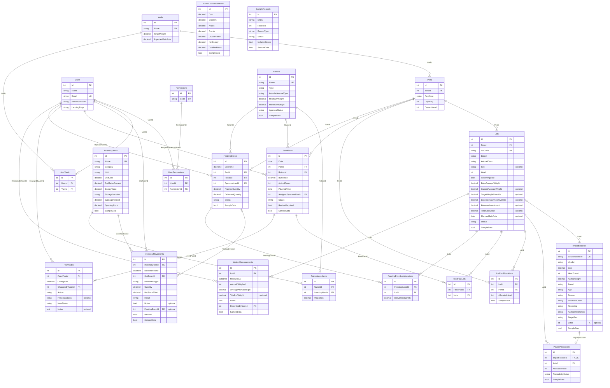

# Approval: Build every operation of the locked API contract in contracts/openapi.

Run 20261013-hackathon-problem-statement-fe-2bf7 · risk **medium** · feature · size L · cost so far $0.86

## Your request (word for word)
> Hackathon Problem Statement: Feedlot Management Solution
> 
> A feedlot is a specialized livestock operation focused on transforming young cattle (300–500 lbs)
> into market-ready livestock (1,200–1,400 lbs) over an 8- to 12-month cycle. The core business
> objective is to maximize the "feed-to-gain" ratio, as the operation's profitability is directly tied
> to how efficiently animals convert nutritional rations into body weight.
> 
> Management is split between two primary tiers: Lots and Pens. A "Lot" reflects the business
> unit (a specific group of cattle purchased and analyzed together for performance), while a "Pen"
> serves as the physical unit (where daily feeding and housing activities occur). Effective software
> must bridge these tiers, allowing for granular daily execution at the pen level while providing
> high-level performance metrics at the lot level.
> 
> Key Requirements
> ● Integrated Data Management
> ○ Procurement Ingestion: Seamlessly import animal data (weight, breed, age, and
> source) from the primary procurement system.
> ○ Lifecycle Forecasting: Automatically calculate projected market dates and target
> weights based on incoming data.
> ● Feed & Ration Management
> ○ Inventory Control & Projections: Monitor real-time ingredient levels and
> generate automated inventory forecasts across multiple time horizons—daily,
> weekly, monthly, quarterly, bi-annual, and annual.
> ○ Wastage Calibration: Integrate a configurable wastage ratio into all consumption
> estimates and inventory projections to account for feeding-loss and ensure
> procurement accuracy.
> ○ Ration & Cost Optimization: Manage complex nutritional recipes and perform
> cost-benefit analysis on different feed mixes to identify the most economical
> paths to weight gain.
> ○ Dynamic Bunk Management: Track daily bunk rates and consumption patterns at
> the pen level, allowing for real-time adjustments to feeding plans based on
> actual intake versus projections.
> ● Execution & Activity Tracking
> ○ Pen-Level Planning: Generate daily feeding schedules and plans for specific
> physical pens.
> ○ Activity Logging: Capture actual feeding data to identify variances between the
> plan and execution.
> ● Performance & Conversion Analytics
> 
> ○ Feed-to-Gain Ratio: Calculate the primary efficiency KPI (Total Feed Consumed vs.
> Total Weight Gained).
> ○ Lot-Level Profitability: Provide deep-dive analysis on specific groups to determine
> the financial ROI of each lot.
> ○ Predictive Insights: Suggest "next steps" for feeding adjustments or sale timing
> based on current weight-gain trends.
> 
> Additional Information & Requirements:
> 
> Create sample/mock data to support the system. Assume the following information is based on
> mock data fetched from other systems.
> 
> ● Automated Data Ingestion: Synchronize PO and Receiving data (Vendor, Costs, Head
> Count, Weights) to eliminate manual entry and establish the financial baseline for each
> lot.
> ● Dynamic Lot Mapping: Reflect complex upstream relationships where a single PO Line
> may split into multiple Lots, ensuring 1:1 or 1:N traceability.
> ● Entity Mapping (PO → Lot → Pen): Provide the foundation to link procurement data to
> physical locations. The system will reflect Pen ID, capacity, and current animal counts as
> fetched from the source.
> ● Centralized Operational Entities: Establish the Lot and Pen as the primary units for all
> downstream feeding and performance analytics.
> ● Lightweight Implementation: Focus on backend data connectivity rather than refined
> UI/UX, as these modules serve specifically to support the feed-to-gain engine.
> 
> The Feed-to-Gain Engine (The Core Challenge)
> 
> Inventory, Ration Module & Feed Plan per Pen
> 
> ● Allow users to maintain a feed Inventory with feed types, available quantities, and unit
> costs ($/lb or $/ton).
> ● Each inventory item may include:feed item name, feed category, quantity available, unit
> of measure, cost per unit, dry matter percentage, energy value, and storage location. It
> should also track stock movement by maintaining the opening stock, stock received,
> stock consumed, and closing stock for each feed item.
> 
> ● Allow users to create a Ration (a feed recipe) by combining multiple feed ingredients
> with specified proportions. Each ration has a calculated cost per pound based on its
> ingredient mix.
> ● A ration may include the Ration name, Ration type, Feed ingredients used, Quantity or
> percentage of each ingredient, Dry matter percentage, Energy value, Cost per unit, and
> Intended animal type or weight range.
> ● A feed plan per pen defines what ration needs to be fed to a specific pen, how much
> feed should be provided, and on which date it should be delivered. Since pens may
> contain animals from one or more lots, the feed plan helps operators manage feeding
> execution in a structured and organized way. The feed plan per pen may include the
> Feed plan date, Pen, Assigned lot, Number of animals in the pen, Selected ration,
> Planned feed quantity, Planned feeding time, Feed quantity per animal, Total feed cost,
> Expected energy intake, and Feed plan status, such as Planned, In progress, Completed,
> or Skipped. The system should allow users to generate a feed plan based on the daily
> bunk rate, selected ration, and number of animals in the pen.
> 
> Feeding Activity
> 
> ● Allow users to log a Feeding Activity against a specific Pen, capturing:
> ○ The feeding activity should capture the Feeding date, Pen, Lot, Ration, Planned
> feed quantity, Actual feed quantity delivered, Difference between planned and
> actual feed, Feed cost, Energy value, Inventory consumed, and Feeding status.
> ● On save, the system should:
> ○ Decrement the feed inventory based on the ration's ingredient mix
> ○ Calculate and store the total feed cost for that feeding event
> ○ Roll up cumulative feed consumption and feed cost at the lot level
> ● Suggested calculation: Feed Variance = Actual Feed Quantity - Planned Feed Quantity
> 
> Weight Measurement Activity
> 
> ● Allow users to log a Weight Measurement Activity against a Lot, capturing:
> ○ Lot
> ○ Measurement date
> ○ Number of animals weighed
> ○ Average animal weight
> ○ Total lot weight
> ○ Weight gain since last measurement
> ○ Notes
> ● Maintain a time-series of weight readings per lot to enable trend analysis.
> 
> Feed-to-Gain Calculation Engine
> 
> This is the most critical part. Build the calculation logic that derives the following metrics from
> feeding and weight data:
> 
> Feed-to-Gain Calculation Metrics
> 
> Metric Formula Why It Matters
> 
> Days on Feed (DOF) Current Date − Receiving Date Tracks how long the lot has
> been on feed
> 
> Total Weight Gain Current Avg Weight − Entry Avg Weight Total growth achieved so far
> 
> Average Daily Gain (ADG) Total Weight Gain ÷ DOF Primary performance
> benchmark
> 
> Total Feed Consumed Sum of all feeding events Total feed input
> 
> Feed Conversion Ratio
> (FCR)
> Total Feed Consumed (lbs) ÷ Total
> Weight Gain (lbs)
> Feed efficiency metric (lower
> is better)
> 
> Cost of Gain ($/lb) Total Feed Cost ÷ Total Weight Gain Core profitability indicator
> 
> Projected Ship Date DOF + ((Target Weight − Current Weight)
> ÷ ADG)
> Forecasted shipping readiness
> 
> These metrics should update automatically whenever a new feeding or weight event is
> recorded.
> 
> Dashboard & Reports (Visualization Layer)
> 
> Surface the engine's output in a way that helps a feedlot operator make decisions.
> 
> The dashboard should include:
> 
> ● Active lots
> ● Active pens
> ● Animals per lot and pen
> ● Feed inventory status
> ● Ration usage
> ● Daily bunk rate per pen
> ● Planned feed vs actual feed
> ● Total feed consumed
> ● Total feed cost
> ● Starting weight vs current weight
> ● Total weight gain
> ● Average Daily Gain
> ● Feed-to-gain ratio
> ● Feed cost per unit of gain
> ● Energy consumed
> ● Best and worst performing lots
> 
> The reports should help answer questions such as:
> 
> ● Which pen consumed the most feed?
> ● Which lot has the best feed-to-gain ratio?
> ● Which lot has the highest Average Daily Gain?
> ● Which ration is being used the most?
> ● Is actual feeding aligned with the feed plan?
> ● Which pens are being overfed or underfed?
> ● How much feed inventory is remaining?
> ● What is the feed cost per unit of weight gain?
> 
> Feed-to-Gain Report
> 
> A dedicated report screen that allows users to:
> 
> ● Compare ADG, FCR, and Cost of Gain across multiple lots
> ● Filter by date range, breed, sex, or pen
> 
> ● Export the report as a CSV or PDF
> 
> Yard-Level Summary (Stretch Goal)
> 
> A high-level dashboard showing aggregate metrics across all active lots — total head, average
> ADG, average Cost of Gain, total feed cost — to give the yard manager a single-glance overview.
> 
> Evaluation Criteria
> 
> Submissions will be evaluated on:
> 
> 1. Correctness of the Feed-to-Gain Calculations — Are the formulas implemented
> accurately? Do metrics update correctly as new data is entered?
> 2. Quality of the Dashboard & Visualizations — How effectively does the UI communicate
> performance to a non-technical operator?
> 3. Data Integrity — Are inventory decrements, feed cost calculations, and weight tracking
> consistent and reliable?
> 4. User Experience — Is the flow from PO → Lot → Daily Activities → Dashboard intuitive
> and frictionless?
> 5. Code Quality & Architecture — Is the solution modular and extensible for future
> activities (treatments, vaccinations, shipping, etc.)?
> 
> What to present and deliver:
> ● Proposed Solution (Approach) and Architectural Diagrams
> ● Demo of the App
> ● Overview Vibe Coding Super Prompt & Other prompts
> ● How was it tested and validated?
> ● What challenges did you face?
> ● How close is this to production readiness?
> ● Go to Market Strategy and Analysis (Extra Advantage) If you build a product based
> solution/offering & with a go-to-market insight.
> 
> This run builds the API side of the product above, in an existing .NET API project. Build every operation of the locked API contract in contracts/openapi.yaml, exactly as it is written there. Keep the data in the project's PostgreSQL database (the connection string named App, which the project already reads), and write its sample data in App.Api/SeedData.cs: a few believable rows for each table, taken from the contract's examples, so each list has something to show. The app runs that file only when the setting Seed:Demo is true, so no test may count on those rows. The web app is built in its own repo; do not build screens here.

## Your answers
- Q-1 Should authentication and authorization be enforced only where contracts/openapi.yaml explicitly requires them, or should additional access rules be added? → **Enforce only authentication/authorization requirements explicitly declared by contracts/openapi.yaml; do not add extra role rules.**
- Q-2 What should happen for paths or HTTP methods that are not defined in the contract? → **Use normal 404/405 responses and add no undocumented operations.**
- Q-3 If demo seed data cannot be written to PostgreSQL when Seed:Demo is true, how should startup behave? → **Fail startup and surface the seed-write error.**
- Q-4 Should successful API writes remain available after the API process restarts? → **Use normal PostgreSQL durability so successful writes remain available after an API restart.**

## Requirements
- **REQ-1** (ADDED) The Feedlot API shall implement every path, HTTP method, parameter, request and response schema, status code, and security rule declared in contracts/openapi.yaml, expose no undocumented API operations, and provide no feedlot product-screen routes or rendered screens.
  - AC-1.1 [api] Given The API is running and a client has valid contract inputs and any authentication context required by the contract.; when The client calls each declared operation using its contract-defined method, path, parameters, and request body.; then Each response status and response body field matches the operation's declared contract, including success and error responses.
  - AC-1.2 [api] Given A client calls a protected operation without valid authentication or without contract-required authorization.; when The client calls that operation.; then The response status is the contract-declared 401 or 403, as applicable, and no undeclared role rule denies an otherwise authorized request.
  - AC-1.3 [api] Given The API host is running.; when A client requests an undefined path such as /yard, or uses an unsupported method for a contract path such as POST /dashboard.; then The response status is 404 for an undefined path or 405 for an unsupported method, and no feedlot product screen is displayed.
- **REQ-2** (ADDED) When an authorized client requests sign-in, session, dashboard, or lot-list operations, the Feedlot API shall return the contract-defined authentication, current-user, dashboard, and filtered lot values.
  - AC-2.1 [api] Given A client has valid sign-in credentials and no bearer token.; when The client sends POST /auth/sign-in with the contract SignInRequest body.; then The response status is 200 and the response contains the contract-defined accessToken and user fields, including declared permissions and authorizedYards.
  - AC-2.2 [api] Given A client has a valid bearer token.; when The client sends GET /session.; then The response status is 200 and the response user field contains the current user and contract-defined permissions.
  - AC-2.3 [api] Given Authorized dashboard data and a valid rankBy value of fcr, adg, or costOfGain are available.; when The client sends GET /dashboard with the selected rankBy value.; then The response status is 200 and the response rankingMeasure, bestLots, and worstLots correspond to the selected measure.
  - AC-2.4 [api] Given Lots have distinct pen, breed, sex, and status values and the client has a valid bearer token.; when The client sends GET /lots with supported query filters.; then The response status is 200 and the response lots list contains only rows matching the supplied filters and contract-defined fields.
  - AC-2.5 [api] Given A client has the access required by the contract for GET /lots, and saved lots include a lot outside the client's authorizedYards that matches the supplied lot-list filters.; when The client sends GET /lots with those supported query filters.; then The response status is 200 and the response lots list includes that matching lot with its contract-defined fields, without an additional authorizedYards restriction.
  - AC-2.6 [api] Given A client submits credentials that do not authenticate an account.; when The client sends POST /auth/sign-in with the contract SignInRequest body containing those credentials.; then The response status is 401 and the response error fields match the contract-declared Unauthorized ApiError response.
- **REQ-3** (ADDED) When an authorized client previews or imports procurement records or saves allocations, the Feedlot API shall return and persist contract-defined PO-line-to-lot and lot-to-pen traceability, including import matching and allocation-conflict results.
  - AC-3.1 [api] Given A client has a valid bearer token and the source adapter is available.; when The client sends GET /imports/source-records.; then The response status is 200 and the response records field is a list of available procurement and receiving records.
  - AC-3.2 [api] Given A client has a valid bearer token and submits a valid ImportRequest selecting source records.; when The client sends POST /imports.; then The response status is 200 and the response contains status, createdCount, updatedCount, records, and allocationConflicts fields reflecting the selected records and current matches.
  - AC-3.3 [api] Given A client has a valid bearer token and valid PO-line-to-lot and lot-to-pen allocation quantities.; when The client calls PUT /allocations and then GET /allocations.; then Both response statuses are 200 and the response poLines, lotPens, and pens contain the saved quantities, traceability status, and capacity information.
  - AC-3.4 [api] Given A client submits an invalid selection, conflicting import, or allocation that violates saved state.; when The client submits the relevant import or allocation request.; then The response status and error response match the operation's declared 409 or 422 contract.
- **REQ-4** (ADDED) When an authorized client requests lot forecasts, forecast-setting updates, metrics, insights, planner actions, or weight-history operations, the Feedlot API shall return contract-defined values, calculations, explainable suggestions, and persisted updates.
  - AC-4.1 [api] Given A client has a valid bearer token and the requested lot exists.; when The client sends GET /lots/{lotId}/forecast.; then The response status is 200 and the response contains the lot forecast values, forecastBasis, and effective yard and lot assumptions.
  - AC-4.2 [api] Given A client has a valid bearer token and submits a valid ForecastSettingsRequest.; when The client sends PATCH /forecast-settings or PATCH /lots/{lotId}/forecast-settings for an existing lot.; then The response status is 200 and the response contains persisted setting values; a subsequent forecast response contains the effective assumptions and projectedMarketDate declared by the contract.
  - AC-4.3 [api] Given A client has a valid bearer token and the requested lot exists with feeding and weight records where applicable.; when The client sends GET /lots/{lotId}/metrics or GET /lots/{lotId}/insights.; then The response status is 200 and the response contains contract-defined metrics or suggestions with their basis, including null unavailable metric values where applicable.
  - AC-4.4 [api] Given A client has a valid bearer token, an existing lot, and a valid planner-selected insight action or WeightMeasurementRequest.; when The client sends POST /lots/{lotId}/insights/actions, GET /lots/{lotId}/weights, or POST /lots/{lotId}/weights as applicable.; then The response status and response fields match the contract, and the returned action or measurement is present in the subsequent relevant response.
  - AC-4.5 [api] Given A client submits a weight measurement that fails contract validation, or requests forecast data or settings for a nonexistent lot.; when The client sends the applicable weight, forecast, or forecast-settings request.; then The response status is the contract-declared 422 with VALIDATION_ERROR for invalid measurement data or 404 with NOT_FOUND for a nonexistent lot.
- **REQ-5** (ADDED) When an authorized client reads or changes inventory, the Feedlot API shall return contract-defined stock, movement, projection, and export values and persist valid inventory changes in PostgreSQL.
  - AC-5.1 [api] Given A client has a valid bearer token and inventory items or movements exist, or the inventory is empty.; when The client sends GET /inventory.; then The response status is 200 and the response contains operationalTotals, items, movements, and contract-defined stock fields.
  - AC-5.2 [api] Given A client has a valid bearer token and submits a valid InventoryItemRequest for creation or update.; when The client sends POST /inventory/items or PATCH /inventory/items/{itemId}.; then The response status is 201 for creation or 200 for update and the response item contains the saved contract fields and stock values.
  - AC-5.3 [api] Given A client has a valid bearer token and submits a valid receipt or adjustment InventoryMovementRequest for an existing item.; when The client sends POST /inventory/movements.; then The response status is 201 and the response contains the saved movement and item with updated stock values.
  - AC-5.4 [api] Given A client has a valid bearer token, a supported horizon, and inventory with applicable plans and wastage settings.; when The client sends GET /inventory/projections separately for daily, weekly, monthly, quarterly, semiAnnual, and annual horizons.; then Each response status is 200 and each response contains the selected horizon, projection rows with projected consumption and balance, and movement distinctions.
  - AC-5.5 [api] Given A client has a valid bearer token and submits an inventory request that fails contract validation or a projection horizon outside the contract enum.; when The client sends the applicable inventory write or projection request.; then The response status is 422 and the response error code is VALIDATION_ERROR.
  - AC-5.6 [api] Given A client has a valid bearer token and authorized operational inventory rows exist.; when The client sends GET /inventory/export.; then The response status is 200 and the response contains fileName, contentType text/csv, and a Base64 CSV file derived from operational records.
- **REQ-6** (ADDED) When an authorized client reads, creates, revises, optimizes, or approves a ration, the Feedlot API shall return contract-defined ration data and optimization or approval results and persist valid ration changes.
  - AC-6.1 [api] Given A client has a valid bearer token and saved ration definitions exist, or the ration collection is empty.; when The client sends GET /rations.; then The response status is 200 and the response rations list contains saved ingredient, proportion, nutrition, cost, and approval fields.
  - AC-6.2 [api] Given A client has a valid bearer token and submits a valid RationRequest for creation or revision.; when The client sends POST /rations or PATCH /rations/{rationId}.; then The response status is 201 for creation or 200 for revision and the response ration contains the persisted definition and calculated contract fields, including costPerPound where declared.
  - AC-6.3 [api] Given A client has a valid bearer token and submits a valid ration optimization request with candidate mixes and nutrition requirements.; when The client sends POST /rations/optimization.; then The response status is 200 and the response contains the contract optimization result and cost comparison, including the lowest-cost qualifying candidate or qualifyingMixFound=false as applicable.
  - AC-6.4 [api] Given A client has a valid bearer token and the requested ration exists in a state eligible for approval.; when The client sends POST /rations/{rationId}/approval.; then The response status is 200 and the response contains the rationId and updated approvalStatus, which is Approved where specified by the contract.
- **REQ-7** (ADDED) When an authorized client reads, creates, reviews, or changes the execution status of a feed plan, the Feedlot API shall return and persist contract-defined pen-level plan details, calculated quantities, audit state, and status.
  - AC-7.1 [api] Given A client has a valid bearer token and saved feed plans exist, or the plan collection is empty.; when The client sends GET /feed-plans.; then The response status is 200 and the response plans list contains saved plan details, execution state, and audit-related fields.
  - AC-7.2 [api] Given A client has a valid bearer token and submits a valid FeedPlanRequest with dated pen, ration, bunk rate, and animal-count values.; when The client sends POST /feed-plans.; then The response status is 201 and the response plan contains calculated planned quantity, quantity per animal, total feed cost, expected energy intake, and status fields.
  - AC-7.3 [api] Given A client has a valid bearer token, an existing plan, and a valid PlanReviewRequest or PlanStatusRequest.; when The client sends POST /feed-plans/{planId}/review or PATCH /feed-plans/{planId}/status.; then The response status is 200 and the response plan contains the saved reviewRequired value or requested execution status.
- **REQ-8** (ADDED) When an authorized client records, corrects, or voids a feeding event, the Feedlot API shall persist the event and return its contract-defined variance, cost, energy, inventory movements, and updated lot feed totals.
  - AC-8.1 [api] Given A client has a valid bearer token and saved feeding events and lot allocations exist, or the event collection is empty.; when The client sends GET /feeding-events.; then The response status is 200 and the response events list contains saved activity, lot allocations, and inventory movements.
  - AC-8.2 [api] Given A client has a valid bearer token and submits a valid FeedingEventRequest with planned and delivered quantities.; when The client sends POST /feeding-events.; then The response status is 201 and the response contains the saved event, variance equal to deliveredQuantity minus plannedQuantity, calculated cost and energy, inventoryMovements, and updated lotFeedTotals.
  - AC-8.3 [api] Given A client has a valid bearer token, an existing feeding event, known opening stock for its affected inventory items, and persisted receipts, adjustments, or other feeding events affecting those items, and either a valid correction request or an event eligible to be voided.; when The client sends PATCH /feeding-events/{eventId} or POST /feeding-events/{eventId}/void, then reads GET /inventory.; then The response status is 200 and the response event has the applicable Corrected or Voided status with corresponding reversal or correction movements and recalculated lotFeedTotals; the subsequent inventory response shows each affected item's stock reconciled from opening stock after applying all persisted receipts, adjustments, and non-voided feeding events, with a corrected event's movement replacing its original movement or a voided event's movement omitted rather than counted twice.
  - AC-8.4 [api] Given A client submits a feeding event that conflicts with current inventory or fails contract validation.; when The client sends POST /feeding-events.; then The response status is the contract-declared 409 or 422 and the response contains the contract ApiError fields.
  - AC-8.5 [api] Given A feeding event has been successfully saved and the App PostgreSQL database is available.; when The API process restarts and the client reads the event and inventory.; then The response contains the saved event and corresponding stock and lot totals.
- **REQ-9** (ADDED) When an authorized client requests an operational, feed-to-gain, or profitability report or export, the Feedlot API shall return contract-defined permission-filtered rows, calculations, summaries, and requested export artifacts.
  - AC-9.1 [api] Given A client has a valid bearer token and operational feeding, performance, and inventory data with supported filters.; when The client sends GET /reports/operational or GET /reports/operational/export.; then The response status is 200 and the response rows and summary match the filters, or the response contains a CSV file derived only from the authorized filtered rows.
  - AC-9.2 [api] Given A client has a valid bearer token and supplies a required date range plus optional breed, sex, or pen filters.; when The client sends GET /reports/feed-to-gain.; then The response status is 200 and the response rows contain contract-defined ADG, feed, FCR, cost-of-gain, and energy fields for matching lots.
  - AC-9.3 [api] Given A client has a valid bearer token and supplies a valid feed-to-gain date range, supported filters, and format csv or pdf.; when The client sends GET /reports/feed-to-gain/export.; then The response status is 200 and the response file artifact has contentType and content corresponding to the requested format and filtered authorized rows.
  - AC-9.4 [api] Given A client omits a required feed-to-gain date or supplies an export format outside the contract enum.; when The client sends a feed-to-gain report or export request.; then The response status is 422 and the response error code is VALIDATION_ERROR.
  - AC-9.5 [api] Given A client has a valid bearer token and supplies supported profitability horizon, breed, penId, or roiStatus filters.; when The client sends GET /reports/profitability or GET /reports/profitability/export.; then The response status is 200 and the response contains authorized matching profitability rows and canViewProfitability where declared, or a CSV file with those filtered authorized rows.
  - AC-9.6 [api] Given A client has a valid bearer token with access to lot-report rows but without profitability.view or profitability.export, and matching profitability data exists.; when The client sends GET /reports/profitability and GET /reports/profitability/export using supported filters.; then The report response status is 200, its canViewProfitability value is false, and its rows contain no non-null returnedInvestment, totalGainValue, netReturn, or roiPercent values; the export response status is 403 and contains no file artifact.
  - AC-9.7 [api] Given A client has a valid bearer token with profitability.view but without profitability.export, and matching profitability data exists.; when The client sends GET /reports/profitability and GET /reports/profitability/export using supported filters.; then The report response status is 200, its canViewProfitability value is true, and its matching rows contain the contract-defined profitability values; the export response status is 403 and contains no file artifact.
  - AC-9.8 [api] Given A client has a valid bearer token with profitability.export but without profitability.view, and matching profitability data exists.; when The client sends GET /reports/profitability and GET /reports/profitability/export using supported filters.; then The report response status is 200, its canViewProfitability value is false, and its rows contain no non-null returnedInvestment, totalGainValue, netReturn, or roiPercent values; the export response status is 200 and the response contains the contract-defined CSV file artifact.
- **REQ-10** (ADDED) When an authorized client reads, loads, resets, or replaces sample records, the Feedlot API shall return contract-defined sample status and records, avoid duplicate loading, and require explicit confirmation for reset or replacement.
  - AC-10.1 [api] Given A client has a valid bearer token and sample records may be absent, not yet loaded, or already loaded.; when The client sends GET /sample-data or POST /sample-data/load.; then The response status is 200 and the response loaded, recordCount, records, and load status distinguish an empty set, a successful load, and already_loaded without duplicating records.
  - AC-10.2 [api] Given A client has a valid bearer token and sample records exist; the client records the GET /sample-data response records and recordCount before attempting reset.; when The client sends POST /sample-data/reset without required confirmation, reads GET /sample-data, then repeats the reset with explicit confirmation and reads GET /sample-data again.; then The unconfirmed response status is the contract-declared 422 or 409 and the intervening GET response records and recordCount are unchanged; the confirmed response reports the completed reset status and resulting recordCount, and the final GET response records do not contain the previously recorded affected sample records.
  - AC-10.3 [api] Given A client has a valid bearer token and sample records exist; the client records the GET /sample-data response records and recordCount before attempting replacement.; when The client sends POST /sample-data/replace without required confirmation, reads GET /sample-data, then repeats replacement with explicit confirmation and reads GET /sample-data again.; then The unconfirmed response status is the contract-declared 422 or 409 and the intervening GET response records and recordCount are unchanged; the confirmed response reports the completed replacement status and resulting recordCount, and the final GET response records contain the replacement sample records rather than the previously recorded affected sample records.
- **REQ-11** (MODIFIED) The Feedlot API shall store contract domain data in PostgreSQL using the configured connection string named App, preserve successful writes across API process restarts, and upgrade an existing App database to the contract domain schema without losing existing data.
  - AC-11.1 [api] Given The API is configured with an App PostgreSQL connection and a client successfully creates or updates a contract resource.; when The API process restarts and the client retrieves the resource through its contract-defined read operation.; then The response contains the saved value and the returned record has the same id and field values as the successful write response.
  - AC-11.2 [api] Given The API is configured with a connection string named App and a successful contract write has completed.; when A test queries the configured PostgreSQL database for the affected entity.; then A row with the values written by the request is present in the App database.
  - AC-11.3 [api] Given An existing App PostgreSQL database contains data and lacks one or more tables required by the contract domain schema.; when The API starts and upgrades the database schema.; then The pre-existing row values are unchanged and PostgreSQL contains the tables required by the contract operations.
- **REQ-12** (MODIFIED) When Seed:Demo is true, the Feedlot API shall use SeedData.Run at startup to insert 3 to 5 believable, contract-example-derived sample rows per application table when that table is empty, leave nonempty tables unchanged, and fail startup while surfacing any seed-write error.
  - AC-12.1 [api] Given A fresh, empty App PostgreSQL database has Seed:Demo true.; when The API starts successfully.; then A database query reads 3 to 5 believable sample rows derived from corresponding contract examples in each application table, and each corresponding API collection response contains a nonempty list.
  - AC-12.2 [api] Given A contract-backed application table already contains operational rows and Seed:Demo is true.; when The API starts and runs SeedData.Run.; then The pre-existing row values are unchanged and no seed rows are added to that nonempty table.
  - AC-12.3 [api] Given Seed:Demo is true and PostgreSQL rejects a seed write during startup.; when The API starts.; then Startup fails and the surfaced error identifies the seed-write failure without reporting successful readiness.
- **REQ-13** (ADDED) When Seed:Demo is false, the Feedlot API shall serve contract collection operations based only on persisted records, including empty collections when no records exist.
  - AC-13.1 [api] Given An isolated App PostgreSQL database has no records and Seed:Demo is false.; when An authorized client calls contract collection endpoints, including GET /lots, GET /inventory, GET /rations, GET /feed-plans, and GET /feeding-events.; then Each response status is 200 and each response collection field is an empty list rather than an error or an assumed demo record.
  - AC-13.2 [api] Given Seed:Demo is false and a test creates its own records through contract write operations.; when The test reads the corresponding contract list operation.; then The response list contains the test-created records without depending on demo-seed record ids, counts, or values.

Not changing: Feedlot product screens and web-app UI implementation, which belong to the separate web-app repository.; Undocumented API paths and methods.; Additional authentication or role rules not explicitly declared by contracts/openapi.yaml.

## Files the plan will touch (50)
- App.Api/AppDb.cs
- App.Api/Configurations/FeedPlans/**  ← not found by grounding; check it
- App.Api/Configurations/Feeding/**  ← not found by grounding; check it
- App.Api/Configurations/Identity/**  ← not found by grounding; check it
- App.Api/Configurations/Imports/**  ← not found by grounding; check it
- App.Api/Configurations/Inventory/**  ← not found by grounding; check it
- App.Api/Configurations/Rations/**  ← not found by grounding; check it
- App.Api/Configurations/Samples/**  ← not found by grounding; check it
- App.Api/Configurations/Weights/**  ← not found by grounding; check it
- App.Api/Configurations/Yards/**  ← not found by grounding; check it
- App.Api/Endpoints/AuthEndpoints.cs  ← not found by grounding; check it
- App.Api/Endpoints/DashboardLotEndpoints.cs  ← not found by grounding; check it
- App.Api/Endpoints/EndpointRegistration.cs  ← not found by grounding; check it
- App.Api/Endpoints/FeedingEventEndpoints.cs  ← not found by grounding; check it
- App.Api/Endpoints/IEndpointDefinition.cs  ← not found by grounding; check it
- App.Api/Endpoints/ImportAllocationEndpoints.cs  ← not found by grounding; check it
- App.Api/Endpoints/InventoryEndpoints.cs  ← not found by grounding; check it
- App.Api/Endpoints/LotAnalyticsEndpoints.cs  ← not found by grounding; check it
- App.Api/Endpoints/RationPlanEndpoints.cs  ← not found by grounding; check it
- App.Api/Endpoints/ReportSampleEndpoints.cs  ← not found by grounding; check it
- App.Api/Entities/FeedPlans/**  ← not found by grounding; check it
- App.Api/Entities/Feeding/**  ← not found by grounding; check it
- App.Api/Entities/Identity/**  ← not found by grounding; check it
- App.Api/Entities/Imports/**  ← not found by grounding; check it
- App.Api/Entities/Inventory/**  ← not found by grounding; check it
- App.Api/Entities/Rations/**  ← not found by grounding; check it
- App.Api/Entities/Samples/**  ← not found by grounding; check it
- App.Api/Entities/Weights/**  ← not found by grounding; check it
- App.Api/Entities/Yards/**  ← not found by grounding; check it
- App.Api/Imports/ISourceRecordsAdapter.cs  ← not found by grounding; check it
- App.Api/Imports/MockSourceRecordsAdapter.cs  ← not found by grounding; check it
- App.Api/Migrations/202610130001_InitialCore.cs  ← not found by grounding; check it  ← protected file
- App.Api/Migrations/202610130002_ImportsAllocations.cs  ← not found by grounding; check it  ← protected file
- App.Api/Migrations/202610130003_Inventory.cs  ← not found by grounding; check it  ← protected file
- App.Api/Migrations/202610130004_RationsFeedPlans.cs  ← not found by grounding; check it  ← protected file
- App.Api/Migrations/202610130005_FeedingEvents.cs  ← not found by grounding; check it  ← protected file
- App.Api/Migrations/202610130006_LotAnalytics.cs  ← not found by grounding; check it  ← protected file
- App.Api/Migrations/202610130007_ReportsSamples.cs  ← not found by grounding; check it  ← protected file
- App.Api/Program.cs
- App.Api/SeedData.cs
- App.Api/Seeders/FeedingSeeder.cs  ← not found by grounding; check it
- App.Api/Seeders/IDemoSeeder.cs  ← not found by grounding; check it
- App.Api/Seeders/IdentitySeeder.cs  ← not found by grounding; check it
- App.Api/Seeders/ImportSeeder.cs  ← not found by grounding; check it
- App.Api/Seeders/InventorySeeder.cs  ← not found by grounding; check it
- App.Api/Seeders/RationPlanSeeder.cs  ← not found by grounding; check it
- App.Api/Seeders/SampleSeeder.cs  ← not found by grounding; check it
- App.Api/Seeders/WeightSeeder.cs  ← not found by grounding; check it
- App.Api/Seeders/YardSeeder.cs  ← not found by grounding; check it
- App.Api/appsettings.json  ← not found by grounding; check it

## Will also affect (found by code search, not in the plan)
- contracts/openapi.yaml (undefined): REQ-12 (MODIFIED) points at it

## Plan
Options: OPT-1 (chosen): Convention-discovered Minimal API endpoint slices with normalized EF Core entities, additive migrations, and injectable source adapter. | OPT-2: Simplest: implement all operations in one large Program.cs endpoint map backed by a small set of JSON payload tables.
Decision: Choose convention-discovered Minimal API endpoint slices and normalized EF Core storage.
TASK-1 owns startup wiring; later slices add only endpoint/entity/configuration/migration/seeder files.
Use additive migrations, empty-table-only seeders, and an injectable in-process mock procurement seam; add no NuGet packages.
Keep contracts/openapi.yaml locked and implement only its declared operations.
- TASK-1 Core API bootstrap, authentication, dashboard, and lot list → REQ-2; must pass AC-2.1, AC-2.2, AC-2.3, AC-2.4, AC-2.5, AC-2.6
- TASK-2 Procurement imports and traceability allocations → REQ-3; must pass AC-3.1, AC-3.2, AC-3.3, AC-3.4
- TASK-3 Operational inventory, movements, projections, and export → REQ-5; must pass AC-5.1, AC-5.2, AC-5.3, AC-5.4, AC-5.5, AC-5.6
- TASK-4 Rations, optimization, approvals, and feed plans → REQ-6, REQ-7; must pass AC-6.1, AC-6.2, AC-6.3, AC-6.4, AC-7.1, AC-7.2, AC-7.3
- TASK-5 Feeding event ledger and inventory reconciliation → REQ-8; must pass AC-8.1, AC-8.2, AC-8.3, AC-8.4, AC-8.5
- TASK-6 Lot forecasts, metrics, insights, and weight history → REQ-4; must pass AC-4.1, AC-4.2, AC-4.3, AC-4.4, AC-4.5
- TASK-7 Reports, exports, and sample-data management; contract completion → REQ-9, REQ-10, REQ-1, REQ-11, REQ-12, REQ-13; must pass AC-1.1, AC-1.2, AC-1.3, AC-9.1, AC-9.2, AC-9.3, AC-9.4, AC-9.5, AC-9.6, AC-9.7, AC-9.8, AC-10.1, AC-10.2, AC-10.3, AC-11.1, AC-11.2, AC-11.3, AC-12.1, AC-12.2, AC-12.3, AC-13.1, AC-13.2

Stub commit (throws NotImplemented until implemented): App.Api/Endpoints/AuthEndpoints.cs, App.Api/Endpoints/DashboardLotEndpoints.cs, App.Api/Endpoints/ImportAllocationEndpoints.cs, App.Api/Imports/ISourceRecordsAdapter.cs, App.Api/Endpoints/InventoryEndpoints.cs, App.Api/Endpoints/RationPlanEndpoints.cs, App.Api/Endpoints/FeedingEventEndpoints.cs, App.Api/Endpoints/LotAnalyticsEndpoints.cs, App.Api/Endpoints/ReportSampleEndpoints.cs

## Data model (contracts/data-model.yaml; 22 tables, locked with the tests once you approve)
- **Yards**: Id int [PK], Name string [UK], TargetWeight decimal, ExpectedGainRate decimal
- **Pens**: Id int [PK], YardId int [FK], PenCode string, Capacity int, CurrentHead int, unique (YardId, PenCode)
- **Lots**: Id int [PK], PenId int [FK], LotCode string [UK], Breed string, AnimalClass string, Sex string?, Head int, ReceivingDate date, EntryAverageWeight decimal, CurrentAverageWeight decimal?, TargetWeightOverride decimal?, ExpectedGainRateOverride decimal?, ReturnedInvestment decimal?, TotalGainValue decimal?, PlannedSaleDate date?, Status string, SampleData bool
- **Users**: Id int [PK], Name string, Email string [UK], PasswordHash string, LandingPage string
- **Permissions**: Id int [PK], Code string [UK]
- **UserPermissions**: Id int [PK], UserId int [FK], PermissionId int [FK], unique (UserId, PermissionId)
- **UserYards**: Id int [PK], UserId int [FK], YardId int [FK], unique (UserId, YardId)
- **ImportRecords**: Id int [PK], SourceIdentifier string [UK], Vendor string, Cost decimal, HeadCount int, AnimalWeight decimal, Breed string, Age string, Source string, PurchaseOrder string, Receiving string, AnimalDescription string, TargetPen string, LotId int [FK]?, SampleData bool
- **PoLineAllocations**: Id int [PK], ImportRecordId int [FK, UK], LotId int [FK], AllocatedHead int, TraceabilityStatus string, SampleData bool
- **LotPenAllocations**: Id int [PK], LotId int [FK], PenId int [FK], AllocatedHead int, SampleData bool, unique (LotId, PenId)
- **InventoryItems**: Id int [PK], Name string [UK], Category string, Unit string, UnitCost decimal, DryMatterPercent decimal, EnergyValue decimal, StorageLocation string, WastagePercent decimal, OpeningStock decimal, SampleData bool
- **InventoryMovements**: Id int [PK], InventoryItemId int [FK], MovementTime datetime, StaffUserId int [FK], MovementType string, Quantity decimal, NetStockEffect decimal, Result string, Notes text?, FeedingEventId int [FK]?, IsActive bool, SampleData bool
- **Rations**: Id int [PK], Name string [UK], Type string, IntendedAnimalType string, MinimumWeight decimal, MaximumWeight decimal, ApprovalStatus string, SampleData bool
- **RationIngredients**: Id int [PK], RationId int [FK], InventoryItemId int [FK], Proportion decimal, unique (RationId, InventoryItemId)
- **RationCandidateMixes**: Id int [PK], Corn decimal, Distillers decimal, Alfalfa decimal, Premix decimal, CrudeProtein decimal, NetEnergy decimal, CostPerPound decimal, SampleData bool
- **FeedPlans**: Id int [PK], Date date, PenId int [FK], RationId int [FK], BunkRate decimal, AnimalCount int, PlannedTime time, AssignedOperatorUserId int [FK], Status string, ReviewRequired bool, SampleData bool, unique (Date, PenId)
- **FeedPlanLots**: Id int [PK], FeedPlanId int [FK], LotId int [FK], unique (FeedPlanId, LotId)
- **PlanAudits**: Id int [PK], FeedPlanId int [FK], ChangedAt datetime, ChangedByUserId int [FK], Action string, PreviousStatus string?, NewStatus string, Notes text?
- **FeedingEvents**: Id int [PK], DateTime datetime, PenId int [FK], RationId int [FK], OperatorUserId int [FK], PlannedQuantity decimal, DeliveredQuantity decimal, Status string, SampleData bool
- **FeedingEventLotAllocations**: Id int [PK], FeedingEventId int [FK], LotId int [FK], DeliveredQuantity decimal, unique (FeedingEventId, LotId)
- **WeightMeasurements**: Id int [PK], LotId int [FK], MeasuredAt datetime, AnimalsWeighed int, AverageAnimalWeight decimal, TotalLotWeight decimal?, Notes text, RecordedByUserId int [FK], SampleData bool
- **SampleRecords**: Id int [PK], Entity string, RecordId int, RecordType string, Status string, IsolationScope text, SampleData bool
- Pens.YardId → Yards.Id (many Pens to one Yards, on delete restrict)
- Lots.PenId → Pens.Id (many Lots to one Pens, on delete restrict)
- UserPermissions.UserId → Users.Id (many UserPermissions to one Users, on delete cascade)
- UserPermissions.PermissionId → Permissions.Id (many UserPermissions to one Permissions, on delete restrict)
- UserYards.UserId → Users.Id (many UserYards to one Users, on delete cascade)
- UserYards.YardId → Yards.Id (many UserYards to one Yards, on delete cascade)
- ImportRecords.LotId → Lots.Id (many ImportRecords to one Lots, optional, on delete set-null)
- PoLineAllocations.ImportRecordId → ImportRecords.Id (one to one, on delete cascade)
- PoLineAllocations.LotId → Lots.Id (many PoLineAllocations to one Lots, on delete restrict)
- LotPenAllocations.LotId → Lots.Id (many LotPenAllocations to one Lots, on delete cascade)
- LotPenAllocations.PenId → Pens.Id (many LotPenAllocations to one Pens, on delete restrict)
- InventoryMovements.InventoryItemId → InventoryItems.Id (many InventoryMovements to one InventoryItems, on delete restrict)
- InventoryMovements.StaffUserId → Users.Id (many InventoryMovements to one Users, on delete restrict)
- InventoryMovements.FeedingEventId → FeedingEvents.Id (many InventoryMovements to one FeedingEvents, optional, on delete set-null)
- RationIngredients.RationId → Rations.Id (many RationIngredients to one Rations, on delete cascade)
- RationIngredients.InventoryItemId → InventoryItems.Id (many RationIngredients to one InventoryItems, on delete restrict)
- FeedPlans.PenId → Pens.Id (many FeedPlans to one Pens, on delete restrict)
- FeedPlans.RationId → Rations.Id (many FeedPlans to one Rations, on delete restrict)
- FeedPlans.AssignedOperatorUserId → Users.Id (many FeedPlans to one Users, on delete restrict)
- FeedPlanLots.FeedPlanId → FeedPlans.Id (many FeedPlanLots to one FeedPlans, on delete cascade)
- FeedPlanLots.LotId → Lots.Id (many FeedPlanLots to one Lots, on delete restrict)
- PlanAudits.FeedPlanId → FeedPlans.Id (many PlanAudits to one FeedPlans, on delete cascade)
- PlanAudits.ChangedByUserId → Users.Id (many PlanAudits to one Users, on delete restrict)
- FeedingEvents.PenId → Pens.Id (many FeedingEvents to one Pens, on delete restrict)
- FeedingEvents.RationId → Rations.Id (many FeedingEvents to one Rations, on delete restrict)
- FeedingEvents.OperatorUserId → Users.Id (many FeedingEvents to one Users, on delete restrict)
- FeedingEventLotAllocations.FeedingEventId → FeedingEvents.Id (many FeedingEventLotAllocations to one FeedingEvents, on delete cascade)
- FeedingEventLotAllocations.LotId → Lots.Id (many FeedingEventLotAllocations to one Lots, on delete restrict)
- WeightMeasurements.LotId → Lots.Id (many WeightMeasurements to one Lots, on delete cascade)
- WeightMeasurements.RecordedByUserId → Users.Id (many WeightMeasurements to one Users, on delete restrict)

## Critic findings (10)
- [medium] REQ-11 At least one of REQ-11's quoted code anchors does not match its cited repository lines, leaving the claimed existing database setup without a verifiable source anchor.
- [medium] REQ-1 AC-1.1 assumes valid contract inputs while claiming to verify every error response, so it cannot exercise errors caused by contract-invalid requests.
- [medium] REQ-10 AC-10.2 and AC-10.3 accept either 422 or 409 for the same missing-confirmation request, despite REQ-1 requiring the exact status declared by the locked contract.
- [low] REQ-12 REQ-12 and AC-12.1 require at least three seed rows per table, while the spec's assumption says two rows satisfy its interpretation of “a few.”
- [medium] REQ-4 AC-4.4 groups the read-only GET /lots/{lotId}/weights with writes but checks for a returned action or measurement in an unspecified subsequent response instead of asserting the GET response.
- [high] REQ-8 AC-8.3 tests corrections and voids only for eligible events, and AC-8.4 covers only creation errors, leaving repeated voids or corrections of voided events untested despite the risk of applying inventory reversals twice.
- [medium] REQ-7 REQ-7's criteria cover valid requests against existing plans but omit the contract response for an unknown plan, an invalid status request, or a disallowed execution-state transition.
- [medium] REQ-11 AC-11.3 requires checking that PostgreSQL contains the tables required by the contract, but the API contract supplies no expected relational table set against which that check can be made.
- [medium] REQ-13 AC-13.1 requires every contract collection to be empty when App PostgreSQL has no rows, even though REQ-3 permits GET /imports/source-records to return records from an available source adapter.
- [medium] REQ-3 AC-3.2 checks a single import response but never reimports a matched source record or reads its resulting state, so duplicate creation and incorrect updatedCount behavior can pass.

## Still open after 0 repairs
- [critic high] REQ-8 AC-8.3 tests corrections and voids only for eligible events, and AC-8.4 covers only creation errors, leaving repeated voids or corrections of voided events untested despite the risk of applying inventory reversals twice.

## Settled by questions, and open risks
- Spec question Q-5: Should all 13 requirements be approved as one run, or should the work be split by cutting or deferring a part? → Approve all 13 requirements in one run. (answered)
- Spec question Q-6: Should lot-list responses apply an additional authorizedYards restriction beyond the filtering and security rules declared in the API contract? → Apply only the lot-list filtering and security rules declared in contracts/openapi.yaml; add no authorizedYards restriction. (answered)
- Spec question Q-7: How should the profitability permission checks be covered for users with view and export permissions independently? → Add separate cases for the contract-defined view-only and export-only paths, checking their respective redaction and export-denial behavior. (answered)
- Spec question Q-8: After correcting or voiding a feeding event, how should the resulting stock be calculated when other persisted movements affect the same items? → Calculate stock using opening stock and all persisted receipts, adjustments, and feeding events, incorporating the correction or void. (answered)
- Spec question Q-9: What must AC-10.2 verify after a confirmed sample reset or replacement? → Verify the affected sample records were actually removed by reset or replaced by the replacement sample records, in addition to checking completion and recordCount. (answered)
- Spec question Q-10: What should the sign-in acceptance criteria cover for incorrect credentials sent to POST /auth/sign-in? → Add one case confirming incorrect credentials receive the contract-defined rejection response. (answered)
- Open risk: AC-8.3 tests corrections and voids only for eligible events, and AC-8.4 covers only creation errors, leaving repeated voids or corrections of voided events untested despite the risk of applying inventory reversals twice.

Round trip: the spec restated back matches your request (nothing dropped, nothing added).

**This spec has 13 requirements, about 2 runs' worth of work for a feature; approve it as one run or reject with which part to cut.**

## Decide
  factory approve 20261013-hackathon-problem-statement-fe-2bf7 <hash> --note "your risk note"
  factory reject  20261013-hackathon-problem-statement-fe-2bf7 <hash> --reason "why"

Card hash: 9eb0f7c2