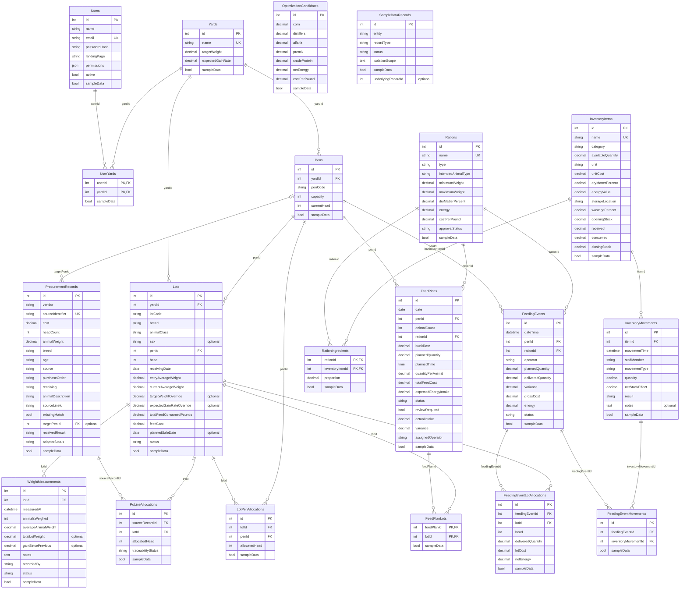

# Approval: Build every operation of the locked API contract in contracts/openapi.

Run 20261013-hackathon-problem-statement-fe-4cda · risk **high** · feature · size L · cost so far $1.20

## Your request (word for word)
> Hackathon Problem Statement: Feedlot Management Solution
> 
> A feedlot is a specialized livestock operation focused on transforming young cattle (300–500 lbs)
> into market-ready livestock (1,200–1,400 lbs) over an 8- to 12-month cycle. The core business
> objective is to maximize the "feed-to-gain" ratio, as the operation's profitability is directly tied
> to how efficiently animals convert nutritional rations into body weight.
> 
> Management is split between two primary tiers: Lots and Pens. A "Lot" reflects the business
> unit (a specific group of cattle purchased and analyzed together for performance), while a "Pen"
> serves as the physical unit (where daily feeding and housing activities occur). Effective software
> must bridge these tiers, allowing for granular daily execution at the pen level while providing
> high-level performance metrics at the lot level.
> 
> Key Requirements
> ● Integrated Data Management
> ○ Procurement Ingestion: Seamlessly import animal data (weight, breed, age, and
> source) from the primary procurement system.
> ○ Lifecycle Forecasting: Automatically calculate projected market dates and target
> weights based on incoming data.
> ● Feed & Ration Management
> ○ Inventory Control & Projections: Monitor real-time ingredient levels and
> generate automated inventory forecasts across multiple time horizons—daily,
> weekly, monthly, quarterly, bi-annual, and annual.
> ○ Wastage Calibration: Integrate a configurable wastage ratio into all consumption
> estimates and inventory projections to account for feeding-loss and ensure
> procurement accuracy.
> ○ Ration & Cost Optimization: Manage complex nutritional recipes and perform
> cost-benefit analysis on different feed mixes to identify the most economical
> paths to weight gain.
> ○ Dynamic Bunk Management: Track daily bunk rates and consumption patterns at
> the pen level, allowing for real-time adjustments to feeding plans based on
> actual intake versus projections.
> ● Execution & Activity Tracking
> ○ Pen-Level Planning: Generate daily feeding schedules and plans for specific
> physical pens.
> ○ Activity Logging: Capture actual feeding data to identify variances between the
> plan and execution.
> ● Performance & Conversion Analytics
> 
> ○ Feed-to-Gain Ratio: Calculate the primary efficiency KPI (Total Feed Consumed vs.
> Total Weight Gained).
> ○ Lot-Level Profitability: Provide deep-dive analysis on specific groups to determine
> the financial ROI of each lot.
> ○ Predictive Insights: Suggest "next steps" for feeding adjustments or sale timing
> based on current weight-gain trends.
> 
> Additional Information & Requirements:
> 
> Create sample/mock data to support the system. Assume the following information is based on
> mock data fetched from other systems.
> 
> ● Automated Data Ingestion: Synchronize PO and Receiving data (Vendor, Costs, Head
> Count, Weights) to eliminate manual entry and establish the financial baseline for each
> lot.
> ● Dynamic Lot Mapping: Reflect complex upstream relationships where a single PO Line
> may split into multiple Lots, ensuring 1:1 or 1:N traceability.
> ● Entity Mapping (PO → Lot → Pen): Provide the foundation to link procurement data to
> physical locations. The system will reflect Pen ID, capacity, and current animal counts as
> fetched from the source.
> ● Centralized Operational Entities: Establish the Lot and Pen as the primary units for all
> downstream feeding and performance analytics.
> ● Lightweight Implementation: Focus on backend data connectivity rather than refined
> UI/UX, as these modules serve specifically to support the feed-to-gain engine.
> 
> The Feed-to-Gain Engine (The Core Challenge)
> 
> Inventory, Ration Module & Feed Plan per Pen
> 
> ● Allow users to maintain a feed Inventory with feed types, available quantities, and unit
> costs ($/lb or $/ton).
> ● Each inventory item may include:feed item name, feed category, quantity available, unit
> of measure, cost per unit, dry matter percentage, energy value, and storage location. It
> should also track stock movement by maintaining the opening stock, stock received,
> stock consumed, and closing stock for each feed item.
> 
> ● Allow users to create a Ration (a feed recipe) by combining multiple feed ingredients
> with specified proportions. Each ration has a calculated cost per pound based on its
> ingredient mix.
> ● A ration may include the Ration name, Ration type, Feed ingredients used, Quantity or
> percentage of each ingredient, Dry matter percentage, Energy value, Cost per unit, and
> Intended animal type or weight range.
> ● A feed plan per pen defines what ration needs to be fed to a specific pen, how much
> feed should be provided, and on which date it should be delivered. Since pens may
> contain animals from one or more lots, the feed plan helps operators manage feeding
> execution in a structured and organized way. The feed plan per pen may include the
> Feed plan date, Pen, Assigned lot, Number of animals in the pen, Selected ration,
> Planned feed quantity, Planned feeding time, Feed quantity per animal, Total feed cost,
> Expected energy intake, and Feed plan status, such as Planned, In progress, Completed,
> or Skipped. The system should allow users to generate a feed plan based on the daily
> bunk rate, selected ration, and number of animals in the pen.
> 
> Feeding Activity
> 
> ● Allow users to log a Feeding Activity against a specific Pen, capturing:
> ○ The feeding activity should capture the Feeding date, Pen, Lot, Ration, Planned
> feed quantity, Actual feed quantity delivered, Difference between planned and
> actual feed, Feed cost, Energy value, Inventory consumed, and Feeding status.
> ● On save, the system should:
> ○ Decrement the feed inventory based on the ration's ingredient mix
> ○ Calculate and store the total feed cost for that feeding event
> ○ Roll up cumulative feed consumption and feed cost at the lot level
> ● Suggested calculation: Feed Variance = Actual Feed Quantity - Planned Feed Quantity
> 
> Weight Measurement Activity
> 
> ● Allow users to log a Weight Measurement Activity against a Lot, capturing:
> ○ Lot
> ○ Measurement date
> ○ Number of animals weighed
> ○ Average animal weight
> ○ Total lot weight
> ○ Weight gain since last measurement
> ○ Notes
> ● Maintain a time-series of weight readings per lot to enable trend analysis.
> 
> Feed-to-Gain Calculation Engine
> 
> This is the most critical part. Build the calculation logic that derives the following metrics from
> feeding and weight data:
> 
> Feed-to-Gain Calculation Metrics
> 
> Metric Formula Why It Matters
> 
> Days on Feed (DOF) Current Date − Receiving Date Tracks how long the lot has
> been on feed
> 
> Total Weight Gain Current Avg Weight − Entry Avg Weight Total growth achieved so far
> 
> Average Daily Gain (ADG) Total Weight Gain ÷ DOF Primary performance
> benchmark
> 
> Total Feed Consumed Sum of all feeding events Total feed input
> 
> Feed Conversion Ratio
> (FCR)
> Total Feed Consumed (lbs) ÷ Total
> Weight Gain (lbs)
> Feed efficiency metric (lower
> is better)
> 
> Cost of Gain ($/lb) Total Feed Cost ÷ Total Weight Gain Core profitability indicator
> 
> Projected Ship Date DOF + ((Target Weight − Current Weight)
> ÷ ADG)
> Forecasted shipping readiness
> 
> These metrics should update automatically whenever a new feeding or weight event is
> recorded.
> 
> Dashboard & Reports (Visualization Layer)
> 
> Surface the engine's output in a way that helps a feedlot operator make decisions.
> 
> The dashboard should include:
> 
> ● Active lots
> ● Active pens
> ● Animals per lot and pen
> ● Feed inventory status
> ● Ration usage
> ● Daily bunk rate per pen
> ● Planned feed vs actual feed
> ● Total feed consumed
> ● Total feed cost
> ● Starting weight vs current weight
> ● Total weight gain
> ● Average Daily Gain
> ● Feed-to-gain ratio
> ● Feed cost per unit of gain
> ● Energy consumed
> ● Best and worst performing lots
> 
> The reports should help answer questions such as:
> 
> ● Which pen consumed the most feed?
> ● Which lot has the best feed-to-gain ratio?
> ● Which lot has the highest Average Daily Gain?
> ● Which ration is being used the most?
> ● Is actual feeding aligned with the feed plan?
> ● Which pens are being overfed or underfed?
> ● How much feed inventory is remaining?
> ● What is the feed cost per unit of weight gain?
> 
> Feed-to-Gain Report
> 
> A dedicated report screen that allows users to:
> 
> ● Compare ADG, FCR, and Cost of Gain across multiple lots
> ● Filter by date range, breed, sex, or pen
> 
> ● Export the report as a CSV or PDF
> 
> Yard-Level Summary (Stretch Goal)
> 
> A high-level dashboard showing aggregate metrics across all active lots — total head, average
> ADG, average Cost of Gain, total feed cost — to give the yard manager a single-glance overview.
> 
> Evaluation Criteria
> 
> Submissions will be evaluated on:
> 
> 1. Correctness of the Feed-to-Gain Calculations — Are the formulas implemented
> accurately? Do metrics update correctly as new data is entered?
> 2. Quality of the Dashboard & Visualizations — How effectively does the UI communicate
> performance to a non-technical operator?
> 3. Data Integrity — Are inventory decrements, feed cost calculations, and weight tracking
> consistent and reliable?
> 4. User Experience — Is the flow from PO → Lot → Daily Activities → Dashboard intuitive
> and frictionless?
> 5. Code Quality & Architecture — Is the solution modular and extensible for future
> activities (treatments, vaccinations, shipping, etc.)?
> 
> What to present and deliver:
> ● Proposed Solution (Approach) and Architectural Diagrams
> ● Demo of the App
> ● Overview Vibe Coding Super Prompt & Other prompts
> ● How was it tested and validated?
> ● What challenges did you face?
> ● How close is this to production readiness?
> ● Go to Market Strategy and Analysis (Extra Advantage) If you build a product based
> solution/offering & with a go-to-market insight.
> 
> This run builds the API side of the product above, in an existing .NET API project. Build every operation of the locked API contract in contracts/openapi.yaml, exactly as it is written there. Keep the data in the project's PostgreSQL database (the connection string named App, which the project already reads), and write its sample data in App.Api/SeedData.cs: a few believable rows for each table, taken from the contract's examples, so each list has something to show. The app runs that file only when the setting Seed:Demo is true, so no test may count on those rows. The web app is built in its own repo; do not build screens here.

## Your answers
- Q-1 Which API data must be persisted in PostgreSQL? → **Persist all application data that API operations read or change, including values derived or cached for later requests.**
- Q-2 When the application adds its data model to the existing PostgreSQL database, what should happen to any pre-existing database contents? → **Preserve existing contents and add the application structures without discarding compatible data.**
- Q-3 When a ration defines ingredient proportions, what basis should the API use to calculate inventory consumption and ration cost? → **Treat proportions as percentages of as-fed ingredient weight; use dry-matter values only for nutritional calculations.**
- Q-4 What should happen when recording a feeding event whose ration requires more of an ingredient than is currently in inventory? → **Reject the entire event without changing inventory or feed rollups.**
- Q-5 How should the feed-to-gain metrics and projected ship date be represented when Days on Feed is zero or ADG is zero or negative? → **Return the affected metrics and projected ship date as unavailable until the required positive denominator or gain exists.**

## Confirm these assumptions (high risk)
- [ ] ASM-1 If `Seed:Demo` is true on multiple application startups, how should `SeedData.Run` handle sample rows already present? → assumed: No; the system starts empty, with seed data for set-up.

## Requirements
- **REQ-1** (MODIFIED) The Feedlot Operations API shall implement every HTTP operation in contracts/openapi.yaml with its declared method, path, parameters, request and response schemas, security requirements, success and error statuses, and behavior, without deviation.
  - AC-1.1 [api] Given A valid request for any method and path declared in contracts/openapi.yaml, with the declared authentication and permission requirements satisfied, or the declared unauthenticated sign-in operation used as specified.; when A client sends the request to the API.; then The response status and JSON fields match the operation's declared success response schema and behavior.
  - AC-1.2 [api] Given A request to a declared operation has missing or invalid credentials, insufficient permission, or input rejected by a declared validation or conflict rule.; when A client sends the request to the API.; then The response status and error fields match the corresponding statuses and schemas declared for that operation.
  - AC-1.3 [api] Given Valid inputs and existing resources where required for each listed operation; valid sign-in credentials for POST /api/auth/sign-in; and an authorized principal with required permissions for each listed operation whose contract requires authentication: GET /api/session; GET /api/dashboard; GET /api/imports/source-records; POST /api/imports; GET and PUT /api/allocations; GET /api/lots; GET /api/lots/{lotId}/forecast; PATCH /api/forecast-settings and PATCH /api/lots/{lotId}/forecast-settings; GET /api/lots/{lotId}/metrics; GET /api/lots/{lotId}/insights; POST /api/lots/{lotId}/insights/actions; GET and POST /api/lots/{lotId}/weights; GET /api/inventory; POST /api/inventory/items; PATCH /api/inventory/items/{itemId}; POST /api/inventory/movements; GET /api/inventory/projections; GET /api/inventory/export; GET /api/rations; POST /api/rations; PATCH /api/rations/{rationId}; POST /api/rations/optimization; POST /api/rations/{rationId}/approval; GET and POST /api/feed-plans; POST /api/feed-plans/{planId}/review; PATCH /api/feed-plans/{planId}/status; GET and POST /api/feeding-events; PATCH /api/feeding-events/{eventId}; POST /api/feeding-events/{eventId}/void; GET /api/reports/operational; GET /api/reports/operational/export; GET /api/reports/feed-to-gain; GET /api/reports/feed-to-gain/export; GET /api/reports/profitability; GET /api/reports/profitability/export; GET /api/sample-data; and POST /api/sample-data/load, /api/sample-data/reset, and /api/sample-data/replace.; when A client sends valid requests to each listed method and path, using the specified input, filters, and permissions.; then Each response status and response body conform to the listed status and response schema, and each export response contains the declared file artifact.
- **REQ-2** (MODIFIED) The Feedlot Operations API shall persist all application values its operations read or change, including derived or cached values used by later requests, in PostgreSQL through the existing App connection string, make committed values available to later requests and after restart, and initialize required application structures without deleting or changing any pre-existing database contents.
  - AC-2.1 [api] Given A PostgreSQL database configured through the App connection string contains a compatible pre-existing row in an unrelated table and has no application tables.; when The application starts, initializes its database structures, and a contract operation reads or changes application data.; then The unrelated row remains unchanged, the required application tables exist, and the response reflects persisted application data.
  - AC-2.2 [api] Given A contract operation creates or changes application data, including a value differing from the existing value.; when The API completes the operation successfully.; then The corresponding database row contains the submitted values and derived or cached values returned in the response.
  - AC-2.3 [api] Given A successful API mutation has been committed to the configured PostgreSQL database.; when The API process restarts and a contract read operation retrieves that data.; then The response fields contain the committed values from the database row.
  - AC-2.4 [api] Given A PostgreSQL test fixture contains an authorized principal established as test setup, an empty application-data state, and a contract operation valid for that principal that creates or changes an application record.; when The client uses the contract operation and then reads the record through the corresponding API list or detail operation.; then The response contains the saved value and a PostgreSQL row contains the same value.
  - AC-2.5 [api] Given A PostgreSQL database configured through App with Seed:Demo=false contains a compatible pre-existing application row with known field values and a row in an unrelated table.; when The application starts and an authorized client reads the application record through its corresponding contract operation.; then The compatible application row retains its original field values, the unrelated database row remains unchanged, and the response contains the retained application values.
- **REQ-3** (ADDED) When Seed:Demo is true at application startup on an initially clean database, the Feedlot Operations API shall run App.Api/SeedData.cs to populate each application table with demo rows based on believable examples from contracts/openapi.yaml.
  - AC-3.1 [api] Given A clean database is configured and Seed:Demo is true.; when The application starts and a client requests each contract list operation.; then Each response list count is at least one and the returned sample values include data drawn from contract examples.
  - AC-3.2 [api] Given The App database is empty and Seed:Demo is true.; when The application starts and database-backed list operations are requested.; then Each application-data table contains 1–3 rows derived from contract examples, and the response lists show those sample values.
- **REQ-4** (ADDED) ⚠ only one draft had this When Seed:Demo is true on a clean database, the Feedlot Operations API shall populate each application table with two or three believable sample rows based on examples in contracts/openapi.yaml.
  - AC-4.1 [api] Given A clean PostgreSQL database and application configuration Seed:Demo=true.; when The application starts and a test queries the application tables and calls their corresponding list API operations.; then Each application table has two or three sample rows and each list response contains at least one corresponding row.
- **REQ-5** (MODIFIED) When Seed:Demo is false at application startup, the Feedlot Operations API shall skip SeedData.Run and insert no demo rows, and serve contract operations without requiring demo seed rows, including protected list requests authenticated using a test-only account fixture separate from demo seed data.
  - AC-5.1 [api] Given Seed:Demo is false, the database has no operational or demo rows, and a test-only account fixture provisions a valid non-demo account with the contract-required authorization state directly in PostgreSQL, separately from demo seed data.; when A client signs in using the fixture credentials and authenticates protected list requests with the returned authorization, including requests valid for an empty operational data state.; then The protected list response statuses and fields conform to the contract without requiring a demo-seeded record.
  - AC-5.2 [api] Given The App database has no operational or demo rows, Seed:Demo is false, and a test-only account fixture separate from demo seed data provisions a principal with the permissions required by the protected lists.; when The application starts, the client signs in with the fixture account, and the client requests database-backed protected lists using the returned authorization.; then Every application-data table has a demo row count of zero, and the response lists contain no demo-seeded records.
  - AC-5.3 [api] Given A clean PostgreSQL database, application configuration Seed:Demo=false, and a test-only account fixture separate from demo seed data with the permissions required by protected list operations.; when The application starts, a client signs in with the fixture account and authenticates list API requests with the returned authorization, and a test queries the application tables.; then The demo-data row count is zero and the list responses contain no demo rows.
- **REQ-6** (ADDED) The Feedlot Operations API shall expose only backend API and documentation surfaces, with no product-facing web application screens or frontend implementation in this repository.
  - AC-6.1 [manual] Given The repository implementation is complete.; when A person reviews its exposed web surfaces and frontend files.; then The review finds API and API documentation surfaces but no product-facing screens or frontend implementation.
  - AC-6.2 [manual] Given The API application built from this repository.; when A person inspects its browser-accessible surfaces.; then The screen shows API health or API documentation and does not show feedlot product screens.
- **REQ-7** (ADDED) When a ration defines ingredient proportions, the Feedlot Operations API shall calculate ingredient consumption and ration cost from as-fed ingredient weights and use dry-matter values only for nutritional calculations.
  - AC-7.1 [api] Given A ration contains ingredients with stated proportions, different dry-matter percentages, and known unit costs.; when A client records a feeding event and reads the ration and event results.; then The response ingredient movement quantities and cost fields reflect the as-fed proportions and costs, while nutritional values reflect dry-matter values.
  - AC-7.2 [api] Given A ration has two ingredients with known as-fed unit costs and dry-matter percentages, with proportions of 70% and 30%, and a feeding request delivers 100 lb.; when The feeding event is recorded successfully.; then The response movement fields report 70 lb and 30 lb consumed, its cost fields equal the as-fed weighted cost, and its nutritional fields reflect the ingredients' dry-matter conversion.
  - AC-7.3 [api] Given A test-created ration whose ingredient proportions are percentages of as-fed weight, with different dry-matter percentages and known unit costs, and sufficient inventory.; when The client records a feeding event through POST /api/feeding-events.; then The response event shows each ingredient's consumed as-fed quantity and a cost equal to the sum of as-fed ingredient quantities multiplied by their unit costs, while nutrition values reflect dry-matter data.
- **REQ-8** (ADDED) When a feeding event is created or corrected, or a saved feeding event is voided, the Feedlot Operations API shall atomically reject any creation or correction requiring unavailable ingredient inventory without changing persisted event, inventory, movement, or lot feed-rollup values, apply successful corrections as replacements of the prior event's inventory and rollup effects, and reverse a voided event's inventory and rollup effects.
  - AC-8.1 [api] Given An ingredient has less available inventory than a proposed feeding event requires and inventory and lot rollup values have been recorded.; when The client posts the feeding event.; then The response status is 409 and the inventory row, feeding-event row count, and lot feed totals remain unchanged.
  - AC-8.2 [api] Given Inventory contains less than the required quantity of at least one ingredient for a feeding event.; when A client submits the event to the createFeedingEvent operation.; then The response status is 409, no feeding-event row or inventory-movement row is added, and inventory quantities and lot feed and cost rollup values remain unchanged.
  - AC-8.3 [api] Given A test-created ration and inventory where one ingredient has less stock than the event requires, with recorded pre-request inventory and lot totals.; when The client submits POST /api/feeding-events for that event.; then The response status is 409, no event row exists for the rejected request, the inventory row values are unchanged, and the lot feed-total response values are unchanged.
  - AC-8.4 [api] Given A saved feeding event has an inventory movement and lot feed rollup values, and a proposed correction requires more of at least one ingredient than is available after accounting for the saved event's existing inventory effect.; when The client submits the correction through PATCH /api/feeding-events/{eventId}.; then The response status is 409, the saved event row and its inventory-movement rows remain unchanged, and the inventory row values and lot feed and cost rollup values remain unchanged.
  - AC-8.5 [api] Given A saved feeding event has an inventory movement and lot feed rollup values, and a valid correction changes the delivered quantity to a different quantity with sufficient inventory.; when The client submits the correction through PATCH /api/feeding-events/{eventId}.; then The response event and lotFeedTotals contain the corrected values, the event's inventory movements reflect only the corrected consumption, and the inventory row reflects the corrected net consumption rather than both the original and corrected quantities.
  - AC-8.6 [api] Given A saved feeding event has an inventory movement and lot feed rollup values.; when The client voids the event through POST /api/feeding-events/{eventId}/void.; then The response event status is Voided, its inventoryMovements include the reversal of the event's inventory consumption, the inventory row reflects the restored quantity, and the lotFeedTotals exclude the voided event's feed and cost.
  - AC-8.7 [api] Given Inventory has a known quantity of an ingredient, and two otherwise valid concurrent POST /api/feeding-events requests each require no more than that quantity individually but together require more than the available quantity.; when The client sends both requests concurrently.; then The two response statuses are one contract-declared success status and one 409; exactly one feeding-event row and its corresponding inventory-movement rows are added, and the inventory row equals the starting quantity minus the successful event's consumption and remains nonnegative.
- **REQ-9** (ADDED) When Days on Feed is zero, ADG is nonpositive, or no positive gain remains toward the target, the Feedlot Operations API shall return ADG, feed-to-gain metrics, and projected ship dates as unavailable whenever their required positive denominator or gain is absent.
  - AC-9.1 [api] Given A lot has zero Days on Feed, or has zero or negative total weight gain or ADG.; when The client requests that lot's metrics.; then The response fields for affected metrics and projectedShipDate contain null rather than a numeric value or date.
  - AC-9.2 [api] Given A lot has zero Days on Feed.; when A client reads its lot metrics and lot list values.; then The response adg and projectedShipDate fields are JSON null.
  - AC-9.3 [api] Given A lot has positive Days on Feed and zero or negative total weight gain.; when A client reads its lot metrics, lot list, dashboard, and feed-to-gain report values.; then The response adg, feedConversionRatio or fcr, costOfGain or costPerGain, and projectedShipDate fields are JSON null wherever those fields are exposed.
  - AC-9.4 [api] Given A lot has positive Days on Feed and positive total weight gain below its target weight.; when A client reads its lot metrics after the latest weight measurement is recorded.; then The response contains numeric values for applicable feed-to-gain metric fields and a projectedShipDate field calculated from the positive gain rate.
  - AC-9.5 [api] Given A test-created lot whose receiving date makes Days on Feed zero.; when The client sends GET /api/lots/{lotId}/metrics.; then The response field daysOnFeed is 0 and the response fields adg and projectedShipDate are null.
  - AC-9.6 [api] Given A test-created lot with positive Days on Feed and zero or negative total weight gain.; when The client sends GET /api/lots/{lotId}/metrics.; then The response fields feedConversionRatio and costOfGain are null, and projectedShipDate is null when ADG is zero or negative.

Checked by a person, not by a test: AC-6.1, AC-6.2 (each needs a person's sign-off before delivery)

Not changing: Product screens and frontend implementation.; Live external procurement-system integration beyond the mock procurement/source-record behavior defined by the API contract.

## Files the plan will touch (22)
- App.Api/AppDb.cs
- App.Api/Auth/**  ← not found by grounding; check it
- App.Api/Domain/FeedPlans/**  ← not found by grounding; check it
- App.Api/Domain/Feeding/**  ← not found by grounding; check it
- App.Api/Domain/Imports/**  ← not found by grounding; check it
- App.Api/Domain/Inventory/**  ← not found by grounding; check it
- App.Api/Domain/Rations/**  ← not found by grounding; check it
- App.Api/Domain/Reports/**  ← not found by grounding; check it
- App.Api/Domain/SampleData/**  ← not found by grounding; check it
- App.Api/Domain/YardLots/**  ← not found by grounding; check it
- App.Api/Endpoints/FeedPlansEndpointModule.cs  ← not found by grounding; check it
- App.Api/Endpoints/FeedingEndpointModule.cs  ← not found by grounding; check it
- App.Api/Endpoints/ImportsEndpointModule.cs  ← not found by grounding; check it
- App.Api/Endpoints/InventoryEndpointModule.cs  ← not found by grounding; check it
- App.Api/Endpoints/RationsEndpointModule.cs  ← not found by grounding; check it
- App.Api/Endpoints/ReportsEndpointModule.cs  ← not found by grounding; check it
- App.Api/Endpoints/SampleDataEndpointModule.cs  ← not found by grounding; check it
- App.Api/Endpoints/YardLotsEndpointModule.cs  ← not found by grounding; check it
- App.Api/Infrastructure/**  ← not found by grounding; check it
- App.Api/Program.cs
- App.Api/SeedData.cs
- App.Api/appsettings.json  ← not found by grounding; check it

## Will also affect (found by code search, not in the plan)
- contracts/openapi.yaml (undefined): REQ-1 (MODIFIED) points at it
- App.Tests/HealthTests.cs (undefined): REQ-5 (MODIFIED) points at it

## Plan
Options: OPTION-A: Simplest structure: put all route handlers and persistence logic in Program.cs and rely on one global EF schema creation path. | OPTION-B (chosen): Convention-discovered endpoint, schema-initializer, and demo-seeder modules, with each domain slice owning its handlers and tables.
Decision: OPTION-A is simplest but conflicts with slice scopes and cannot safely initialize an existing nonempty database.
Choose OPTION-B: discover endpoint modules at startup and use additive per-domain CREATE TABLE IF NOT EXISTS initializers and seeders.
Honor the locked OpenAPI contract exactly; its server URL /api is the route prefix, and contracts/openapi.yaml is unchanged.
Seed:Demo controls startup demo seeding; explicit sample-data operations affect only rows marked sampleData=true.
If an existing application table is incompatible, fail visibly rather than drop or rewrite existing rows; preserve unrelated and operational data.
- TASK-1 Bootstrap modular API, additive database setup, and sign-in/session slice → REQ-6, Sign-in/session operation slice: establish the common API, persistence, security, and demo-seeder conventions used by later slices. Full REQ-1 and REQ-2 acceptance is completed after all slices are integrated.; must pass AC-6.1, AC-6.2
- TASK-2 Implement yard dashboard, lot, forecast, weight, and insight APIs → Yard dashboard, filterable lots, forecasts/settings, lot metrics, weight history/recording, and insight/action API slice., REQ-9: complete unavailable metric and projected-date behavior on metrics, lots, and dashboard routes; feed-to-gain report coverage is completed in TASK-8.; builds towards a later task (no criteria of its own)
- TASK-3 Implement procurement preview/import and allocation APIs → Imports/source-records preview, selected-record import, and PO-line/lot/pen allocation API slice.; builds towards a later task (no criteria of its own)
- TASK-4 Implement inventory, movements, projections, and CSV export → Inventory list/totals, item create/update, receipt/adjustment movements, horizon projections, and inventory export API slice.; builds towards a later task (no criteria of its own)
- TASK-5 Implement ration definitions, optimization, and approval APIs → Ration list/create/update, candidate-mix optimization, and ration approval API slice., REQ-7: persist the ration ingredient cost and dry-matter inputs needed for as-fed cost and dry-matter nutrition calculations; event behavior is completed in TASK-7.; builds towards a later task (no criteria of its own)
- TASK-6 Implement dated feed-plan creation, listing, review, and status updates → Feed-plan list/create, explicit review, and execution-status API slice.; builds towards a later task (no criteria of its own)
- TASK-7 Implement atomic feeding-event, inventory, and lot-rollup operations → REQ-7, REQ-8, Feeding-event list/create/correct/void API slice, including contract response movement and lotFeedTotals data.; must pass AC-7.1, AC-7.2, AC-7.3, AC-8.1, AC-8.2, AC-8.3, AC-8.4, AC-8.5, AC-8.6, AC-8.7
- TASK-8 Implement operational, feed-to-gain, and profitability reports and exports → REQ-9, Operational report/filter/export, feed-to-gain report/filter/export, and profitability report/filter/export API slices.; must pass AC-9.1, AC-9.2, AC-9.3, AC-9.4, AC-9.5, AC-9.6
- TASK-9 Implement sample-data management and complete contract/persistence acceptance → REQ-1, REQ-2, REQ-3, REQ-4, REQ-5, Sample-data status/load/reset/replace APIs; operations affect only sampleData=true rows and never delete operational or fixture-account rows.; must pass AC-1.1, AC-1.2, AC-1.3, AC-2.1, AC-2.2, AC-2.3, AC-2.4, AC-2.5, AC-3.1, AC-3.2, AC-4.1, AC-5.1, AC-5.2, AC-5.3

Stub commit (throws NotImplemented until implemented): App.Api/Infrastructure/IEndpointModule.cs, App.Api/Auth/AuthEndpointModule.cs, App.Api/Endpoints/YardLotsEndpointModule.cs, App.Api/Endpoints/ImportsEndpointModule.cs, App.Api/Endpoints/InventoryEndpointModule.cs, App.Api/Endpoints/RationsEndpointModule.cs, App.Api/Endpoints/FeedPlansEndpointModule.cs, App.Api/Endpoints/FeedingEndpointModule.cs, App.Api/Endpoints/ReportsEndpointModule.cs, App.Api/Endpoints/SampleDataEndpointModule.cs

## Data model (contracts/data-model.yaml; 20 tables, locked with the tests once you approve)
- **Users**: id int [PK], name string, email string [UK], passwordHash string, landingPage string, permissions json, active bool, sampleData bool
- **Yards**: id int [PK], name string [UK], targetWeight decimal, expectedGainRate decimal, sampleData bool
- **UserYards**: userId int [PK, FK], yardId int [PK, FK], sampleData bool
- **Pens**: id int [PK], yardId int [FK], penCode string, capacity int, currentHead int, sampleData bool, unique (yardId, penCode)
- **Lots**: id int [PK], yardId int [FK], lotCode string, breed string, animalClass string, sex string?, penId int [FK], head int, receivingDate date, entryAverageWeight decimal, currentAverageWeight decimal, targetWeightOverride decimal?, expectedGainRateOverride decimal?, totalFeedConsumedPounds decimal, feedCost decimal, plannedSaleDate date?, status string, sampleData bool, unique (yardId, lotCode)
- **WeightMeasurements**: id int [PK], lotId int [FK], measuredAt datetime, animalsWeighed int, averageAnimalWeight decimal, totalLotWeight decimal?, gainSincePrevious decimal?, notes text, recordedBy string, status string, sampleData bool
- **ProcurementRecords**: id int [PK], vendor string, sourceIdentifier string [UK], cost decimal, headCount int, animalWeight decimal, breed string, age string, source string, purchaseOrder string, receiving string, animalDescription string, sourceLineId string, existingMatch bool, targetPenId int [FK]?, receivedResult string, adapterStatus string, sampleData bool
- **PoLineAllocations**: id int [PK], sourceRecordId int [FK], lotId int [FK], allocatedHead int, traceabilityStatus string, sampleData bool, unique (sourceRecordId, lotId)
- **LotPenAllocations**: id int [PK], lotId int [FK], penId int [FK], allocatedHead int, sampleData bool, unique (lotId, penId)
- **InventoryItems**: id int [PK], name string [UK], category string, availableQuantity decimal, unit string, unitCost decimal, dryMatterPercent decimal, energyValue decimal, storageLocation string, wastagePercent decimal, openingStock decimal, received decimal, consumed decimal, closingStock decimal, sampleData bool
- **InventoryMovements**: id int [PK], itemId int [FK], movementTime datetime, staffMember string, movementType string, quantity decimal, netStockEffect decimal, result string, notes text?, sampleData bool
- **Rations**: id int [PK], name string [UK], type string, intendedAnimalType string, minimumWeight decimal, maximumWeight decimal, dryMatterPercent decimal, energy decimal, costPerPound decimal, approvalStatus string, sampleData bool
- **RationIngredients**: rationId int [PK, FK], inventoryItemId int [PK, FK], proportion decimal, sampleData bool
- **OptimizationCandidates**: id int [PK], corn decimal, distillers decimal, alfalfa decimal, premix decimal, crudeProtein decimal, netEnergy decimal, costPerPound decimal, sampleData bool
- **FeedPlans**: id int [PK], date date, penId int [FK], animalCount int, rationId int [FK], bunkRate decimal, plannedQuantity decimal, plannedTime time, quantityPerAnimal decimal, totalFeedCost decimal, expectedEnergyIntake decimal, status string, reviewRequired bool, actualIntake decimal, variance decimal, assignedOperator string, sampleData bool
- **FeedPlanLots**: feedPlanId int [PK, FK], lotId int [PK, FK], sampleData bool
- **FeedingEvents**: id int [PK], dateTime datetime, penId int [FK], rationId int [FK], operator string, plannedQuantity decimal, deliveredQuantity decimal, variance decimal, grossCost decimal, energy decimal, status string, sampleData bool
- **FeedingEventLotAllocations**: id int [PK], feedingEventId int [FK], lotId int [FK], head int, deliveredQuantity decimal, lotCost decimal, netEnergy decimal, sampleData bool, unique (feedingEventId, lotId)
- **FeedingEventMovements**: id int [PK], feedingEventId int [FK], inventoryMovementId int [FK], sampleData bool, unique (feedingEventId, inventoryMovementId)
- **SampleDataRecords**: id int [PK], entity string, recordType string, status string, isolationScope text, sampleData bool, underlyingRecordId int?, unique (entity, underlyingRecordId)
- UserYards.userId → Users.id (many UserYards to one Users, on delete cascade)
- UserYards.yardId → Yards.id (many UserYards to one Yards, on delete cascade)
- Pens.yardId → Yards.id (many Pens to one Yards, on delete restrict)
- Lots.yardId → Yards.id (many Lots to one Yards, on delete restrict)
- Lots.penId → Pens.id (many Lots to one Pens, on delete restrict)
- WeightMeasurements.lotId → Lots.id (many WeightMeasurements to one Lots, on delete cascade)
- ProcurementRecords.targetPenId → Pens.id (many ProcurementRecords to one Pens, optional, on delete set-null)
- PoLineAllocations.sourceRecordId → ProcurementRecords.id (many PoLineAllocations to one ProcurementRecords, on delete cascade)
- PoLineAllocations.lotId → Lots.id (many PoLineAllocations to one Lots, on delete restrict)
- LotPenAllocations.lotId → Lots.id (many LotPenAllocations to one Lots, on delete cascade)
- LotPenAllocations.penId → Pens.id (many LotPenAllocations to one Pens, on delete restrict)
- InventoryMovements.itemId → InventoryItems.id (many InventoryMovements to one InventoryItems, on delete restrict)
- RationIngredients.rationId → Rations.id (many RationIngredients to one Rations, on delete cascade)
- RationIngredients.inventoryItemId → InventoryItems.id (many RationIngredients to one InventoryItems, on delete restrict)
- FeedPlans.penId → Pens.id (many FeedPlans to one Pens, on delete restrict)
- FeedPlans.rationId → Rations.id (many FeedPlans to one Rations, on delete restrict)
- FeedPlanLots.feedPlanId → FeedPlans.id (many FeedPlanLots to one FeedPlans, on delete cascade)
- FeedPlanLots.lotId → Lots.id (many FeedPlanLots to one Lots, on delete restrict)
- FeedingEvents.penId → Pens.id (many FeedingEvents to one Pens, on delete restrict)
- FeedingEvents.rationId → Rations.id (many FeedingEvents to one Rations, on delete restrict)
- FeedingEventLotAllocations.feedingEventId → FeedingEvents.id (many FeedingEventLotAllocations to one FeedingEvents, on delete cascade)
- FeedingEventLotAllocations.lotId → Lots.id (many FeedingEventLotAllocations to one Lots, on delete restrict)
- FeedingEventMovements.feedingEventId → FeedingEvents.id (many FeedingEventMovements to one FeedingEvents, on delete cascade)
- FeedingEventMovements.inventoryMovementId → InventoryMovements.id (many FeedingEventMovements to one InventoryMovements, on delete restrict)
- UserYards joins Users and Yards (many to many)
- RationIngredients joins Rations and InventoryItems (many to many)
- FeedPlanLots joins FeedPlans and Lots (many to many)

## Critic findings (25)
- [high] REQ-4 AC-3.2 allows 1–3 seed rows per table, but REQ-4/AC-4.1 requires two or three, so a table seeded with one row passes REQ-3 and fails REQ-4 (and REQ-4 otherwise repeats REQ-3).
- [high] REQ-1 AC-1.3 lists every path with an /api prefix (e.g. POST /api/auth/sign-in, GET /api/sample-data), but the anchored contract declares /auth/sign-in and /sample-data, and no servers/base-path anchor backs the prefix, which contradicts I-1's 'exactly as it is written'.
- [medium] REQ-1 AC-1.3 lists about 45 operations but only two contract anchors exist, so nothing anchors the list's paths or shows it covers 'every operation' in contracts/openapi.yaml.
- [high] REQ-5 The contract operations POST /sample-data/load, /reset and /replace put demo data in at runtime, which conflicts with REQ-5's 'insert no demo rows' when Seed:Demo is false and with I-4's 'runs that file only when Seed:Demo is true', and the spec never reconciles them.
- [high] REQ-1 The spec never says what sample-data reset/replace do to non-demo operational rows, the test-only fixture account, or the pre-existing rows that REQ-2/Q-2 must preserve.
- [high] REQ-2 AC-2.1 needs application tables created in a database that already has an unrelated table, but the anchored startup uses EnsureCreated(), which does nothing when any table exists; the spec names no schema-initialization or migration mechanism and no upgrade path for databases EnsureCreated already built.
- [medium] REQ-2 The EARS forbids changing 'any pre-existing database contents', while Q-2 only protects 'compatible' data; 'compatible' is never defined, nothing says what happens to incompatible pre-existing rows, and AC-2.5's 'pre-existing application row' cannot exist because AppDb has no entities today.
- [medium] REQ-2 AC-2.2 and AC-2.4 are labelled level 'api' but check that 'the corresponding database row contains' values, which is a direct database check rather than a public API surface.
- [medium] REQ-5 AC-5.2 and AC-5.3 assert a 'demo row count of zero', but no column or marker separates demo rows from other rows (the fixture account itself is a row), so the check cannot be observed or decided.
- [high] REQ-5 With Seed:Demo=false outside tests, no contract operation or bootstrap step creates a first account or its permissions (only a test fixture is specified), so every protected operation is unreachable in a real deployment.
- [medium] REQ-3 AC-3.1 calls every contract list operation with Seed:Demo=true, but most require authentication and no principal or seeded credentials are given for that scenario.
- [medium] REQ-1 AC-1.2 only covers errors the contract declares, so failures it does not declare (e.g. an unknown lotId/itemId/eventId with no 404, or the database being unavailable) have no specified behaviour.
- [medium] REQ-7 Nothing specifies what happens when ration proportions do not add up to 100% or an ingredient has no unit cost or dry-matter value.
- [medium] REQ-7 AC-7.1 to AC-7.3 refer to 'movement quantities', 'cost fields' and 'nutritional fields', and AC-7.2 to lb units, with no contract anchor naming those fields or units.
- [medium] REQ-7 The spec does not say whether PATCH /rations/{rationId} after feeding events have been recorded recalculates those past events' consumption and cost or leaves them as recorded.
- [high] REQ-8 AC-8.1 to AC-8.4 and AC-8.7 hardcode a 409 status, and AC-8.6 assumes a 'Voided' status, inventoryMovements and lotFeedTotals, none anchored to the contract; if createFeedingEvent declares a different status, the requirement breaks I-1.
- [medium] REQ-8 No behaviour is defined for voiding an event that is already voided (risk of a double inventory reversal) or for PATCHing a voided event.
- [high] REQ-9 AC-9.1 to AC-9.6 require JSON null for adg, feedConversionRatio, costOfGain and projectedShipDate without showing the contract declares them nullable; if it does not, this conflicts with REQ-1's 'without deviation'.
- [medium] REQ-9 AC-9.3 hedges on field names ('feedConversionRatio or fcr', 'costOfGain or costPerGain'), so the response schema it relies on is unanchored and unverified.
- [medium] REQ-9 The EARS adds 'or no positive gain remains toward the target' (a lot at or above target weight gets no ship date), which goes beyond Q-5; Q-5 only covered zero Days on Feed and zero or negative ADG.
- [medium] REQ-2 REQ-2 requires persisting derived or cached values, but no rule says when time-dependent values (daysOnFeed, projectedShipDate) or values changed by new weights or feeding-event corrections/voids are recomputed, so stored metrics can go stale.
- [medium] REQ-1 Applying the contract's security requirements is never stated to leave '/', '/openapi/v1.json' and '/swagger' anonymous, yet the health test and the factory's product page depend on those routes.
- [medium] REQ-2 The Program.cs lines 8–9 anchor quote contains the redacted placeholder «SECRET_1» and so cannot match the source text exactly (spec-lint already flags this anchor as not matching the code).
- [low] REQ-3 Seeding 'each application table' independently does not require seeded feeding events, inventory movements and lot feed rollups to agree with each other, although REQ-8 assumes they always do.
- [low] REQ-6 AC-6.1 and AC-6.2 are manual reviews only and give no automatable check at a public surface.

## Still open after 0 repairs
- [critic high] REQ-4 AC-3.2 allows 1–3 seed rows per table, but REQ-4/AC-4.1 requires two or three, so a table seeded with one row passes REQ-3 and fails REQ-4 (and REQ-4 otherwise repeats REQ-3).
- [critic high] REQ-1 AC-1.3 lists every path with an /api prefix (e.g. POST /api/auth/sign-in, GET /api/sample-data), but the anchored contract declares /auth/sign-in and /sample-data, and no servers/base-path anchor backs the prefix, which contradicts I-1's 'exactly as it is written'.
- [critic high] REQ-5 The contract operations POST /sample-data/load, /reset and /replace put demo data in at runtime, which conflicts with REQ-5's 'insert no demo rows' when Seed:Demo is false and with I-4's 'runs that file only when Seed:Demo is true', and the spec never reconciles them.
- [critic high] REQ-1 The spec never says what sample-data reset/replace do to non-demo operational rows, the test-only fixture account, or the pre-existing rows that REQ-2/Q-2 must preserve.
- [critic high] REQ-2 AC-2.1 needs application tables created in a database that already has an unrelated table, but the anchored startup uses EnsureCreated(), which does nothing when any table exists; the spec names no schema-initialization or migration mechanism and no upgrade path for databases EnsureCreated already built.
- [critic high] REQ-5 With Seed:Demo=false outside tests, no contract operation or bootstrap step creates a first account or its permissions (only a test fixture is specified), so every protected operation is unreachable in a real deployment.
- [critic high] REQ-8 AC-8.1 to AC-8.4 and AC-8.7 hardcode a 409 status, and AC-8.6 assumes a 'Voided' status, inventoryMovements and lotFeedTotals, none anchored to the contract; if createFeedingEvent declares a different status, the requirement breaks I-1.
- [critic high] REQ-9 AC-9.1 to AC-9.6 require JSON null for adg, feedConversionRatio, costOfGain and projectedShipDate without showing the contract declares them nullable; if it does not, this conflicts with REQ-1's 'without deviation'.

## Settled by questions, and open risks
- Spec question Q-6: Should all nine requirements be approved as one run, or should the work be split or reduced? → Approve all nine requirements as one run. (answered)
- Spec question Q-7: How should AC-5.1 provide an authenticated principal for protected list requests while keeping seeding disabled? → Add a test-only account fixture, separate from demo seed data, and authenticate the protected-list requests with it. (answered)
- Open risk: AC-3.2 allows 1–3 seed rows per table, but REQ-4/AC-4.1 requires two or three, so a table seeded with one row passes REQ-3 and fails REQ-4 (and REQ-4 otherwise repeats REQ-3).
- Open risk: AC-1.3 lists every path with an /api prefix (e.g. POST /api/auth/sign-in, GET /api/sample-data), but the anchored contract declares /auth/sign-in and /sample-data, and no servers/base-path anchor backs the prefix, which contradicts I-1's 'exactly as it is written'.
- Open risk: The contract operations POST /sample-data/load, /reset and /replace put demo data in at runtime, which conflicts with REQ-5's 'insert no demo rows' when Seed:Demo is false and with I-4's 'runs that file only when Seed:Demo is true', and the spec never reconciles them.
- Open risk: The spec never says what sample-data reset/replace do to non-demo operational rows, the test-only fixture account, or the pre-existing rows that REQ-2/Q-2 must preserve.
- Open risk: AC-2.1 needs application tables created in a database that already has an unrelated table, but the anchored startup uses EnsureCreated(), which does nothing when any table exists; the spec names no schema-initialization or migration mechanism and no upgrade path for databases EnsureCreated already built.
- Open risk: With Seed:Demo=false outside tests, no contract operation or bootstrap step creates a first account or its permissions (only a test fixture is specified), so every protected operation is unreachable in a real deployment.
- Open risk: AC-8.1 to AC-8.4 and AC-8.7 hardcode a 409 status, and AC-8.6 assumes a 'Voided' status, inventoryMovements and lotFeedTotals, none anchored to the contract; if createFeedingEvent declares a different status, the requirement breaks I-1.
- Open risk: AC-9.1 to AC-9.6 require JSON null for adg, feedConversionRatio, costOfGain and projectedShipDate without showing the contract declares them nullable; if it does not, this conflicts with REQ-1's 'without deviation'.

Round trip: the spec restated back matches your request (nothing dropped, nothing added).

**This spec has 9 requirements, about 2 runs' worth of work for a feature; approve it as one run or reject with which part to cut.**

## Decide
  factory approve 20261013-hackathon-problem-statement-fe-4cda <hash> --note "your risk note"
  factory reject  20261013-hackathon-problem-statement-fe-4cda <hash> --reason "why"

Card hash: 1b8bc836