# Approval: Build the API side in the existing .NET API project.

Run 20261013-meridian-coldchain-platform-in-1d97 · risk **high** · feature · size L · cost so far $2.46

## Your request (word for word)
> Meridian ColdChain Platform
> 
> Introduction
> 
> Meridian Healthcare Distribution supplies vaccines, insulin, biologics and other temperature-sensitive
> medicines to around 400 hospitals, pharmacies and clinics. Stock is held in three warehouses (Karachi,
> Lahore and Dubai) and delivered by Meridian's own vans in insulated shipper boxes.
> 
> Every one of these products has a storage temperature band, for example 2 °C to 8 °C. A product that
> spends too long outside its band may lose potency without any visible sign. Regulators require Meridian
> to prove, for every unit it hands over, that the product stayed within its permitted conditions from the
> moment Meridian received it until the customer signed for it.
> 
> Today this proof is assembled by hand. Cold rooms are checked on paper twice a day. Each shipper box
> carries a data logger that is plugged into a computer after the van returns. Stock is tracked in
> spreadsheets per warehouse. Delivery notes are signed on paper.
> 
> Meridian plans to replace this with a single platform covering stock, orders, deliveries, live temperature
> monitoring, quality decisions and recalls.
> 
> Problem Statement
> 
> The current process does not tell anyone that a product is at risk until it is too late to act.
> 
> As a result:
> 
> ● A temperature problem in a van is discovered hours after the product has been handed to the
> customer.
> ● Quality staff cannot tell how much time outside its band a product has already used up, so they
> either write off good stock or release stock on judgement alone.
> ● Stock nearest its expiry date is not reliably sent out first, and customers receive product with too
> little shelf life left.
> ● Two people working from different copies of a spreadsheet promise the same stock to two
> customers.
> ● When a manufacturer recalls a lot, finding every customer who received it takes two to three days.
> ● Records can be changed after the fact, and an inspector cannot be shown who decided what and
> when.
> ● Drivers lose mobile signal in basements, hospital loading bays and on long routes, so anything that
> depends on a live connection fails exactly where it is needed.
> 
> Solution Overview
> 
> The proposed solution will consist of:
> 
> ● A web portal for warehouse staff, dispatchers, quality staff, administrators and auditors.
> ● A customer portal for hospitals, pharmacies and clinics.
> ● A driver mobile application for iOS and Android that keeps working without a connection.
> ● A service that receives temperature readings from data loggers and cold-room sensors.
> ● A centralized backend system holding one shared record of stock, orders and temperature history.
> 
> Meridian staff will sign in with their Meridian Microsoft account. Customer users are invited by their
> own organisation and see only their own organisation's orders and deliveries.
> 
> Each product has a temperature profile: its storage band and a stability budget, which is the total time
> the product is allowed to spend outside the band over its whole life, split by how far outside it went.
> The system keeps a running account of the budget each handling unit has used, from receipt to delivery.
> 
> Stock is received in lots. Customers order by product and quantity. The system decides which lots to
> send, earliest expiry first. Picked stock is packed into shipper boxes, each with a data logger, and the
> boxes are loaded onto a route.
> 
> Loggers report a reading every 5 minutes. When a reading falls outside the band, the system opens an
> excursion, charges the time against the budget of everything in that box, and alerts the driver, the
> dispatcher and quality staff. Affected stock cannot be handed over until quality staff have decided
> what happens to it.
> 
> When a lot is recalled, the system shows where every unit of it is or went, blocks what Meridian still
> holds, and tracks each customer's response until every unit is accounted for.
> 
> The portals shall be available in English and Arabic. Arabic is shown right to left.
> 
> User Roles
> 
> Warehouse Operator
> 
> Receives stock, puts it away, picks and packs orders into shipper boxes.
> 
> Dispatcher
> 
> Plans routes, assigns drivers and vehicles, and follows deliveries during the day.
> 
> Driver
> 
> Loads shipper boxes, drives the route and hands over deliveries using the mobile application.
> 
> Quality Officer
> 
> Reviews excursions and proposes what happens to affected stock.
> 
> Quality Manager
> 
> Approves quality decisions and starts and closes recalls. Legally responsible for released stock.
> 
> Customer User
> 
> A member of staff at a hospital, pharmacy or clinic who places orders and follows deliveries.
> 
> Customer Administrator
> 
> A customer user who can also invite and remove users for their own organisation.
> 
> System Administrator
> 
> Manages staff accounts, warehouses, vehicles, shipper box types, products and system configuration.
> 
> Auditor
> 
> An internal or external inspector with read-only access to all records and the audit trail.
> 
> User Stories
> 
> US-001: Sign In and Access Control
> 
> User Story
> 
> As a user, I want to sign in securely and see only what my role and organisation allow so that
> regulated records are protected.
> 
> Description
> 
> Meridian staff shall sign in with their Meridian Microsoft account. Accounts from other organisations
> shall not be accepted for staff roles.
> 
> Customer users shall sign in with an email address and password and a second step using a one-time
> code. A customer user belongs to exactly one customer organisation.
> 
> Drivers use the same Meridian account on the mobile application. Once signed in, the application shall
> remain usable for the working day without a connection.
> 
> A staff member may hold more than one role. Each staff member belongs to one or more warehouses
> and sees only stock, orders and routes of those warehouses. Quality Managers and Auditors see all
> warehouses.
> 
> Acceptance Criteria
> 
> ● Staff can sign in only with a Meridian Microsoft account.
> ● Customer users can sign in only after completing the second step.
> ● A customer user never sees another organisation's orders, deliveries or documents.
> ● A staff member sees only the warehouses they are assigned to.
> ● A Customer Administrator can invite and remove users of their own organisation only.
> ● A removed or disabled user loses access immediately, including on a mobile device that is online.
> ● A signed-in driver can open and work today's route without a connection.
> ● An Auditor cannot create, change or delete any record.
> 
> US-002: Products and Temperature Profiles
> 
> User Story
> 
> As a System Administrator, I want to define each product's temperature profile so that the system
> can judge every reading against the right limits.
> 
> Description
> 
> A product has a name, a code, a pack size and a temperature profile.
> 
> A temperature profile consists of a storage band and a stability budget. The budget is expressed as
> tiers. For example, for a 2 °C to 8 °C product:
> 
> ● Above 8 °C up to 15 °C: 12 hours in total.
> ● Above 15 °C up to 25 °C: 2 hours in total.
> ● Above 25 °C: not permitted.
> ● Below 2 °C down to 0 °C: 4 hours in total.
> ● Below 0 °C: not permitted.
> 
> Time spent in a tier counts against that tier's allowance. A reading in a not-permitted range means the
> product cannot be released by anyone other than through the full two-person decision in US-010.
> 
> Profiles are versioned. Changing a profile requires a reason and takes effect from a stated date. Earlier
> versions remain viewable.
> 
> Acceptance Criteria
> 
> ● A product cannot be saved without a temperature profile.
> ● Tiers must not overlap and must leave no gap between the band and the not-permitted ranges.
> ● Each tier has an allowance in hours and minutes, or is marked not permitted.
> ● A profile change creates a new version with a reason, an effective date and the person who made
> it.
> ● Earlier versions of a profile can be viewed but not changed.
> ● Products can be listed, searched by name or code, and deactivated. A deactivated product cannot
> be ordered.
> 
> US-003: Receive Stock
> 
> User Story
> 
> As a Warehouse Operator, I want to receive incoming stock by lot so that every unit is traceable
> from the moment it arrives.
> 
> Description
> 
> Stock arrives from manufacturers in lots. For each receipt the operator records the product, lot number,
> expiry date, quantity, supplier and the cold room and shelf where it is stored.
> 
> The manufacturer's shipment arrives with its own logger. The operator uploads the logger's file, and
> the system charges any time outside the band during the inbound journey against the lot's budget.
> 
> All received stock starts as Quarantined. A Quality Officer reviews the receipt and releases it, after
> which it is available to be allocated to orders. Stock within 30 days of expiry on arrival cannot be
> released.
> 
> A lot can be in these statuses: Quarantined, Released, On Hold, Rejected, Recalled, Expired. Stock
> becomes Expired automatically at the end of its expiry date.
> 
> Acceptance Criteria
> 
> ● A receipt records product, lot number, expiry date, quantity, supplier and storage location.
> ● The same lot number for the same product can be received more than once, and the receipts are
> tracked separately but reported together.
> ● Received stock is Quarantined until released by a Quality Officer.
> ● The inbound logger file can be uploaded, and the budget used on the inbound journey is shown
> before the release decision.
> ● Stock with an expiry date in the past cannot be received.
> ● Stock within 30 days of expiry on arrival cannot be released.
> ● Only Released stock can be allocated to an order.
> ● Stock becomes Expired automatically and is removed from any allocation it was part of, and the
> dispatcher is told.
> ● Moving stock between shelves or cold rooms is recorded with who, when, from and to.
> 
> US-004: Place an Order
> 
> User Story
> 
> As a Customer User, I want to order products for a delivery date so that my site receives what it
> needs on time.
> 
> Description
> 
> A customer user places an order made of one or more lines. Each line is a product and a quantity in
> packs. The order has a delivery address, chosen from the organisation's saved addresses, and a
> requested delivery date.
> 
> Orders placed before the cut-off time (default 14:00, configurable per warehouse) can be delivered the
> next working day. Orders placed after the cut-off are delivered no earlier than the working day after
> that. Working days and public holidays are configured per warehouse.
> 
> Each customer organisation is served by one warehouse and has a minimum remaining shelf life (for
> example 90 days) that any delivered product must have on the delivery date. The customer chooses
> per order whether a short order may be delivered in part or must be delivered complete.
> 
> An order moves through: Submitted, Allocated, Partly Allocated, Packed, Out for Delivery, Delivered,
> Partly Delivered, Cancelled. A customer can cancel or change an order until packing begins.
> 
> Acceptance Criteria
> 
> ● An order has at least one line, and each line has a quantity of at least 1 pack.
> ● The earliest selectable delivery date follows the cut-off time, working days and holidays of the
> serving warehouse.
> ● The customer chooses between "deliver what is available" and "deliver complete only".
> ● The customer sees the order status and each line's allocated and outstanding quantity.
> ● An order can be changed or cancelled by the customer until it is Packed. After that, only a
> dispatcher can cancel it.
> ● Cancelling an order returns its allocated stock to available stock.
> ● Submitting the same order twice by mistake, for example by a double tap, creates one order.
> 
> US-005: Allocate Stock to Orders
> 
> User Story
> 
> As a Dispatcher, I want the system to choose which lots fulfil each order so that the oldest suitable
> stock goes out first and nothing is promised twice.
> 
> Description
> 
> When an order is submitted, the system allocates stock to each line from the serving warehouse.
> 
> Allocation rules:
> 
> ● Only Released stock is used.
> ● The lot with the earliest expiry date is used first.
> ● A lot is skipped for a customer if, on the requested delivery date, it would have less than that
> customer's minimum remaining shelf life.
> ● Between two lots with the same expiry date, the one with more of its stability budget used is sent
> first.
> ● A line may be fulfilled from more than one lot.
> ● Stock is never allocated beyond what is physically available.
> 
> If a line cannot be fully allocated, an order marked "deliver what is available" is Partly Allocated and the
> remainder waits as a back order, which is filled automatically, oldest order first, when suitable stock is
> released. An order marked "deliver complete only" holds no stock until every line can be fully allocated.
> 
> A dispatcher may override the system's choice of lot for a line, with a reason. An override may not
> break the Released-only rule or the customer's minimum shelf life.
> 
> Acceptance Criteria
> 
> ● Allocation follows earliest-expiry-first within the rules above.
> ● No unit of stock is ever allocated to two orders, including when many orders are submitted at the
> same moment.
> ● A line can be split across lots, and the split is visible on the order.
> ● A "deliver complete only" order holds no stock until it can be fully allocated.
> ● Back orders are filled automatically in the order they were submitted when stock becomes available.
> ● A dispatcher override requires a reason and is refused if it breaks the Released-only rule or the
> minimum shelf life.
> ● When allocated stock is put On Hold, Rejected, Recalled or Expired, it is removed from the order,
> the system tries to allocate replacement stock, and the dispatcher is told the outcome.
> ● Available, allocated and quarantined quantities per product, lot and warehouse can be viewed at
> any time and always add up to the quantity on hand.
> 
> US-006: Pack Shipper Boxes and Plan Routes
> 
> User Story
> 
> As a Dispatcher, I want to pack orders into shipper boxes and place them on routes so that every
> box can keep its contents in range for the whole journey.
> 
> Description
> 
> A Warehouse Operator picks the allocated lots and packs them into shipper boxes. Each box has a
> type, and each type has a temperature range it is built for and a qualified duration (for example 48
> hours) for which it holds that range once sealed. Each packed box is given one data logger by scanning
> the logger's barcode. A box holds stock for one delivery stop only, but may hold several products and
> lots, provided all of them share the same storage band.
> 
> A dispatcher creates a route for a date with a vehicle, a driver and an ordered list of stops. Each stop
> has a planned arrival time entered by the dispatcher. The system does not work out the best order of
> stops.
> 
> A route cannot be confirmed if any box on it would reach its stop later than its qualified duration, less
> a safety margin (default 4 hours, configurable), counted from the moment the box was sealed.
> 
> Acceptance Criteria
> 
> ● A box cannot be sealed without exactly one logger, and a logger cannot be in two open boxes at
> once.
> ● A box cannot be packed with products whose storage bands differ, or with a product whose band
> the box type is not built for.
> ● Sealing a box records the time, the operator, the contents by lot and quantity, and the logger.
> ● A route has one vehicle, one driver, a date and at least one stop.
> ● A driver or vehicle cannot be on two routes whose times overlap.
> ● A route is refused confirmation if a box would exceed its qualified duration less the safety margin
> at its planned arrival, and the screen says which box and by how much.
> ● A dispatcher can move a stop to another route or reorder stops until the driver has left for that
> stop.
> ● The driver is told of any change to a route that has already been confirmed.
> 
> US-007: Receive Temperature Readings
> 
> User Story
> 
> As a Quality Officer, I want every reading from every logger and cold-room sensor stored reliably
> so that the temperature history of any unit is complete and trustworthy.
> 
> Description
> 
> Loggers in shipper boxes and fixed sensors in cold rooms take a reading every 5 minutes. Readings
> reach the system through the logger supplier's gateway, which sends them in batches. Each reading
> carries the device identifier, the time the reading was taken and the temperature.
> 
> The mobile network is not reliable. Readings may arrive minutes or hours late, in the wrong order, more
> than once, or in one large batch when a van comes back into coverage. The system shall produce the
> same temperature history regardless of the order in which readings arrive.
> 
> A device that has sent nothing for 15 minutes is treated as silent. A silent logger in a box that is out for
> delivery raises an alert. Time with no readings is shown as a gap in the history and is not assumed to
> be in range.
> 
> The system shall be sized for 5,000 devices reporting at once.
> 
> Acceptance Criteria
> 
> ● Readings are accepted only from the supplier's gateway and only for known devices.
> ● A reading received twice is stored once.
> ● Readings that arrive late or out of order are placed at the time they were taken, and everything
> calculated from them is brought up to date.
> ● A reading with a time in the future, or from before the box was sealed, is kept but marked and not
> used in calculations.
> ● A device with no reading for 15 minutes is shown as silent, and an alert is raised if its box is out for
> delivery.
> ● Gaps are visible in the temperature history as gaps.
> ● The temperature history of any box, cold room or lot can be viewed as a chart and as a table, with
> the band and the excursions marked.
> 
> US-008: Detect Excursions and Track the Stability Budget
> 
> User Story
> 
> As a Quality Officer, I want the system to detect excursions and keep each unit's remaining budget
> up to date so that I know immediately which stock is at risk and by how much.
> 
> Description
> 
> An excursion opens when a reading from a box or cold room is outside the band of a product stored
> in it. It closes when three readings in a row are back inside the band. The duration of the excursion is
> charged, tier by tier, against the stability budget of every handling unit that was in that box or cold
> room at the time.
> 
> The budget is tracked per handling unit, not per lot: two parts of the same lot that travelled in different
> boxes have different histories. The budget used in the manufacturer's inbound journey, in the cold
> room and in every box is added together.
> 
> When an excursion opens, the driver (if the box is on a route), the dispatcher and the Quality Officers
> of the warehouse are alerted within 2 minutes of the reading being received. A further alert is sent
> when the remaining allowance in any tier falls below 25%, and again when a tier is used up or a
> not-permitted range is reached.
> 
> All stock affected by an open or undecided excursion is placed On Hold automatically.
> 
> Because readings can arrive late, an excursion may be discovered, lengthened, shortened or removed
> after the event. Budgets, holds and alerts shall follow the corrected history.
> 
> Acceptance Criteria
> 
> ● An excursion opens on the first reading outside the band and closes after three consecutive
> readings inside it.
> ● Excursion time is charged to the correct tier, and a single excursion that passes through several
> tiers is charged to each for the time spent in it.
> ● The budget used and remaining per tier is shown for every handling unit, with the excursions that
> consumed it.
> ● Parts of one lot with different histories show different budgets.
> ● Alerts reach the driver, dispatcher and Quality Officers within 2 minutes of the reading being
> received.
> ● Stock affected by an excursion is On Hold until a decision is made under US-010.
> ● Late readings that change an excursion update the budget, the holds and the excursion record,
> and the change is recorded in the audit trail.
> ● A late reading that reveals an excursion on stock already delivered opens a case for quality review
> and is shown to the customer.
> 
> US-009: Deliver with the Driver Application
> 
> User Story
> 
> As a Driver, I want to load, drive and hand over my deliveries from my phone, with or without
> signal, so that every handover is recorded properly.
> 
> Description
> 
> The driver sees today's route with its stops in order. Before leaving, the driver scans each shipper box
> onto the vehicle. The application warns about a box that belongs to another route or a box that is
> missing.
> 
> During the route the application shows the current temperature and status of each box and any alerts.
> 
> At a stop the driver scans the boxes for that stop. If a box holds stock that is On Hold, the application
> shows "Do not deliver" for that box and does not allow it to be handed over. For the remaining boxes,
> the driver records the receiver's name, captures their signature and a photo of the delivered boxes,
> and completes the handover. The time and location are recorded automatically.
> 
> A receiver may refuse all or part of a delivery. The driver records what was refused and a reason, and
> refused boxes return to the warehouse, where they are Quarantined.
> 
> Everything above shall work without a connection. Work done offline is sent when the connection
> returns. If the route was changed while the driver was offline, the driver is shown the difference before
> continuing, and a handover already completed offline is never lost or undone.
> 
> Acceptance Criteria
> 
> ● The driver sees only their own routes.
> ● Loading requires every box on the route to be scanned, and a wrong or missing box is reported.
> ● A box with stock On Hold cannot be handed over, and the driver sees the reason.
> ● A handover records receiver name, signature, photo, time and location.
> ● A partial or full refusal can be recorded with a reason per box.
> ● Loading, handover and refusal work without a connection and are sent automatically later.
> ● A handover recorded offline keeps the time it actually happened, not the time it was sent.
> ● If a hold was placed on a box while the driver was offline and the box was handed over, the
> handover is kept, the conflict is flagged and a quality case is opened.
> ● The same handover sent twice is recorded once.
> ● The dispatcher sees each stop's status and the time it was last updated.
> 
> US-010: Decide What Happens to Affected Stock
> 
> User Story
> 
> As a Quality Manager, I want every excursion to end in a recorded, signed decision so that no
> affected product reaches a patient without a responsible person approving it.
> 
> Description
> 
> Every excursion requires a decision for each affected handling unit: Release or Reject.
> 
> The system shows the reviewer the full temperature history, the budget used and remaining per tier,
> and a recommendation: Release when every tier still has allowance left, Reject when any tier is used
> up or a not-permitted range was reached.
> 
> ● If the excursion stayed within the first tier above or below the band and allowance remains, a
> Quality Officer may decide alone.
> ● In every other case, a Quality Officer proposes and a Quality Manager approves. The two shall be
> different people.
> ● A decision that goes against the system's recommendation always needs both, and a written
> justification.
> 
> Each decision is signed electronically: the person confirms their identity again at the moment of
> signing and gives a reason. A signed decision cannot be edited. It can only be superseded by a new
> signed decision, and both remain on record.
> 
> Rejected stock is removed from available stock and listed for destruction. Destruction is recorded
> with a date, a quantity and a witness.
> 
> Acceptance Criteria
> 
> ● Stock that is On Hold cannot be allocated, packed, loaded or handed over.
> ● The reviewer sees the history, the budget per tier and the system's recommendation.
> ● A single-person decision is allowed only in the case described above.
> ● The person who proposes a decision cannot approve it, even if they hold both roles.
> ● Signing requires the person to confirm their identity again and enter a reason.
> ● A signed decision cannot be changed or deleted by anyone, including a System Administrator.
> ● Releasing stock returns it to where it was: available, or back on its order and route.
> ● Rejecting stock removes it from its order, and the order is reallocated under US-005.
> ● Decisions waiting longer than 4 hours are escalated to the Quality Manager.
> ● Destroyed quantities can never exceed rejected quantities.
> 
> US-011: Recall a Lot
> 
> User Story
> 
> As a Quality Manager, I want to recall a lot and see every unit accounted for so that no recalled
> product stays in use.
> 
> Description
> 
> A Quality Manager starts a recall for a product and one or more lot numbers, with a reason and a
> severity.
> 
> Starting a recall immediately:
> 
> ● Sets all stock of those lots that Meridian holds, in any warehouse, to Recalled.
> ● Removes it from every order and stops it being handed over, including boxes already on a van.
> ● Lists every customer who received any of those lots, with quantities, delivery dates and receivers.
> ● Notifies those customers by email and in the customer portal.
> 
> The trace from lot to every location and customer shall be available within one minute of the request.
> 
> Each affected customer responds in the portal with, for each delivery, how many packs are still on
> hand, how many were used or dispensed, and how many were destroyed on site. Packs on hand are
> collected on a return route and Quarantined on arrival.
> 
> A recall can be closed only when every pack of the lot is accounted for: held by Meridian, returned,
> reported used, reported destroyed, or written off as unaccounted with a signed justification.
> 
> Acceptance Criteria
> 
> ● Only a Quality Manager can start or close a recall, and both actions are signed.
> ● Recalled stock is blocked across all warehouses at once, including stock that is packed or on a
> route.
> ● A driver on a route sees "Do not deliver" for a recalled box as soon as the device is online.
> ● The trace lists every warehouse location, box, route and customer delivery for the lot, with
> quantities.
> ● The quantities in the trace add up exactly to the total quantity received for the lot.
> ● Customers are notified and can respond per delivery.
> ● A customer's reported quantities cannot exceed what was delivered to them.
> ● Customers who have not responded within 24 hours are reminded, and the Quality Manager sees
> who is outstanding.
> ● Recall progress shows the percentage of packs accounted for.
> ● A recall cannot be closed while any pack is unaccounted for without a signed write-off.
> 
> US-012: Follow Orders in the Customer Portal
> 
> User Story
> 
> As a Customer User, I want to follow my deliveries and download proof of their condition so that
> I can accept stock with confidence.
> 
> Description
> 
> The customer portal shows the organisation's orders, their status, the lots and expiry dates allocated,
> and for deliveries on the road the planned arrival time and whether the temperature is in range.
> 
> After delivery, the customer can download a delivery certificate as a PDF for each delivery. The
> certificate shows the products, lots, expiry dates and quantities, the receiver and time of handover,
> the temperature chart for each box from sealing to handover, any excursions and the signed decisions
> on them.
> 
> The portal and the certificate are available in English and Arabic according to the user's preference.
> 
> Acceptance Criteria
> 
> ● A customer sees current and past orders of their own organisation only.
> ● A delivery on the road shows its planned arrival time and an in-range or out-of-range status,
> without revealing other customers on the route.
> ● A delivery certificate can be downloaded for every completed delivery.
> ● The certificate contains the contents by lot, the handover details, the temperature chart, and any
> excursions with their decisions.
> ● A certificate issued once does not change. If late readings alter the history, a new version is
> issued and both remain available.
> ● All dates and times are shown in the customer's own time zone.
> ● Switching to Arabic turns the whole portal right to left, including tables, charts and the certificate.
> 
> US-013: Audit Trail
> 
> User Story
> 
> As an Auditor, I want a complete, unalterable record of who did what and when so that Meridian
> can demonstrate compliance during an inspection.
> 
> Description
> 
> The system shall record every creation, change and deletion of regulated data: products and profiles,
> stock, orders and allocations, boxes and routes, handovers, excursions, decisions, recalls, users and
> roles, and configuration.
> 
> Each entry records who, when, what was changed, the old and new values, and the reason where one
> was given. Actions taken by the system itself, such as automatic holds and allocations, are recorded
> as such.
> 
> Audit entries cannot be edited or deleted by anyone. It shall be possible to demonstrate that the trail
> has not been altered.
> 
> All times are stored in a single reference time and shown in the viewer's time zone. Karachi and
> Lahore share one time zone and Dubai is in another.
> 
> Records shall be kept for 7 years.
> 
> Acceptance Criteria
> 
> ● Every change to regulated data produces an audit entry with who, when, old value, new value and
> reason.
> ● Automatic actions are recorded and attributed to the system.
> ● No user, including a System Administrator, can edit or delete an audit entry.
> ● An alteration made to the audit trail outside the application can be detected.
> ● The audit trail can be filtered by record, user, date range and type of action.
> ● An Auditor can export any filtered view.
> ● The full history of one lot, from receipt to delivery or destruction, can be viewed in one place in
> time order.
> 
> US-014: Reports and Scheduled Summaries
> 
> User Story
> 
> As a Quality Manager, I want regular reports on excursions, wastage and delivery performance so
> that I can find and fix weak points in the cold chain.
> 
> Description
> 
> A daily summary shall be emailed at 07:00 warehouse time to the Quality Officers of each warehouse,
> listing excursions in the last 24 hours, decisions still waiting, silent devices and stock On Hold.
> 
> A monthly report shall be generated on the first day of each month and emailed to configured
> stakeholders. It should include, at a minimum:
> 
> ● Number and rate of excursions by route, driver, vehicle and shipper box type.
> ● Packs rejected and destroyed, by product and by cause.
> ● Deliveries on time and in full, as a percentage.
> ● Average time from excursion to decision.
> ● Stock within 60 days of expiry, by product and warehouse.
> ● Open recalls and their progress.
> 
> The same figures shall be available on screen for any date range, filterable by warehouse.
> 
> Acceptance Criteria
> 
> ● The daily summary is sent at 07:00 in each warehouse's own time zone.
> ● The monthly report is generated automatically on the first day of the month and emailed to the
> configured stakeholders.
> ● Report figures match the underlying records for the same period.
> ● A delivery counts as on time when handed over within 60 minutes of its planned arrival, and as in
> full when every ordered pack was handed over.
> ● Reports can be viewed on screen for any date range and exported.
> ● A staff member sees report figures only for their own warehouses.
> 
> Out of Scope for Phase 1
> 
> ● Pricing, invoicing and payments. These remain in Meridian's accounting system.
> ● Working out the best order of stops on a route.
> ● Purchasing from manufacturers and forecasting demand.
> ● Automatic penalties for drivers or customers.
> ● Transfers of stock between warehouses.
> ● The logger hardware and the supplier's gateway, which already exist.
> 
> This run builds the API side of the product above, in an existing .NET API project. Build every operation of the locked API contract in contracts/openapi.yaml, exactly as it is written there. Keep the data in the project's PostgreSQL database (the connection string named App, which the project already reads), and write its sample data in App.Api/SeedData.cs: a few believable rows for each table, taken from the contract's examples, so each list has something to show. The app runs that file only when the setting Seed:Demo is true, so no test may count on those rows. The web app is built in its own repo; do not build screens here.

## Your answers
- Q-1 Should the backend persist and execute the broader product workflows only when an operation in the locked OpenAPI contract exposes them, or should it also build data/workflows for capabilities that the contract does not expose? → **Implement the data and business rules needed by contracted operations only; do not add uncontracted API operations.**
- Q-2 For contracted operations, should access enforcement include the detailed warehouse, organisation, and role restrictions described in the user stories, beyond whatever security is declared in the OpenAPI contract? → **Enforce the user stories' explicit restrictions on contracted data: customer-organisation isolation, warehouse assignments, staff roles, and Auditor read-only access, without changing the API surface.**
- Q-3 Where the contracted receipt operations expose stock receipt behavior, which of the narrative receipt and quality rules must the API enforce and persist? → **Apply the explicit receipt rules where exposed: separate traceable receipt records even for repeated product/lot pairs, quarantine on receipt, Quality Officer release, and the stated expiry restrictions.**
- Q-4 For contracted customer-order and allocation operations, how much of the described order lifecycle should be implemented beyond basic persistence of contract fields? → **Apply the explicit order rules where exposed: customer changes/cancellation only before packing, duplicate-submission protection, suitable-stock allocation, and the stated allocation and back-order behavior.**
- Q-5 How broad should the audit history be for contracted data changes? The request requires an audit trail and says records can be changed after the fact, but does not define the complete event set or immutability behavior. → **Store actor and time for consequential changes and decisions exposed by contracted operations.**
- Q-6 The product stories describe behaviors beyond the locked API contract, while the final instruction says to implement the contract exactly. When a story requires behavior the contract does not define, which scope should govern? → **Implement only operations and behavior defined by the locked OpenAPI contract; do not add uncontracted behavior.**
- Q-7 For sample rows that refer to one another, should the seeder create compatible references, or may it seed each table independently? → **Create compatible references between related sample rows.**
- Q-8 The contract includes an operation to return a configured staff identity-provider authorization URL, but the provider and source of that configuration are not identified here. What should the API use? → **Use the existing staff identity provider and supply its authorization URL and token-validation settings through deployment configuration.**
- Q-9 When demo seeding is disabled and a database table has no records, should list operations return an empty list or provide sample rows without persisting them? → **Return an empty list when the database has no matching records.**
- Q-1 How long must audit events for consequential changes and decisions remain available? → **Retain audit events without automatic expiry.**
- Q-2 What should happen to the existing spreadsheet-based operational data when the API is introduced? → **Do not migrate legacy data; start with records entered through the contracted API operations.**
- Q-3 When the configured database is unavailable or invalid, what should the API do beyond the existing fail-fast behavior for a missing connection string? → **Fail startup for invalid configuration and return the contract-defined server error for failed operations; never report a business operation as successful.**
- Q-4 The staff identity-provider URL and token-validation settings will come from deployment configuration. What should happen if required settings are missing or invalid? → **Fail application startup with a clear configuration error.**

## Confirm these assumptions (high risk)
- [ ] ASM-1 What authentication integration is expected behind the contract's staff authorization-URL operation and the described customer sign-in? → assumed: Email and password, with a reset link by email; no social or single sign-on.
- [ ] ASM-2 Should the API bring existing spreadsheet or paper-process data into the new persisted records, or start with no imported business data? → assumed: No; the system starts empty, with seed data for set-up.
- [ ] ASM-3 The request says readings arrive through a logger supplier's gateway and that alerts reach drivers, dispatchers, and Quality Officers, but does not identify the supplier, gateway authentication, or alert delivery channel. What should the API integrate with? → assumed: Email only, from fixed templates; no SMS or push.
- [ ] ASM-4 What is the persisted unit meant by “handling unit” for temperature-budget history when part of a lot is split into different boxes or storage histories? → assumed: A separately tracked quantity or lot portion becomes a handling unit when its history diverges, such as when it is split into a different box.
- [ ] ASM-5 How should the API ensure stock becomes Expired at the end of its expiry date and is removed from allocations, given that the API-side request does not specify a scheduler or other trigger? → assumed: Run an application-side scheduled check that updates expired stock, removes allocations, and records the resulting dispatcher alert.
- [ ] ASM-2 How should the API establish that temperature readings are coming from the logger supplier's gateway, and which supplier integration details should it use? → assumed: Accept readings through the locked contract operation using gateway credentials/configuration supplied for deployment; do not add a vendor-specific client.
- [ ] ASM-3 How should customer users receive the one-time code required at sign-in? → assumed: Email and password, with a reset link by email; no social or single sign-on.

Other assumptions: ASM-6 The request makes order cut-off times and route safety margins configurable, with warehouse-specific working days and holidays, but does not say where those values are maintained. How should contracted operations obtain them? → assumed: Administrators work in the same app on admin-only screens; no separate back office.; ASM-1 Should the existing root health response and Swagger/OpenAPI UI remain available alongside the contracted operations? → assumed: Keep the existing health response, OpenAPI document, and Swagger UI.; ASM-4 By what channel must the API deliver operational alerts to drivers, dispatchers, and Quality Officers when the requirements say they must be alerted? → assumed: Email only, from fixed templates; no SMS or push.; ASM-5 Which time zone and source of working-day and public-holiday calendars should govern warehouse cut-off and delivery-date calculations? → assumed: Use each warehouse's configured local time zone and a calendar maintained in warehouse configuration.

## Requirements
- **REQ-1** (ADDED) The Meridian API in the existing ASP.NET Core .NET 9 project shall implement every method, path, parameter, header, request and response schema, media type, and status defined in `contracts/openapi.yaml`, without adding uncontracted business operations.
  - AC-1.1 [api] Given Every operation in the locked contract has a valid authorized request and record fixtures.; when A client calls each declared operation using its method, path, parameters, headers, and request media type.; then The response status, media type, and body fields match the operation's declared successful response.
  - AC-1.2 [api] Given An operation declares invalid-input, authentication, authorization, not-found, conflict, or server-error responses.; when The corresponding condition is sent through that operation.; then The response status and error body match a response declared for that operation.
  - AC-1.3 [api] Given A path and method are absent from the locked contract.; when A request is sent to that path and method.; then The response status is 404 or 405 and no business record is created.
- **REQ-2** (ADDED) The Meridian API shall implement the locked contract under the `/api` path prefix, expose no uncontracted business operation, and preserve the existing root health response, OpenAPI document, and Swagger UI.
  - AC-2.1 [api] Given The API is running.; when A client calls `/`, `/openapi/v1.json`, and `/swagger`.; then Each response status is 200, the root response value is `API is up`, and the OpenAPI response includes the contracted `/api` operations.
- **REQ-3** (ADDED) The Meridian API shall persist records, relationships, state changes, and file artifacts required by contracted operations in the configured shared database, keep successful mutations available after process restart, avoid importing legacy spreadsheet or paper-process business data, and support deployment bootstrap and explicitly enabled demo seed data.
  - AC-3.1 [api] Given A valid contracted create or update request is made against a configured database.; when The request succeeds, the application restarts, and the resource is fetched through its contracted read operation.; then The response status is successful and the returned record fields match the persisted row.
  - AC-3.2 [api] Given A contracted upload operation receives a valid evidence or logger file.; when The API restarts and the related contracted read or download operation is called.; then The response status is successful and the returned file or record fields match the uploaded content and metadata.
  - AC-3.3 [api] Given Legacy spreadsheet or paper-process data exists outside a new configured database and has not been submitted through contracted operations.; when The API starts and contracted collections are queried.; then The database contains no imported legacy business row and response lists contain no imported legacy records.
  - AC-3.4 [api] Given Deployment bootstrap configuration supplies the initial System Administrator identity, warehouse records, and customer-organisation records.; when The API starts against an empty database.; then The database contains rows for the configured initial administrator, warehouses, and organisations before contracted operations are served.
  - AC-3.5 [api] Given A deployment supplies demo seed records and `Seed:Demo` is explicitly enabled or disabled.; when The API starts against an empty database.; then The database contains the configured demo seed rows only when `Seed:Demo` is enabled, and contains no demo seed rows when it is disabled.
- **REQ-4** (ADDED) The Meridian API shall provide contracted staff authorization-URL lookup, customer email-and-password sign-in with one-time-code verification and resend, and password-reset request, token-inspection, and completion flows, deliver customer codes and reset links by email, and enforce configured verification and resend attempt limits.
  - AC-4.1 [api] Given An active customer account has valid credentials and configured email delivery.; when The customer submits credentials to the contracted sign-in operation.; then The response contains a challenge identifier, an email message contains the one-time code, and no authenticated customer result is issued before code verification.
  - AC-4.2 [api] Given A customer challenge is pending.; when The customer verifies a valid code, submits an invalid or reused code, or requests a resend.; then Each response status and returned authentication or challenge value reflects the contract-defined outcome, and only a valid unused code produces an authenticated customer result.
  - AC-4.3 [api] Given A customer account requests a password reset.; when The account requests, inspects, and completes a reset using the issued token.; then The response values identify token usability, the reset link is sent by email, and a consumed or invalid token cannot reset the password again.
  - AC-4.4 [api] Given The staff identity-provider authorization URL is configured.; when An unauthenticated client calls the staff authorization-URL operation.; then The response status is 200 and the returned value is the configured URL.
  - AC-4.5 [api] Given A customer submits an unknown email address or an incorrect password.; when The customer calls the sign-in operation for each case.; then The response status and error body are the same for both cases, and no challenge value or authenticated result is returned.
  - AC-4.6 [api] Given A customer submits an expired or previously used code, attempts sign-in for a deactivated account, or calls the staff authorization-URL operation while its URL is unconfigured.; when The corresponding contracted operation is called.; then The response status and error body match a declared failure response, and no authenticated result or unusable authorization URL is returned.
  - AC-4.7 [api] Given A customer has exceeded the deployment-configured verification or resend attempt limit.; when The customer submits another code verification or resend request.; then The response status is a declared failure status and no authenticated result or additional one-time-code email message is issued.
- **REQ-5** (ADDED) The Meridian API shall validate staff identities using the configured Meridian Microsoft identity provider, separately from customer email-and-password authentication, map authenticated staff identities to active persisted accounts, and enforce contracted customer-organisation, staff-role, warehouse-scope, Auditor read-only, and account-status restrictions on every operation.
  - AC-5.1 [api] Given Customer organisations have separate orders, deliveries, certificates, or recall records.; when An authenticated user from one organisation lists or requests another organisation's records.; then The response status is 403 or the contract-defined not-found status and contains no other-organisation record.
  - AC-5.2 [api] Given A staff member is assigned to one warehouse and another warehouse has records.; when The staff member lists or requests warehouse-scoped stock, receipts, orders, routes, or quality records outside the assignment.; then The response list contains only assigned-warehouse records and an inaccessible-record response contains no record value.
  - AC-5.3 [api] Given An Auditor is authenticated and a record is available.; when The Auditor reads the record and attempts a contracted create, update, or delete operation.; then The read response contains the record and each prohibited write response status is 403.
  - AC-5.4 [api] Given An account has been deactivated or removed.; when That account makes a subsequent authenticated request to a protected contracted operation.; then The response status is 401 or 403 and contains no protected record.
  - AC-5.5 [api] Given A Quality Manager or Auditor is authenticated and requests a record in a warehouse outside an ordinary staff member's assignment.; when The account reads that record.; then The response status is successful and the returned record belongs to the requested warehouse.
  - AC-5.6 [api] Given A request supplies a valid token issued by the configured Meridian Microsoft identity provider for an active staff account, or supplies an invalid, untrusted, unknown-account, or deactivated-account identity.; when The caller invokes a protected contracted staff operation.; then The response status and accessible records reflect the matched persisted account's roles and warehouse assignments, and an invalid or inactive identity receives status 401 or 403 with no protected record.
- **REQ-6** (ADDED) The Meridian API shall persist searchable products and immutable versioned temperature profiles, require a profile for each product, and validate profile tiers and governance history.
  - AC-6.1 [api] Given A System Administrator creates or searches for a product.; when The product is submitted, listed, retrieved, or deactivated through contracted operations.; then The response record contains the submitted product specification and active state, and searches return matching product records.
  - AC-6.2 [api] Given A product has no valid temperature profile or a profile has overlapping or discontinuous tier boundaries.; when The product or profile is submitted.; then The response status is 400 and the response error identifies the invalid profile or tier values.
  - AC-6.3 [api] Given A valid profile change includes an effective date, label, limits, tiers, and reason.; when A System Administrator creates the profile version and later lists versions.; then The response record and profile list contain the new version, reason, effective date, and actor, while the previous version remains returned unchanged.
  - AC-6.4 [api] Given A product has an earlier profile version.; when A caller attempts to alter that earlier version rather than create a new version.; then The response status is 409 and the earlier profile record remains unchanged.
  - AC-6.5 [api] Given A product is deactivated.; when A customer submits an order line for that product.; then The response status is 400 or 409 as declared by the operation and the response does not report a successful order.
- **REQ-7** (MODIFIED) The Meridian API shall persist separate contracted receipt, receipt-logger, receipt-evidence, stock, movement, and opening-stock records and enforce receipt traceability, quarantine, expiry validation, and Quality Officer release, while allowing a Quality Officer to release an ordinary eligible receipt without the separate two-person approval required for decisions that invoke that workflow.
  - AC-7.1 [api] Given A permitted Warehouse Operator submits a valid receipt with product, lot number, expiry date, quantity, supplier, and location.; when The operator creates the receipt and retrieves it.; then The response record contains the submitted values and a Quarantined status.
  - AC-7.2 [api] Given A product and lot number already have a receipt.; when A second permitted receipt with the same product and lot number is submitted.; then The response contains a distinct receipt identifier and the stock list reports both quantities without merging receipt records.
  - AC-7.3 [api] Given A receipt expiry date is before the current date, or release is attempted when expiry is within 30 days of receipt.; when The receipt or release action is submitted.; then The response status is 400 or 409 as defined by the operation and the receipt or release status value is not changed to Released.
  - AC-7.4 [api] Given A valid supplier-format logger file or separate evidence file is available for an existing receipt.; when The file is uploaded through its contracted receipt operation and the receipt is subsequently fetched.; then The response contains the receipt record or action result and a subsequent receipt response contains the stored file-related record or processed readings.
  - AC-7.5 [api] Given A handling unit has positive available quantity at a warehouse location.; when A permitted move or opening-stock operation is submitted.; then The response record contains the resulting quantity and location, and a movement record contains actor, time, source, destination, and moved quantity.
  - AC-7.6 [api] Given A receipt is quarantined, meets the expiry restrictions, and has no condition requiring a two-person quality decision.; when An authorized Quality Officer releases the receipt through its contracted workflow.; then The response record contains the Quality Officer as the decision actor and the stock status is Released; this receipt release does not bypass a separately required two-person decision.
- **REQ-8** (MODIFIED) When a handling unit reaches the end of its expiry date in its warehouse's configured local time zone, the Meridian API shall mark it Expired even if it is Quarantined or On Hold, remove it from allocations, apply the contracted replacement-allocation and order-status rules, record the change, and alert the dispatcher.
  - AC-8.1 [job] Given A handling unit is allocated to an order and its expiry date ends in the warehouse's configured local time zone.; when The scheduled expiry check runs at the start of the next local calendar day.; then The stock row has Expired status even if it was Quarantined or On Hold, its allocation rows are removed, the order row reflects any replacement allocation, and an audit event and dispatcher alert email call record the change.
  - AC-8.2 [job] Given A released handling unit is allocated to an order and has passed its expiry date in the warehouse's configured local time zone.; when The scheduled expiry check runs.; then The stock row has Expired status, the allocation count for that unit is zero unless eligible replacement stock is allocated, the affected order status and outstanding quantity reflect the replacement outcome, and a dispatcher alert row identifies the expiry notification.
  - AC-8.3 [job] Given An order contains an allocation that expires and no suitable replacement stock is available.; when The scheduled expiry check runs.; then A partial order response shows Partly Allocated status and the outstanding quantity, while a complete-only order row has no allocations and Submitted status; the expired stock row has Expired status and a dispatcher alert row records the outcome.
- **REQ-9** (ADDED) The Meridian API shall persist customer orders and dispatch allocations using the serving warehouse's deployment-configured cut-off, working-day, holiday, time-zone, and customer shelf-life rules, and enforce idempotency, order validation, pre-packing customer changes, and cancellation rules.
  - AC-9.1 [api] Given An authenticated customer submits an order with at least one line, positive pack quantities, an organisation-owned address, and an idempotency key.; when The order is submitted twice with the same key and payload.; then Both response bodies return the same order identifier and the order list contains one order.
  - AC-9.2 [api] Given A customer submits an invalid line, another organisation's address, a date earlier than permitted, or a product inactive for ordering.; when The customer places the order.; then The response status is 400 or 409 and no order row is created.
  - AC-9.3 [api] Given The serving warehouse has deployment-supplied cut-off, working-day, holiday, and local time-zone configuration.; when A customer requests an order delivery date before or after cut-off.; then The response record accepts no date earlier than the next working day before cut-off or the working day after that when submitted after cut-off.
  - AC-9.4 [api] Given An order is not yet Packed or has already reached Packed status.; when The customer attempts to change or cancel it.; then The response status and order status value reflect the applicable lifecycle rule, and successful cancellation returns the allocated quantity to available stock.
- **REQ-10** (ADDED) The Meridian API shall allocate only released, physically available stock meeting customer minimum remaining shelf life, select earliest expiry first with the specified stability-budget tie-break, and apply complete-order, partial-order, back-order, and override rules.
  - AC-10.1 [api] Given Released stock is available for an order from its serving warehouse and has eligible lots.; when The order is allocated.; then The response record shows earliest-expiry eligible lots first, applies minimum remaining shelf life, uses greater stability-budget usage first for tied expiry dates, and exposes each allocation and outstanding quantity.
  - AC-10.2 [api] Given Suitable stock is insufficient for a partial order or any line of a complete-only order.; when Allocation is attempted.; then The partial order response shows allocated and outstanding quantities without over-allocating stock, while the complete-only order holds no stock until every line can be fully allocated.
  - AC-10.3 [api] Given Multiple orders are submitted concurrently against the same available handling units.; when The allocations are committed.; then The response records and stock list show no unit allocated to more than one order and total allocated quantity does not exceed physical available quantity.
  - AC-10.4 [api] Given A dispatcher submits an allocation override with a reason, without a reason, or to stock violating Released status or customer shelf life.; when The override operation is called.; then The valid response record includes the reason and changed allocation, while each invalid response status is 400 or 409 and the original allocation remains unchanged.
  - AC-10.5 [api] Given Suitable stock is released for waiting back orders.; when The allocation service updates affected orders.; then The order response records show oldest-first back-order allocation.
  - AC-10.6 [api] Given An older back order awaits suitable stock or a complete-only order cannot be fully allocated.; when Suitable stock is released or allocation is attempted.; then The response record shows eligible back orders filled in submission order and no stock held by the incomplete complete-only order.
- **REQ-11** (ADDED) The Meridian API shall persist compatible box packing and route plans, enforce box and route qualification, and record driver loading, departure, synchronization, handover, refusal, and delivery-evidence operations.
  - AC-11.1 [api] Given A Warehouse Operator submits a pack request for allocated stock.; when The requested box contains one logger, products with the same storage band, and a compatible box type.; then The response record contains the box, logger, lot quantities, operator, and seal time; a reused logger or incompatible packing response status is 409.
  - AC-11.2 [api] Given A dispatcher submits a route with date, vehicle, driver, ordered stops, and planned arrival times.; when The route is created, updated, or confirmed.; then The response record contains the requested route values and a conflicting driver or vehicle assignment returns status 409.
  - AC-11.3 [api] Given A route's packed box would exceed qualified duration less the configured safety margin at a planned arrival.; when The route confirmation operation is called.; then The response status is 409 and the response message identifies the box and qualification shortfall or duration overrun.
  - AC-11.4 [api] Given A driver calls route listing, route detail, scan, departure, or synchronization operations for the authenticated driver's route.; when The driver supplies contracted date, action identifiers, or route data.; then The response list or record contains only that driver's authorized route, ordered stops, expected boxes, scans, and departure state.
  - AC-11.5 [api] Given A driver synchronizes queued actions with distinct action identifiers or repeats an action identifier.; when The synchronization operation is called.; then The response record contains accepted and conflicting actions, and the resulting route history contains each accepted action only once.
  - AC-11.6 [api] Given A driver submits a handover with receiver, acknowledgement, signature, photo, completion time, and box delivery or refusal quantities.; when The handover operation is called and authorized delivery evidence is subsequently fetched.; then The response record and delivery-evidence response contain persisted evidence and quantities, and refused quantities retain the refusal reason.
  - AC-11.7 [api] Given A confirmed route is changed before its driver has left for the affected stop.; when A dispatcher updates the route schedule or stop order.; then The response record contains the changed schedule or stop order and an email call or driver-change event is recorded.
- **REQ-12** (ADDED) The Meridian API shall process readings from contracted receipt logger uploads and from the configured authenticated logger gateway through the locked contract operation, expose temperature histories for contracted entity types, and persist available readings, gaps, excursions, tier-by-tier handling-unit budgets, related holds, and corrected history when readings arrive late or out of order.
  - AC-12.1 [api] Given A contracted receipt logger upload contains repeated, late, out-of-order, future-dated, or pre-sealing readings.; when The file is processed and temperature history is requested for its entity and date range.; then The response record places readings at their occurred times, stores a duplicate once, flags future and pre-sealing readings as excluded from calculations, and shows unavailable-reading gaps.
  - AC-12.2 [api] Given Three consecutive in-band readings follow an out-of-band reading in persisted history.; when The related temperature history and handling-unit record are requested.; then The response records show the excursion open from the first out-of-band reading until the third consecutive in-band reading and show time charged to each applicable tier.
  - AC-12.3 [api] Given A handling unit has excursion history or a late reading changes that history.; when The handling-unit or temperature-history operation is called after recalculation.; then The response record shows separate budgets for portions with different histories, updated remaining tier allowances, excursion links, holds, and an audit event for the correction.
  - AC-12.4 [job] Given An excursion begins, a tier allowance falls below 25 percent, a tier is exhausted, or a not-permitted range is reached.; when The triggering reading is received and processed.; then An email call is recorded within 120 seconds for the required driver when on-route, dispatcher, and warehouse Quality Officers, and affected stock response records have On Hold status pending a decision.
  - AC-12.5 [job] Given A logger has sent no reading for 15 minutes and its box is out for delivery.; when The silent-device check runs and temperature history is requested.; then The response record marks the device silent, shows the gap, and an alert email call is recorded.
  - AC-12.6 [api] Given A cold room or its temperature records are available.; when A caller lists cold rooms, retrieves a cold room, or requests temperature history for a room, box, lot, handling unit, or device.; then The response list or record contains the latest reading, status, gaps, alerts, history timestamps, and applicable band and excursion markers.
  - AC-12.7 [api] Given A handling unit has recorded temperature history with an interval containing no readings and a stored profile band.; when The caller fetches temperature history for the unit or its box, lot, device, or cold room.; then The response contains readings in recorded-time order, an explicit gap, and temperature-band and excursion fields for the requested interval.
  - AC-12.8 [api] Given The configured authenticated logger gateway has a batch of readings for known devices, including duplicate, late, or out-of-order readings.; when The gateway submits the batch through the locked contract operation using its configured credentials.; then The persisted reading rows contain each valid reading once at its occurred time, and contracted temperature-history responses show the same ordered readings and calculated history regardless of batch arrival order.
  - AC-12.9 [api] Given A logger-gateway batch contains readings for a known device, but the request has missing or invalid gateway credentials.; when The gateway submits the batch through the locked contract operation.; then The response status is 401 and a subsequent temperature-history response contains no reading from the batch.
  - AC-12.10 [api] Given A logger-gateway batch contains at least one valid reading for a known device and also contains a reading for an unknown device or malformed reading data.; when The gateway submits the batch through the locked contract operation using valid credentials.; then The response status is 400 and subsequent temperature-history responses contain none of the readings from the rejected batch.
- **REQ-13** (MODIFIED) The Meridian API shall persist quality cases, signed proposals and decisions, superseding decisions, and destruction records, apply the required two-person quality approval, make the latest valid signed disposition authoritative for extant stock, and preserve prior decision history without restoring stock already destroyed or delivered.
  - AC-13.1 [api] Given A Quality Officer submits a disposition proposal subject to the two-person approval workflow, with disposition, reason, and identity confirmation.; when The proposal is retrieved or a decision is submitted by the proposing officer or an eligible different Quality Manager.; then The response record contains the proposal and actor, the proposing officer cannot approve their own proposal, and a different eligible manager's approval or return is recorded without replacing the proposal; this approval restriction does not apply to an ordinary receipt release under AC-7.6.
  - AC-13.2 [api] Given A quality decision exists for stock that has not been destroyed or delivered, and an authorized caller submits a separately signed superseding decision.; when The supersede operation is called and the decision and affected stock are subsequently retrieved.; then The response record contains the new current decision and the earlier decision remains in the returned decision history; the stock status reflects the superseding disposition, a change away from Released removes remaining allocations and applies the contracted replacement-allocation rules, and a decision that would change the status of destroyed or delivered quantity returns status 409 with the prior decision and stock status unchanged.
  - AC-13.3 [api] Given Rejected stock has a positive quantity to destroy.; when An authorized caller submits a destruction date, quantity, and witness.; then The response record contains those values and the destroyed quantity is removed from available stock.
  - AC-13.4 [api] Given A handling unit has tiered budget usage and a related quality case.; when An authorized Quality Officer fetches the unit and quality case.; then The response contains the used and remaining value for each tier and linked case telemetry and decision fields.
- **REQ-14** (ADDED) The Meridian API shall persist signed recalls, trace selected lots through affected stock and delivery records, block affected stock still held, and record customer responses and signed closure or write-off decisions until quantities are accounted for.
  - AC-14.1 [api] Given An eligible Quality Manager starts a signed recall for selected product lots.; when The recall is started and its record and trace are requested.; then The response records identify affected stock, warehouse locations, boxes, routes, deliveries, customer response progress, and recalled held stock is unavailable for allocation.
  - AC-14.2 [api] Given A customer submits or updates a recall response for an authorized delivery.; when The recall response operation is called.; then The response record contains on-hand, used, destroyed, and stated-disposition values and recall progress reflects the submitted quantities.
  - AC-14.3 [api] Given A recall has unaccounted quantity or all quantity is accounted for.; when A Quality Manager submits closure or a signed write-off.; then The response status is 409 for closure with unaccounted quantity and no valid write-off, or the response record contains the signed closure or write-off when preconditions are met.
  - AC-14.4 [api] Given A started recall has affected warehouse, box, route, and delivery records.; when Recall-trace and lot-history operations are called.; then The response lists contain the chronological trace of the lot through warehouse, boxes, routes, deliveries, movements, and destruction records.
- **REQ-15** (ADDED) The Meridian API shall implement customer organisation account, address, team, delivery, certificate, recall-notice, order, and language-preference operations with returned records and mutations scoped to the authenticated organisation.
  - AC-15.1 [api] Given An authenticated customer requests orders, deliveries, delivery details, certificates, certificate files, or recall notices.; when The corresponding customer operation is called.; then The response list, record, or PDF file contains only records belonging to that customer's organisation.
  - AC-15.2 [api] Given A Customer Administrator submits a valid saved address or invitation, changes an address, or removes an address or team member within their organisation.; when The contracted customer-administration operation is called.; then The response record or action result identifies the change and subsequent lists contain the updated organisation-scoped address or team record.
  - AC-15.3 [api] Given A Customer Administrator attempts to edit or remove an address or member belonging to another organisation.; when The contracted customer-administration operation is called.; then The response status is 403 or the contract-defined not-found status and no other-organisation row is changed.
  - AC-15.4 [api] Given An authenticated customer account has a saved language preference.; when The account is retrieved and patched with `en` or `ar`.; then The response record contains the saved language value and a value outside the contract enum returns status 400.
- **REQ-16** (ADDED) The Meridian API shall implement contracted administration, operational-report, and lot-history operations, persisting organisation shelf-life settings, account role and warehouse assignments, and chronological business records.
  - AC-16.1 [api] Given A System Administrator requests organisations, organization details, accounts, or account details.; when The corresponding list or retrieval operation is called.; then The response list or record contains persisted organization, member, address, shelf-life, role, and access-assignment values within caller authorization scope.
  - AC-16.2 [api] Given A System Administrator creates, updates, or deactivates an account or updates an organization's minimum remaining shelf life.; when The contracted administration operation is called.; then The response status and record or action result reflect the new account state, roles, assignments, or minimum shelf-life value.
  - AC-16.3 [api] Given An authorized caller requests an operational report for a permitted date range and warehouse or requests lot history.; when The report or lot-history operation is called.; then The response record or list contains only authorized report values and chronologically ordered receipt, movement, delivery, and destruction events for the requested lot.
- **REQ-17** (ADDED) The Meridian API shall record the actor and timestamp for consequential contracted changes and decisions in read-only audit events and retain those events without automatic expiry.
  - AC-17.1 [api] Given A consequential contracted change or decision is successfully recorded.; when An authorized caller queries audit events using supported search, date, action-type, or user filters.; then The response list contains the event's actor, timestamp, action type, affected record, and applies the supplied filters.
  - AC-17.2 [api] Given An audit event has been recorded.; when Time passes and the event is queried again or a write is attempted.; then The response list still contains the event and a write attempt against the audit event returns status 403.
  - AC-17.3 [api] Given An authenticated actor performs a consequential contracted mutation or decision.; when The operation completes and the authorized audit-events operation is queried for the actor and time range.; then The response list and audit row contain the actor, event time, and action type.
- **REQ-18** (ADDED) The Meridian API shall fail startup when persistent-storage configuration is invalid and return the contract-defined server-error response without reporting a business operation as successful when storage is unavailable during a contracted operation.
  - AC-18.1 [manual] Given The database configuration is invalid.; when The API process starts.; then The process exits before serving contracted operations and startup output contains an error.
  - AC-18.2 [api] Given The API is running and its configured database becomes unavailable during a contracted operation.; when The operation is called.; then The response status is 500 with the contract-defined `server_error` code and no success response or success record is returned.
- **REQ-19** (MODIFIED) The Meridian API shall implement only the operations and behavior defined in `contracts/openapi.yaml`, with the existing root health, OpenAPI-document, and Swagger UI routes retained.
  - AC-19.1 [api] Given Every operation and response case defined in `contracts/openapi.yaml`, including contract-valid and contract-invalid requests and the declared authentication and authorization cases.; when A test client sends the corresponding HTTP requests to every declared operation.; then The response status, content type, response fields, and error body conform to that operation's OpenAPI request and response definitions.
  - AC-19.2 [api] Given A caller authenticated as an account with assigned warehouse or organization scopes calls a collection or record operation using contract-defined filters.; when The caller sends the HTTP request to that operation.; then The response status and returned list or record contain only data within the caller's assigned scope and reflect the supplied filters.
  - AC-19.3 [api] Given The API is running with valid startup configuration.; when A client requests `GET /`, `GET /openapi/v1.json`, and `GET /swagger`.; then The response status for each request is 200.
- **REQ-20** (ADDED) When a contract operation creates or changes business data, the Meridian API shall persist the resulting records in the PostgreSQL database configured by `ConnectionStrings:App`, apply only lifecycle constraints explicitly described by that operation in the contract, use `EnsureCreated` only when the database has no tables, and leave schema changes for a reviewed deployment migration that preserves existing data in databases that already have tables.
  - AC-20.1 [api] Given A configured PostgreSQL database and a valid request to a contract operation that creates or changes persistent business data.; when A client calls the operation and then reads the affected entity through the corresponding contract operation or directly from the database.; then The response status is the operation's contract-declared success status, the returned record identifier and values reflect the requested change, and the persisted row values match that change.
  - AC-20.2 [api] Given A configured PostgreSQL database and a valid receipt input.; when A client calls `POST /api/warehouse/receipts` and reads the resulting receipt.; then The response status is 200, the returned record status is Quarantined, and the persisted row status is Quarantined.
  - AC-20.3 [api] Given A customer-owned order that is before packing and a valid order change input.; when The authenticated customer sends a valid `PATCH /api/customer/orders/{orderId}` request.; then The response status is 200, and the returned record and persisted row reflect the change.
  - AC-20.4 [job] Given An existing PostgreSQL database contains existing records and a reviewed migration introduces the required schema changes.; when The deployment migration runs against that database.; then The existing row values remain unchanged and the database table list contains the migrated schema.
  - AC-20.5 [api] Given The configured PostgreSQL database has no tables.; when The API starts and a client requests `GET /`.; then The response status is 200 and the database table list contains the contract-backed tables.
  - AC-20.6 [api] Given The configured PostgreSQL database has at least one table and existing records, and a reviewed migration is pending.; when The API starts before the deployment migration runs and a client requests `GET /`.; then The response status is 200, existing row values remain unchanged, and the database table list matches its pre-start list.
- **REQ-21** (MODIFIED) When the `Seed:Demo` setting is true, the Meridian API shall run `SeedData.Run` during startup.
  - AC-21.1 [api] Given A configured PostgreSQL database, valid staff identity-provider settings, and `Seed:Demo` set to true.; when The API starts and a client requests `GET /`.; then The response status is 200.
- **REQ-22** (MODIFIED) ⚠ only one draft had this When `SeedData.Run` is called, the Meridian Cold Chain API shall add between two and five contract-example-based rows only to each empty contract-backed table, preserve existing rows, and create references that resolve to existing related rows.
  - AC-22.1 [unit] Given An empty database with its contract-backed tables created.; when A test directly invokes the public `SeedData.Run` method with `AppDb`.; then The row count in each contract-backed table is between two and five, the rows are based on contract examples, and each relationship field value resolves to a row in its referenced table.
  - AC-22.2 [unit] Given A database with at least one contract-backed table already containing records and other contract-backed tables empty.; when A test directly invokes the public `SeedData.Run` method with `AppDb`.; then The existing row values remain unchanged and the row count in that populated table does not increase.
- **REQ-23** (MODIFIED) ⚠ only one draft had this If `Seed:Demo` is false or unset, then the Meridian API shall not run the demo seeder or create demo rows.
  - AC-23.1 [api] Given A configured PostgreSQL database containing a non-demo account row provisioned by deployment and no rows matching the contract's demo examples, with valid staff identity-provider settings and `Seed:Demo` false or unset.; when The API starts.; then The provisioned account row values remain unchanged and the row count matching each contract demo example remains zero.
- **REQ-24** (MODIFIED) If a contract collection operation has no matching persisted records, then the Meridian API shall return an empty list rather than unpersisted sample records.
  - AC-24.1 [api] Given The configured PostgreSQL database has no matching persisted records for a contract collection operation and `Seed:Demo` is false.; when A client calls that collection operation.; then The response status is the contract-declared success status, the returned list count is 0, and the database row count remains zero.
- **REQ-25** (ADDED) The Meridian API and its test and factory configurations shall use the organization's existing staff identity provider, obtain its authorization URL and token-validation settings from deployment configuration, and use valid nonproduction settings in test and factory runs.
  - AC-25.1 [api] Given Valid deployment configuration for the organization's existing staff identity provider, including its authorization URL and token-validation settings.; when A caller sends `GET /api/auth/staff/authorization-url`.; then The response status is 200 and the response field `message` contains the configured authorization URL.
  - AC-25.2 [api] Given Valid settings for the organization's existing staff identity provider and a caller with permission to access a protected contract operation.; when The caller sends one request with a valid provider token and one with an invalid provider token.; then The valid-token response status is the contract-declared success status and the invalid-token response status is 401.
  - AC-25.3 [api] Given Test and factory configurations provide valid nonproduction authorization URL and token-validation settings for the organization's existing staff identity provider.; when The test or factory host starts and a client calls `GET /api/auth/staff/authorization-url`.; then The response status is 200 and the response field contains the configured nonproduction authorization URL.
- **REQ-26** (ADDED) If a required staff identity-provider authorization URL or token-validation setting is missing or invalid, then the Meridian API shall fail application startup with an error identifying the affected setting; the existing `HealthTests.ApiIsUp` and factory checks use valid nonproduction settings and continue to reach the health, OpenAPI-document, and Swagger UI routes.
  - AC-26.1 [api] Given Deployment configuration with a required staff identity-provider setting missing or invalid.; when The API process starts.; then The process exit status is nonzero and the startup error identifies the configuration problem.
  - AC-26.2 [api] Given A required staff identity-provider authorization URL or token-validation setting is missing or invalid.; when The application host starts with that deployment configuration.; then The process exit status is nonzero and the startup error identifies the affected setting.
  - AC-26.3 [api] Given The existing `HealthTests.ApiIsUp` and factory checks run with valid nonproduction staff identity-provider authorization URL and token-validation settings.; when The test and factory hosts start and clients request `GET /`, `GET /openapi/v1.json`, and `GET /swagger`.; then The process exit status is 0 and the response status for each request is 200.
- **REQ-27** (ADDED) ⚠ only one draft had this The Meridian API shall implement customer and staff authentication and authorization only through the locked contract, store customer passwords using a standard salted password-hashing algorithm rather than as plaintext, authorize callers only using the roles and scopes stated in the contract without a separate role-to-operation permission table, match staff token email claims to enabled account emails, deny access for unmatched or disabled accounts, and add no lockout or one-time-code policies beyond the contract.
  - AC-27.1 [api] Given A valid staff token associated with an enabled PostgreSQL account whose `warehouseIds` contains only 10; persisted stock rows exist in warehouses 10 and 20.; when The caller requests the stock collection with `warehouseId=20`.; then The response status is 200 and the returned list is empty.
  - AC-27.2 [api] Given An existing customer account with credentials accepted by the contracted sign-in operation, a valid one-time code available for that account, an associated PostgreSQL account record assigned organization 10, and persisted orders for organizations 10 and 20.; when The customer submits credentials to `POST /api/auth/customer/sign-in`, submits the issued challenge and valid code to `POST /api/auth/customer/code/verify`, then lists orders and requests an order belonging to organization 20.; then The sign-in and code-verification response statuses are 200, the response list contains only organization-10 records, and the response status for the organization-20 order is 403.
  - AC-27.3 [api] Given Two authenticated staff identities with associated PostgreSQL account records assigned Quality Officer and Quality Manager roles, respectively, and the same permitted quality scope; an open recall has an unaccounted quantity.; when Each account submits the contract's signed `POST /api/quality/recalls/{recallId}/write-offs` operation for that recall.; then The Quality Officer response status is 403 and the Quality Manager response status is 200.
  - AC-27.4 [api] Given A customer account password is set through a contract-defined password-setting operation.; when A test reads the corresponding PostgreSQL account row and verifies the stored password value against the submitted password.; then The row's password field contains a salted password hash that verifies against the submitted password and does not equal the plaintext password.
  - AC-27.5 [api] Given A valid staff identity-provider token has an email claim matching an enabled PostgreSQL account assigned permission to use a protected contract operation.; when The caller sends the token with a request to that operation.; then The response status is the operation's contract-declared success status.
  - AC-27.6 [api] Given A valid staff identity-provider token has no matching PostgreSQL account email, or matches a disabled account.; when The caller sends the token with a request to a protected contract operation.; then The response status is 403.
- **REQ-28** (ADDED) ⚠ only one draft had this The Meridian deployment shall provision the initial PostgreSQL account outside the API rather than through an API bootstrap flow.
  - AC-28.1 [job] Given A newly deployed PostgreSQL database has no account row and the deployment has the initial account details.; when The deployment provisions the initial account.; then The PostgreSQL account row list contains the provisioned initial account.

Checked by a person, not by a test: AC-18.1 (each needs a person's sign-off before delivery)

Not changing: Portal, customer-portal, staff web, and mobile-application screens or client-side offline storage; this run implements the API side only.; Uncontracted API operations and broader workflows not exposed by contracts/openapi.yaml.; Legacy spreadsheet or paper-process data migration.; SMS and push notification delivery, social sign-in, alternate single sign-on, and vendor-specific logger clients.; An additional general inbound logger or temperature-ingestion API not present in the locked contract.; Portal screens and web-app implementation (I-5, Q-1).; Product-story behavior that is not defined by the locked OpenAPI contract (Q-1).

## Files the plan will touch (43)
- App.Api/App.Api.csproj  ← protected file
- App.Api/AppDb.cs
- App.Api/Auth/**  ← not found by grounding; check it
- App.Api/Endpoints/AdminEndpoints.cs  ← not found by grounding; check it
- App.Api/Endpoints/AuthEndpoints.cs  ← not found by grounding; check it
- App.Api/Endpoints/CustomerEndpoints.cs  ← not found by grounding; check it
- App.Api/Endpoints/CustomerOrderEndpoints.cs  ← not found by grounding; check it
- App.Api/Endpoints/DispatchEndpoints.cs  ← not found by grounding; check it
- App.Api/Endpoints/DriverEndpoints.cs  ← not found by grounding; check it
- App.Api/Endpoints/IEndpointModule.cs  ← not found by grounding; check it
- App.Api/Endpoints/QualityEndpoints.cs  ← not found by grounding; check it
- App.Api/Endpoints/RecallEndpoints.cs  ← not found by grounding; check it
- App.Api/Endpoints/ReportingEndpoints.cs  ← not found by grounding; check it
- App.Api/Endpoints/TemperatureEndpoints.cs  ← not found by grounding; check it
- App.Api/Endpoints/WarehouseEndpoints.cs  ← not found by grounding; check it
- App.Api/Infrastructure/**  ← not found by grounding; check it
- App.Api/Migrations/**  ← not found by grounding; check it  ← protected file
- App.Api/Models/Admin/**  ← not found by grounding; check it
- App.Api/Models/Customer/**  ← not found by grounding; check it
- App.Api/Models/Dispatch/**  ← not found by grounding; check it
- App.Api/Models/Driver/**  ← not found by grounding; check it
- App.Api/Models/Identity/**  ← not found by grounding; check it
- App.Api/Models/Orders/**  ← not found by grounding; check it
- App.Api/Models/Quality/**  ← not found by grounding; check it
- App.Api/Models/Recall/**  ← not found by grounding; check it
- App.Api/Models/Reporting/**  ← not found by grounding; check it
- App.Api/Models/Temperature/**  ← not found by grounding; check it
- App.Api/Models/Warehouse/**  ← not found by grounding; check it
- App.Api/Program.cs
- App.Api/SeedData.cs
- App.Api/Seeding/AdminDemoSeed.cs  ← not found by grounding; check it
- App.Api/Seeding/CustomerDemoSeed.cs  ← not found by grounding; check it
- App.Api/Seeding/DispatchDemoSeed.cs  ← not found by grounding; check it
- App.Api/Seeding/DriverDemoSeed.cs  ← not found by grounding; check it
- App.Api/Seeding/IDemoSeedModule.cs  ← not found by grounding; check it
- App.Api/Seeding/OrderDemoSeed.cs  ← not found by grounding; check it
- App.Api/Seeding/QualityDemoSeed.cs  ← not found by grounding; check it
- App.Api/Seeding/RecallDemoSeed.cs  ← not found by grounding; check it
- App.Api/Seeding/ReportingDemoSeed.cs  ← not found by grounding; check it
- App.Api/Seeding/TemperatureDemoSeed.cs  ← not found by grounding; check it
- App.Api/Seeding/WarehouseDemoSeed.cs  ← not found by grounding; check it
- App.Api/appsettings.Development.json  ← not found by grounding; check it
- App.Api/appsettings.json  ← not found by grounding; check it

New packages: Microsoft.AspNetCore.Authentication.JwtBearer 9.0.0

## Will also affect (found by code search, not in the plan)
- contracts/openapi.yaml (undefined): REQ-7 (MODIFIED) points at it

## Plan
Options: OPTION-1 (chosen): Convention-discovered Minimal API modules, delivering each domain as a wired endpoint-and-persistence slice. | OPTION-2: Put all handlers, persistence, and route mappings in Program.cs and AppDb.cs. | OPTION-3: Generate controllers/models from OpenAPI and add business services behind them.
Decision: Use discovered Minimal API and EF/seed modules so each task adds a wired slice without later Program.cs edits.
Keep contracts/openapi.yaml unchanged; map only its operations and retain the existing health, OpenAPI, and Swagger shell routes.
Use PostgreSQL and registered staff-identity/email seams; request a contract change for the claimed logger-gateway operation absent from the locked document.
Role-to-operation policy and identity-provider vendor are inconsistent or unspecified; enforce explicit scoped/named-role rules and seek clarification rather than inventing a permission table or vendor.
- TASK-1 Wire API shell, authentication, and shared conventions → REQ-2, REQ-3, REQ-4, REQ-5, REQ-18, REQ-19, REQ-20, REQ-21, REQ-23, REQ-25, REQ-26, REQ-28, Preserve `/`, `/openapi/v1.json`, and `/swagger`; discover endpoint modules by convention so later slices need no Program.cs edits., Persist/bootstrap support for the configured database and establish shared auth, scope, audit, email, and seeding conventions., Implement contracted staff authorization URL and customer sign-in/code/resend/password-reset routes., Validate database startup configuration and return contract-shaped storage errors., Retain existing health/OpenAPI/Swagger routes and establish `/api` endpoint-module routing., Use EnsureCreated only for a genuinely table-free database; leave nonempty schemas unchanged at startup., Run SeedData.Run at startup only when Seed:Demo is true; do not run demo seeding when false or unset., Configure the staff identity-provider authorization URL and token-validation settings, fail startup for missing or invalid required settings, and provide valid nonproduction Development settings., Define account identity, enabled status, roles, and scopes so deployment can provision the initial System Administrator outside the API without adding an API bootstrap flow.; must pass AC-2.1, AC-4.1, AC-4.2, AC-4.3, AC-4.4, AC-4.5, AC-4.6, AC-4.7, AC-5.1, AC-5.2, AC-5.3, AC-5.4, AC-5.5, AC-5.6, AC-18.1, AC-18.2, AC-19.1, AC-19.2, AC-19.3, AC-21.1, AC-23.1, AC-25.1, AC-25.2, AC-25.3, AC-26.1, AC-26.2, AC-26.3, AC-28.1
- TASK-2 Implement catalog and system-administration operations → REQ-6, REQ-16, Persist searchable products and immutable versioned temperature profiles; validate tier boundaries and governance history., Implement organization shelf-life, account assignment, and account/product administration operations.; must pass AC-6.1, AC-6.2, AC-6.3, AC-6.4, AC-6.5
- TASK-3 Implement warehouse receipts, stock, and movements → REQ-3, REQ-7, Persist warehouse records and uploaded evidence across restart in PostgreSQL., Create separate quarantined receipts, preserve lot traceability, validate expiry, process receipt files, and record stock movement/opening-stock history.; must pass AC-7.1, AC-7.2, AC-7.3, AC-7.4, AC-7.5, AC-7.6
- TASK-4 Implement temperature history, cold rooms, and excursion processing → REQ-12, Persist/recalculate receipt-upload readings, gaps, excursions, tier budgets, and cold-room history; run configured alert checks through IEmailSender., Implement cold-room and temperature-history operations only where defined by the locked contract; do not add an uncontracted gateway route.; must pass AC-12.1, AC-12.2, AC-12.3, AC-12.4, AC-12.5, AC-12.6, AC-12.7, AC-12.8, AC-12.9, AC-12.10
- TASK-5 Implement customer orders, allocation, and expiry processing → REQ-8, REQ-9, REQ-10, Run local-day expiry checks, remove expired allocations, apply replacement rules, audit changes, and send dispatcher alerts., Persist orders and enforce configured delivery dates and pre-pack change/cancel rules, including idempotency behavior supported by the locked contract., Allocate only eligible released stock, implement partial/complete rules and earliest-expiry allocation, prevent concurrent over-allocation, and handle back orders.; must pass AC-8.1, AC-8.2, AC-8.3, AC-9.1, AC-9.2, AC-9.3, AC-9.4, AC-10.1, AC-10.2, AC-10.3, AC-10.4, AC-10.5, AC-10.6
- TASK-6 Implement packing and dispatcher route/order operations → REQ-11, Enforce packing compatibility/logger uniqueness, route assignment conflicts, planned-time qualification and safety margin; record route changes.; builds towards a later task (no criteria of its own)
- TASK-7 Implement driver route, scan, sync, and handover operations → REQ-11, Scope driver operations to the authenticated driver's routes, persist idempotent queued actions and evidence, and validate handover quantities.; must pass AC-11.1, AC-11.2, AC-11.3, AC-11.4, AC-11.5, AC-11.6, AC-11.7
- TASK-8 Implement quality cases and governed dispositions → REQ-13, Persist proposals and decision history, enforce two-person proposal approval, apply current dispositions to extant stock, and record witnessed destruction.; must pass AC-13.1, AC-13.2, AC-13.3, AC-13.4
- TASK-9 Implement signed recalls and recall trace → REQ-14, Persist signed recall selection, trace lots through affected stock and delivery records, and enforce quantity-accounting closure/write-off rules.; must pass AC-14.1, AC-14.2, AC-14.3, AC-14.4
- TASK-10 Implement customer organization operations and certificates → REQ-15, Scope customer data and mutations to the authenticated organization; enforce Customer Administrator access for address/team management and persist language preferences.; must pass AC-15.1, AC-15.2, AC-15.3, AC-15.4
- TASK-11 Implement audit queries, operational reports, and lot history → REQ-1, REQ-16, REQ-17, REQ-22, REQ-24, REQ-27, Implement every remaining operation in the locked contract with exact filters, request/response envelopes, media types, and declared status cases; the complete operation set is testable after this slice is wired., Return authorized reports and chronological receipt/movement/delivery/destruction history., Expose immutable retained audit events with actor, event time, action type, affected record, and filters., Complete the cross-domain demo-seeding behavior: SeedData.Run adds two to five contract-example-based rows only to empty contract-backed tables, preserves populated tables and valid relationships, and runs only when enabled., Verify empty matching contract collections return the declared successful empty-list envelope without transient sample records when demo seeding is disabled., Complete and verify contract-only authentication/authorization behavior across all wired operations, including salted customer password hashes and account-email matching for staff tokens.; must pass AC-1.1, AC-1.2, AC-1.3, AC-16.1, AC-16.2, AC-16.3, AC-17.1, AC-17.2, AC-17.3, AC-22.1, AC-22.2, AC-24.1, AC-27.1, AC-27.2, AC-27.3, AC-27.4, AC-27.5, AC-27.6
- TASK-12 Add reviewed deployment schema migration → REQ-3, REQ-20, Supply a reviewed migration adding contract-backed schema to existing databases without changing existing row values; keep startup non-mutating for nonempty databases., Align the deployed PostgreSQL schema with the full EF model and support persistent contract-backed records.; must pass AC-3.1, AC-3.2, AC-3.3, AC-3.4, AC-3.5, AC-20.1, AC-20.2, AC-20.3, AC-20.4, AC-20.5, AC-20.6

Stub commit (throws NotImplemented until implemented): App.Api/Auth/ExternalSeams.cs

## Data model (contracts/data-model.yaml; 48 tables, locked with the tests once you approve)
- **Accounts**: Id int [PK], FullName string, Email string [UK], PasswordHash text?, IsEnabled bool, Language enum?
- **Organizations**: Id int [PK], Name string [UK], MinimumRemainingDays int
- **Warehouses**: Id int [PK], Name string [UK], TimeZoneId string, CutoffLocalTime time, WorkingDays json, HolidayDates json, SafetyMarginMinutes decimal
- **AccountRoles**: AccountId int [PK, FK], Role enum [PK]
- **AccountWarehouses**: AccountId int [PK, FK], WarehouseId int [PK, FK]
- **AccountOrganizations**: AccountId int [PK, FK], OrganizationId int [PK, FK]
- **Addresses**: Id int [PK], OrganizationId int [FK], FacilityName string, StreetAddress string, Locality string, ReceivingContact string
- **AuthChallenges**: Id uuid [PK], AccountId int [FK], CodeHash string, ExpiresAt datetime, UsedAt datetime?, AttemptCount int, ResendCount int, CreatedAt datetime
- **CustomerSessions**: Id uuid [PK], AccountId int [FK], TokenHash string [UK], ExpiresAt datetime, RevokedAt datetime?
- **PasswordResetTokens**: Id uuid [PK], AccountId int [FK], TokenHash string [UK], ExpiresAt datetime, ConsumedAt datetime?
- **Products**: Id int [PK], Name string, PackSpecification string, CurrentProfileId int [FK]?, DefaultLocation string, HandlingNotes text?, IsActive bool
- **TemperatureProfiles**: Id int [PK], ProductId int [FK], EffectiveDate date, Label string, LowerLimit decimal, UpperLimit decimal, Reason text, ActorAccountId int [FK], unique (ProductId, EffectiveDate)
- **TemperatureProfileTiers**: Id int [PK], ProfileId int [FK], Sequence int, LowerBoundary decimal, UpperBoundary decimal, Allowance decimal, Designation string, unique (ProfileId, Sequence)
- **Receipts**: Id int [PK], ProductId int [FK], WarehouseId int [FK], LotNumber string, ExpiryDate date, Quantity int, Supplier string, Location string, Status string, ReceivedAt datetime, ActorAccountId int [FK]
- **HandlingUnits**: Id int [PK], ReceiptId int [FK]?, ProductId int [FK], WarehouseId int [FK], ProfileId int [FK], LotNumber string, ExpiryDate date, Quantity int, Location string, Status string, CreatedAt datetime
- **ReceiptFiles**: Id int [PK], ReceiptId int [FK], FileKind enum, FileName string, ContentType string, ContentBase64 text, UploadedAt datetime, ActorAccountId int [FK]
- **StockMovements**: Id int [PK], HandlingUnitId int [FK], ActorAccountId int [FK], SourceLocation string?, DestinationLocation string?, Quantity int, EventType string, OccurredAt datetime
- **OpeningStocks**: Id int [PK], HandlingUnitId int [FK], ActorAccountId int [FK], CreatedAt datetime
- **ColdRooms**: Id int [PK], WarehouseId int [FK], Name string, LowerLimit decimal, UpperLimit decimal, Status string, unique (WarehouseId, Name)
- **LoggerDevices**: Id int [PK], DeviceIdentifier string [UK], ColdRoomId int [FK]?, LastReadingAt datetime?, IsActive bool
- **TemperatureReadings**: Id long [PK], DeviceId int [FK], EntityType string, EntityId int, OccurredAt datetime, ReceivedAt datetime, Temperature decimal, ExcludedReason string?, unique (DeviceId, OccurredAt, Temperature)
- **TemperatureExcursions**: Id int [PK], EntityType string, EntityId int, StartedAt datetime, EndedAt datetime?, Status string, CorrectedAt datetime?
- **TemperatureBudgets**: Id int [PK], HandlingUnitId int [FK], ProfileTierId int [FK], Used decimal, Remaining decimal, unique (HandlingUnitId, ProfileTierId)
- **Orders**: Id int [PK], OrganizationId int [FK], AddressId int [FK], ActorAccountId int [FK], RequestedDeliveryDate date, FulfillmentPreference enum, Status string, SubmittedAt datetime, PackedAt datetime?
- **OrderLines**: Id int [PK], OrderId int [FK], ProductId int [FK], Quantity int
- **Allocations**: Id int [PK], OrderLineId int [FK], HandlingUnitId int [FK], Quantity int, CreatedAt datetime, unique (OrderLineId, HandlingUnitId)
- **OrderIdempotencyRecords**: Id int [PK], OrganizationId int [FK], Key string, PayloadHash string, OrderId int [FK], CreatedAt datetime, unique (OrganizationId, Key)
- **Boxes**: Id int [PK], BoxType string, BoxIdentifier string [UK], LoggerId string [UK], Status string, SealedAt datetime?, ActorAccountId int [FK]?
- **BoxItems**: Id int [PK], BoxId int [FK], HandlingUnitId int [FK], AllocationId int [FK], Quantity int, unique (BoxId, HandlingUnitId)
- **DispatchRoutes**: Id int [PK], RouteDate date, VehicleId int, DriverAccountId int [FK], Status string, ConfirmedAt datetime?
- **RouteStops**: Id int [PK], RouteId int [FK], StopId int, Sequence int, PlannedArrival datetime, unique (RouteId, Sequence)
- **RouteBoxes**: Id int [PK], RouteId int [FK], BoxId int [FK], StopId int
- **RouteScans**: Id int [PK], RouteId int [FK], BoxIdentifier string, ActionId string [UK], OccurredAt datetime, ActorAccountId int [FK]
- **RouteDepartures**: Id int [PK], RouteId int [FK, UK], ActorAccountId int [FK], DepartedAt datetime
- **Deliveries**: Id int [PK], RouteId int [FK], StopId int, OrganizationId int [FK], Status string, CompletedAt datetime
- **DeliveryHandovers**: Id int [PK], HandoverId string [UK], DeliveryId int [FK], ReceiverName string, Acknowledged bool, Signature text, PhotoBase64 text, LocationAvailable bool, Latitude decimal?, Longitude decimal?, CompletedAt datetime
- **DeliveryBoxResults**: Id int [PK], DeliveryId int [FK], BoxId int [FK], DeliveredQuantity int, Refused bool, RefusalReason text?, unique (DeliveryId, BoxId)
- **Certificates**: Id int [PK], DeliveryId int [FK], Version int, FileName string, ContentBase64 text, CreatedAt datetime, unique (DeliveryId, Version)
- **QualityCases**: Id int [PK], HandlingUnitId int [FK], ExcursionId int [FK]?, Status string, Recommendation text?, CreatedAt datetime
- **DispositionProposals**: Id int [PK], CaseId int [FK], Disposition string, Reason text, Justification text?, IdentityConfirmation text, ProposerAccountId int [FK], CreatedAt datetime
- **QualityDecisions**: Id int [PK], CaseId int [FK], ProposalId int [FK]?, SupersedesDecisionId int [FK]?, Decision string, Reason text, IdentityConfirmation text, ActorAccountId int [FK], CreatedAt datetime
- **DestructionRecords**: Id int [PK], HandlingUnitId int [FK], DestructionDate date, Quantity int, Witness string, ActorAccountId int [FK]
- **RecallCampaigns**: Id int [PK], ProductId int [FK], Reason text, Severity string, IdentityConfirmation text, ActorAccountId int [FK], Status string, CreatedAt datetime
- **RecallLots**: Id int [PK], RecallId int [FK], HandlingUnitId int [FK], unique (RecallId, HandlingUnitId)
- **RecallResponses**: Id int [PK], RecallId int [FK], DeliveryId int [FK], ActorAccountId int [FK], OnHandQuantity int, UsedQuantity int, DestroyedQuantity int, StatedDisposition text, SubmittedAt datetime, unique (RecallId, DeliveryId)
- **RecallActions**: Id int [PK], RecallId int [FK], ActionType enum, Quantity int?, Category string?, Justification text, IdentityConfirmation text, ActorAccountId int [FK], CreatedAt datetime
- **CustomerInvitations**: Id int [PK], OrganizationId int [FK], Email string, Role string, InvitedAt datetime, AcceptedAt datetime?, unique (OrganizationId, Email)
- **AuditEvents**: Id long [PK], ActorAccountId int [FK]?, Actor string, ActionType string, AffectedRecordType string, AffectedRecordId string, EventTime datetime, Details json?
- AccountRoles.AccountId → Accounts.Id (many AccountRoles to one Accounts, on delete cascade)
- AccountWarehouses.AccountId → Accounts.Id (many AccountWarehouses to one Accounts, on delete cascade)
- AccountWarehouses.WarehouseId → Warehouses.Id (many AccountWarehouses to one Warehouses, on delete cascade)
- AccountOrganizations.AccountId → Accounts.Id (many AccountOrganizations to one Accounts, on delete cascade)
- AccountOrganizations.OrganizationId → Organizations.Id (many AccountOrganizations to one Organizations, on delete cascade)
- Addresses.OrganizationId → Organizations.Id (many Addresses to one Organizations, on delete cascade)
- AuthChallenges.AccountId → Accounts.Id (many AuthChallenges to one Accounts, on delete cascade)
- CustomerSessions.AccountId → Accounts.Id (many CustomerSessions to one Accounts, on delete cascade)
- PasswordResetTokens.AccountId → Accounts.Id (many PasswordResetTokens to one Accounts, on delete cascade)
- Products.CurrentProfileId → TemperatureProfiles.Id (many Products to one TemperatureProfiles, optional, on delete restrict)
- TemperatureProfiles.ProductId → Products.Id (many TemperatureProfiles to one Products, on delete cascade)
- TemperatureProfiles.ActorAccountId → Accounts.Id (many TemperatureProfiles to one Accounts, on delete restrict)
- TemperatureProfileTiers.ProfileId → TemperatureProfiles.Id (many TemperatureProfileTiers to one TemperatureProfiles, on delete cascade)
- Receipts.ProductId → Products.Id (many Receipts to one Products, on delete restrict)
- Receipts.WarehouseId → Warehouses.Id (many Receipts to one Warehouses, on delete restrict)
- Receipts.ActorAccountId → Accounts.Id (many Receipts to one Accounts, on delete restrict)
- HandlingUnits.ReceiptId → Receipts.Id (many HandlingUnits to one Receipts, optional, on delete restrict)
- HandlingUnits.ProductId → Products.Id (many HandlingUnits to one Products, on delete restrict)
- HandlingUnits.WarehouseId → Warehouses.Id (many HandlingUnits to one Warehouses, on delete restrict)
- HandlingUnits.ProfileId → TemperatureProfiles.Id (many HandlingUnits to one TemperatureProfiles, on delete restrict)
- ReceiptFiles.ReceiptId → Receipts.Id (many ReceiptFiles to one Receipts, on delete cascade)
- ReceiptFiles.ActorAccountId → Accounts.Id (many ReceiptFiles to one Accounts, on delete restrict)
- StockMovements.HandlingUnitId → HandlingUnits.Id (many StockMovements to one HandlingUnits, on delete restrict)
- StockMovements.ActorAccountId → Accounts.Id (many StockMovements to one Accounts, on delete restrict)
- OpeningStocks.HandlingUnitId → HandlingUnits.Id (many OpeningStocks to one HandlingUnits, on delete restrict)
- OpeningStocks.ActorAccountId → Accounts.Id (many OpeningStocks to one Accounts, on delete restrict)
- ColdRooms.WarehouseId → Warehouses.Id (many ColdRooms to one Warehouses, on delete restrict)
- LoggerDevices.ColdRoomId → ColdRooms.Id (many LoggerDevices to one ColdRooms, optional, on delete set-null)
- TemperatureReadings.DeviceId → LoggerDevices.Id (many TemperatureReadings to one LoggerDevices, on delete restrict)
- TemperatureBudgets.HandlingUnitId → HandlingUnits.Id (many TemperatureBudgets to one HandlingUnits, on delete cascade)
- TemperatureBudgets.ProfileTierId → TemperatureProfileTiers.Id (many TemperatureBudgets to one TemperatureProfileTiers, on delete restrict)
- Orders.OrganizationId → Organizations.Id (many Orders to one Organizations, on delete restrict)
- Orders.AddressId → Addresses.Id (many Orders to one Addresses, on delete restrict)
- Orders.ActorAccountId → Accounts.Id (many Orders to one Accounts, on delete restrict)
- OrderLines.OrderId → Orders.Id (many OrderLines to one Orders, on delete cascade)
- OrderLines.ProductId → Products.Id (many OrderLines to one Products, on delete restrict)
- Allocations.OrderLineId → OrderLines.Id (many Allocations to one OrderLines, on delete cascade)
- Allocations.HandlingUnitId → HandlingUnits.Id (many Allocations to one HandlingUnits, on delete restrict)
- OrderIdempotencyRecords.OrganizationId → Organizations.Id (many OrderIdempotencyRecords to one Organizations, on delete cascade)
- OrderIdempotencyRecords.OrderId → Orders.Id (many OrderIdempotencyRecords to one Orders, on delete cascade)
- Boxes.ActorAccountId → Accounts.Id (many Boxes to one Accounts, optional, on delete restrict)
- BoxItems.BoxId → Boxes.Id (many BoxItems to one Boxes, on delete cascade)
- BoxItems.HandlingUnitId → HandlingUnits.Id (many BoxItems to one HandlingUnits, on delete restrict)
- BoxItems.AllocationId → Allocations.Id (many BoxItems to one Allocations, on delete restrict)
- DispatchRoutes.DriverAccountId → Accounts.Id (many DispatchRoutes to one Accounts, on delete restrict)
- RouteStops.RouteId → DispatchRoutes.Id (many RouteStops to one DispatchRoutes, on delete cascade)
- RouteBoxes.RouteId → DispatchRoutes.Id (many RouteBoxes to one DispatchRoutes, on delete cascade)
- RouteBoxes.BoxId → Boxes.Id (many RouteBoxes to one Boxes, on delete restrict)
- RouteScans.RouteId → DispatchRoutes.Id (many RouteScans to one DispatchRoutes, on delete cascade)
- RouteScans.ActorAccountId → Accounts.Id (many RouteScans to one Accounts, on delete restrict)
- RouteDepartures.RouteId → DispatchRoutes.Id (one to one, on delete cascade)
- RouteDepartures.ActorAccountId → Accounts.Id (many RouteDepartures to one Accounts, on delete restrict)
- Deliveries.RouteId → DispatchRoutes.Id (many Deliveries to one DispatchRoutes, on delete restrict)
- Deliveries.OrganizationId → Organizations.Id (many Deliveries to one Organizations, on delete restrict)
- DeliveryHandovers.DeliveryId → Deliveries.Id (many DeliveryHandovers to one Deliveries, on delete cascade)
- DeliveryBoxResults.DeliveryId → Deliveries.Id (many DeliveryBoxResults to one Deliveries, on delete cascade)
- DeliveryBoxResults.BoxId → Boxes.Id (many DeliveryBoxResults to one Boxes, on delete restrict)
- Certificates.DeliveryId → Deliveries.Id (many Certificates to one Deliveries, on delete cascade)
- QualityCases.HandlingUnitId → HandlingUnits.Id (many QualityCases to one HandlingUnits, on delete restrict)
- QualityCases.ExcursionId → TemperatureExcursions.Id (many QualityCases to one TemperatureExcursions, optional, on delete set-null)
- DispositionProposals.CaseId → QualityCases.Id (many DispositionProposals to one QualityCases, on delete restrict)
- DispositionProposals.ProposerAccountId → Accounts.Id (many DispositionProposals to one Accounts, on delete restrict)
- QualityDecisions.CaseId → QualityCases.Id (many QualityDecisions to one QualityCases, on delete restrict)
- QualityDecisions.ProposalId → DispositionProposals.Id (many QualityDecisions to one DispositionProposals, optional, on delete restrict)
- QualityDecisions.SupersedesDecisionId → QualityDecisions.Id (many QualityDecisions to one QualityDecisions, optional, on delete restrict)
- QualityDecisions.ActorAccountId → Accounts.Id (many QualityDecisions to one Accounts, on delete restrict)
- DestructionRecords.HandlingUnitId → HandlingUnits.Id (many DestructionRecords to one HandlingUnits, on delete restrict)
- DestructionRecords.ActorAccountId → Accounts.Id (many DestructionRecords to one Accounts, on delete restrict)
- RecallCampaigns.ProductId → Products.Id (many RecallCampaigns to one Products, on delete restrict)
- RecallCampaigns.ActorAccountId → Accounts.Id (many RecallCampaigns to one Accounts, on delete restrict)
- RecallLots.RecallId → RecallCampaigns.Id (many RecallLots to one RecallCampaigns, on delete cascade)
- RecallLots.HandlingUnitId → HandlingUnits.Id (many RecallLots to one HandlingUnits, on delete restrict)
- RecallResponses.RecallId → RecallCampaigns.Id (many RecallResponses to one RecallCampaigns, on delete restrict)
- RecallResponses.DeliveryId → Deliveries.Id (many RecallResponses to one Deliveries, on delete restrict)
- RecallResponses.ActorAccountId → Accounts.Id (many RecallResponses to one Accounts, on delete restrict)
- RecallActions.RecallId → RecallCampaigns.Id (many RecallActions to one RecallCampaigns, on delete restrict)
- RecallActions.ActorAccountId → Accounts.Id (many RecallActions to one Accounts, on delete restrict)
- CustomerInvitations.OrganizationId → Organizations.Id (many CustomerInvitations to one Organizations, on delete cascade)
- AuditEvents.ActorAccountId → Accounts.Id (many AuditEvents to one Accounts, optional, on delete set-null)
- AccountWarehouses joins Accounts and Warehouses (many to many)
- AccountOrganizations joins Accounts and Organizations (many to many)

```mermaid
erDiagram
  Accounts ||--o{ AccountRoles : "AccountId"
  Accounts ||--o{ AccountWarehouses : "AccountId"
  Warehouses ||--o{ AccountWarehouses : "WarehouseId"
  Accounts ||--o{ AccountOrganizations : "AccountId"
  Organizations ||--o{ AccountOrganizations : "OrganizationId"
  Organizations ||--o{ Addresses : "OrganizationId"
  Accounts ||--o{ AuthChallenges : "AccountId"
  Accounts ||--o{ CustomerSessions : "AccountId"
  Accounts ||--o{ PasswordResetTokens : "AccountId"
  TemperatureProfiles |o--o{ Products : "CurrentProfileId"
  Products ||--o{ TemperatureProfiles : "ProductId"
  Accounts ||--o{ TemperatureProfiles : "ActorAccountId"
  TemperatureProfiles ||--o{ TemperatureProfileTiers : "ProfileId"
  Products ||--o{ Receipts : "ProductId"
  Warehouses ||--o{ Receipts : "WarehouseId"
  Accounts ||--o{ Receipts : "ActorAccountId"
  Receipts |o--o{ HandlingUnits : "ReceiptId"
  Products ||--o{ HandlingUnits : "ProductId"
  Warehouses ||--o{ HandlingUnits : "WarehouseId"
  TemperatureProfiles ||--o{ HandlingUnits : "ProfileId"
  Receipts ||--o{ ReceiptFiles : "ReceiptId"
  Accounts ||--o{ ReceiptFiles : "ActorAccountId"
  HandlingUnits ||--o{ StockMovements : "HandlingUnitId"
  Accounts ||--o{ StockMovements : "ActorAccountId"
  HandlingUnits ||--o{ OpeningStocks : "HandlingUnitId"
  Accounts ||--o{ OpeningStocks : "ActorAccountId"
  Warehouses ||--o{ ColdRooms : "WarehouseId"
  ColdRooms |o--o{ LoggerDevices : "ColdRoomId"
  LoggerDevices ||--o{ TemperatureReadings : "DeviceId"
  HandlingUnits ||--o{ TemperatureBudgets : "HandlingUnitId"
  TemperatureProfileTiers ||--o{ TemperatureBudgets : "ProfileTierId"
  Organizations ||--o{ Orders : "OrganizationId"
  Addresses ||--o{ Orders : "AddressId"
  Accounts ||--o{ Orders : "ActorAccountId"
  Orders ||--o{ OrderLines : "OrderId"
  Products ||--o{ OrderLines : "ProductId"
  OrderLines ||--o{ Allocations : "OrderLineId"
  HandlingUnits ||--o{ Allocations : "HandlingUnitId"
  Organizations ||--o{ OrderIdempotencyRecords : "OrganizationId"
  Orders ||--o{ OrderIdempotencyRecords : "OrderId"
  Accounts |o--o{ Boxes : "ActorAccountId"
  Boxes ||--o{ BoxItems : "BoxId"
  HandlingUnits ||--o{ BoxItems : "HandlingUnitId"
  Allocations ||--o{ BoxItems : "AllocationId"
  Accounts ||--o{ DispatchRoutes : "DriverAccountId"
  DispatchRoutes ||--o{ RouteStops : "RouteId"
  DispatchRoutes ||--o{ RouteBoxes : "RouteId"
  Boxes ||--o{ RouteBoxes : "BoxId"
  DispatchRoutes ||--o{ RouteScans : "RouteId"
  Accounts ||--o{ RouteScans : "ActorAccountId"
  DispatchRoutes ||--o| RouteDepartures : "RouteId"
  Accounts ||--o{ RouteDepartures : "ActorAccountId"
  DispatchRoutes ||--o{ Deliveries : "RouteId"
  Organizations ||--o{ Deliveries : "OrganizationId"
  Deliveries ||--o{ DeliveryHandovers : "DeliveryId"
  Deliveries ||--o{ DeliveryBoxResults : "DeliveryId"
  Boxes ||--o{ DeliveryBoxResults : "BoxId"
  Deliveries ||--o{ Certificates : "DeliveryId"
  HandlingUnits ||--o{ QualityCases : "HandlingUnitId"
  TemperatureExcursions |o--o{ QualityCases : "ExcursionId"
  QualityCases ||--o{ DispositionProposals : "CaseId"
  Accounts ||--o{ DispositionProposals : "ProposerAccountId"
  QualityCases ||--o{ QualityDecisions : "CaseId"
  DispositionProposals |o--o{ QualityDecisions : "ProposalId"
  QualityDecisions |o--o{ QualityDecisions : "SupersedesDecisionId"
  Accounts ||--o{ QualityDecisions : "ActorAccountId"
  HandlingUnits ||--o{ DestructionRecords : "HandlingUnitId"
  Accounts ||--o{ DestructionRecords : "ActorAccountId"
  Products ||--o{ RecallCampaigns : "ProductId"
  Accounts ||--o{ RecallCampaigns : "ActorAccountId"
  RecallCampaigns ||--o{ RecallLots : "RecallId"
  HandlingUnits ||--o{ RecallLots : "HandlingUnitId"
  RecallCampaigns ||--o{ RecallResponses : "RecallId"
  Deliveries ||--o{ RecallResponses : "DeliveryId"
  Accounts ||--o{ RecallResponses : "ActorAccountId"
  RecallCampaigns ||--o{ RecallActions : "RecallId"
  Accounts ||--o{ RecallActions : "ActorAccountId"
  Organizations ||--o{ CustomerInvitations : "OrganizationId"
  Accounts |o--o{ AuditEvents : "ActorAccountId"
  Accounts {
    int Id PK
    string FullName
    string Email UK
    text PasswordHash "optional"
    bool IsEnabled
    enum Language "optional; en | ar"
  }
  Organizations {
    int Id PK
    string Name UK
    int MinimumRemainingDays
  }
  Warehouses {
    int Id PK
    string Name UK
    string TimeZoneId
    time CutoffLocalTime
    json WorkingDays
    json HolidayDates
    decimal SafetyMarginMinutes
  }
  AccountRoles {
    int AccountId PK, FK
    enum Role PK "Driver | Dispatcher | Quality Officer | Quality Manager | Auditor | System Administrator | Customer Administrator | Customer"
  }
  AccountWarehouses {
    int AccountId PK, FK
    int WarehouseId PK, FK
  }
  AccountOrganizations {
    int AccountId PK, FK
    int OrganizationId PK, FK
  }
  Addresses {
    int Id PK
    int OrganizationId FK
    string FacilityName
    string StreetAddress
    string Locality
    string ReceivingContact
  }
  AuthChallenges {
    uuid Id PK
    int AccountId FK
    string CodeHash
    datetime ExpiresAt
    datetime UsedAt "optional"
    int AttemptCount
    int ResendCount
    datetime CreatedAt
  }
  CustomerSessions {
    uuid Id PK
    int AccountId FK
    string TokenHash UK
    datetime ExpiresAt
    datetime RevokedAt "optional"
  }
  PasswordResetTokens {
    uuid Id PK
    int AccountId FK
    string TokenHash UK
    datetime ExpiresAt
    datetime ConsumedAt "optional"
  }
  Products {
    int Id PK
    string Name
    string PackSpecification
    int CurrentProfileId FK "optional"
    string DefaultLocation
    text HandlingNotes "optional"
    bool IsActive
  }
  TemperatureProfiles {
    int Id PK
    int ProductId FK
    date EffectiveDate
    string Label
    decimal LowerLimit
    decimal UpperLimit
    text Reason
    int ActorAccountId FK
  }
  TemperatureProfileTiers {
    int Id PK
    int ProfileId FK
    int Sequence
    decimal LowerBoundary
    decimal UpperBoundary
    decimal Allowance
    string Designation
  }
  Receipts {
    int Id PK
    int ProductId FK
    int WarehouseId FK
    string LotNumber
    date ExpiryDate
    int Quantity
    string Supplier
    string Location
    string Status
    datetime ReceivedAt
    int ActorAccountId FK
  }
  HandlingUnits {
    int Id PK
    int ReceiptId FK "optional"
    int ProductId FK
    int WarehouseId FK
    int ProfileId FK
    string LotNumber
    date ExpiryDate
    int Quantity
    string Location
    string Status
    datetime CreatedAt
  }
  ReceiptFiles {
    int Id PK
    int ReceiptId FK
    enum FileKind "logger | evidence"
    string FileName
    string ContentType
    text ContentBase64
    datetime UploadedAt
    int ActorAccountId FK
  }
  StockMovements {
    int Id PK
    int HandlingUnitId FK
    int ActorAccountId FK
    string SourceLocation "optional"
    string DestinationLocation "optional"
    int Quantity
    string EventType
    datetime OccurredAt
  }
  OpeningStocks {
    int Id PK
    int HandlingUnitId FK
    int ActorAccountId FK
    datetime CreatedAt
  }
  ColdRooms {
    int Id PK
    int WarehouseId FK
    string Name
    decimal LowerLimit
    decimal UpperLimit
    string Status
  }
  LoggerDevices {
    int Id PK
    string DeviceIdentifier UK
    int ColdRoomId FK "optional"
    datetime LastReadingAt "optional"
    bool IsActive
  }
  TemperatureReadings {
    long Id PK
    int DeviceId FK
    string EntityType
    int EntityId
    datetime OccurredAt
    datetime ReceivedAt
    decimal Temperature
    string ExcludedReason "optional"
  }
  TemperatureExcursions {
    int Id PK
    string EntityType
    int EntityId
    datetime StartedAt
    datetime EndedAt "optional"
    string Status
    datetime CorrectedAt "optional"
  }
  TemperatureBudgets {
    int Id PK
    int HandlingUnitId FK
    int ProfileTierId FK
    decimal Used
    decimal Remaining
  }
  Orders {
    int Id PK
    int OrganizationId FK
    int AddressId FK
    int ActorAccountId FK
    date RequestedDeliveryDate
    enum FulfillmentPreference "partial | complete"
    string Status
    datetime SubmittedAt
    datetime PackedAt "optional"
  }
  OrderLines {
    int Id PK
    int OrderId FK
    int ProductId FK
    int Quantity
  }
  Allocations {
    int Id PK
    int OrderLineId FK
    int HandlingUnitId FK
    int Quantity
    datetime CreatedAt
  }
  OrderIdempotencyRecords {
    int Id PK
    int OrganizationId FK
    string Key
    string PayloadHash
    int OrderId FK
    datetime CreatedAt
  }
  Boxes {
    int Id PK
    string BoxType
    string BoxIdentifier UK
    string LoggerId UK
    string Status
    datetime SealedAt "optional"
    int ActorAccountId FK "optional"
  }
  BoxItems {
    int Id PK
    int BoxId FK
    int HandlingUnitId FK
    int AllocationId FK
    int Quantity
  }
  DispatchRoutes {
    int Id PK
    date RouteDate
    int VehicleId
    int DriverAccountId FK
    string Status
    datetime ConfirmedAt "optional"
  }
  RouteStops {
    int Id PK
    int RouteId FK
    int StopId
    int Sequence
    datetime PlannedArrival
  }
  RouteBoxes {
    int Id PK
    int RouteId FK
    int BoxId FK
    int StopId
  }
  RouteScans {
    int Id PK
    int RouteId FK
    string BoxIdentifier
    string ActionId UK
    datetime OccurredAt
    int ActorAccountId FK
  }
  RouteDepartures {
    int Id PK
    int RouteId FK, UK
    int ActorAccountId FK
    datetime DepartedAt
  }
  Deliveries {
    int Id PK
    int RouteId FK
    int StopId
    int OrganizationId FK
    string Status
    datetime CompletedAt
  }
  DeliveryHandovers {
    int Id PK
    string HandoverId UK
    int DeliveryId FK
    string ReceiverName
    bool Acknowledged
    text Signature
    text PhotoBase64
    bool LocationAvailable
    decimal Latitude "optional"
    decimal Longitude "optional"
    datetime CompletedAt
  }
  DeliveryBoxResults {
    int Id PK
    int DeliveryId FK
    int BoxId FK
    int DeliveredQuantity
    bool Refused
    text RefusalReason "optional"
  }
  Certificates {
    int Id PK
    int DeliveryId FK
    int Version
    string FileName
    text ContentBase64
    datetime CreatedAt
  }
  QualityCases {
    int Id PK
    int HandlingUnitId FK
    int ExcursionId FK "optional"
    string Status
    text Recommendation "optional"
    datetime CreatedAt
  }
  DispositionProposals {
    int Id PK
    int CaseId FK
    string Disposition
    text Reason
    text Justification "optional"
    text IdentityConfirmation
    int ProposerAccountId FK
    datetime CreatedAt
  }
  QualityDecisions {
    int Id PK
    int CaseId FK
    int ProposalId FK "optional"
    int SupersedesDecisionId FK "optional"
    string Decision
    text Reason
    text IdentityConfirmation
    int ActorAccountId FK
    datetime CreatedAt
  }
  DestructionRecords {
    int Id PK
    int HandlingUnitId FK
    date DestructionDate
    int Quantity
    string Witness
    int ActorAccountId FK
  }
  RecallCampaigns {
    int Id PK
    int ProductId FK
    text Reason
    string Severity
    text IdentityConfirmation
    int ActorAccountId FK
    string Status
    datetime CreatedAt
  }
  RecallLots {
    int Id PK
    int RecallId FK
    int HandlingUnitId FK
  }
  RecallResponses {
    int Id PK
    int RecallId FK
    int DeliveryId FK
    int ActorAccountId FK
    int OnHandQuantity
    int UsedQuantity
    int DestroyedQuantity
    text StatedDisposition
    datetime SubmittedAt
  }
  RecallActions {
    int Id PK
    int RecallId FK
    enum ActionType "closure | write-off"
    int Quantity "optional"
    string Category "optional"
    text Justification
    text IdentityConfirmation
    int ActorAccountId FK
    datetime CreatedAt
  }
  CustomerInvitations {
    int Id PK
    int OrganizationId FK
    string Email
    string Role
    datetime InvitedAt
    datetime AcceptedAt "optional"
  }
  AuditEvents {
    long Id PK
    int ActorAccountId FK "optional"
    string Actor
    string ActionType
    string AffectedRecordType
    string AffectedRecordId
    datetime EventTime
    json Details "optional"
  }
```

## Critic findings (53)
- [high] REQ-5 REQ-5 checks staff identities against a 'Meridian Microsoft identity provider', but the accepted ASM-1 says email and password with no social or single sign-on; the spec's own assumption limits ASM-1 to customers, and no answer authorises that.
- [medium] REQ-5 The spec says staff 'must' use a Microsoft identity provider, but nothing in the intent, answers, assumptions or the quoted contract text names Microsoft; the contract only says 'configured staff identity-provider authorization URL', so the vendor choice has no anchor.
- [medium] REQ-1 AC-1.3 requires 404/405 for any path and method not in the contract, but REQ-2/AC-2.1 requires `/`, `/openapi/v1.json` and `/swagger`, none of which are in the contract, to return 200.
- [low] REQ-2 AC-2.1 checks only that the generated `/openapi/v1.json` 'includes' the contracted operations, so it can drift from the locked contract (for example `/api`-prefixed paths versus contract paths relative to `servers: /api`), even though REQ-1 says 'exactly as written'.
- [medium] REQ-9 REQ-9 and the spec's assumptions say cut-off, working-day and holiday values come from deployment configuration with 'no configuration API or screen', which contradicts the accepted ASM-6 that administrators maintain them in the same app on admin-only screens.
- [medium] REQ-7 REQ-7, REQ-8 and REQ-13 are marked op MODIFIED, but current behaviour (C-3) shows an empty AppDb and no receipt, expiry or quality behaviour, so there is nothing to modify and the anchors (an empty context, contract text) don't support it.
- [medium] REQ-7 AC-7.6 and REQ-7 lean on 'a condition requiring a two-person quality decision' but never define which receipt conditions send a release into the two-person workflow, so it can't be determined which transition from Quarantined applies.
- [medium] REQ-7 AC-7.4 and AC-3.2 cover only valid logger and evidence files; there is no AC for a malformed supplier-format file, an unsupported type, an oversize file, or an upload to a receipt that doesn't exist.
- [low] REQ-8 AC-8.1's precondition is a handling unit that is allocated to an order while possibly Quarantined, but REQ-10 allocates only Released stock, so that state can't occur.
- [medium] REQ-8 The expiry transition says what happens to Quarantined, On Hold and Released stock but not to stock that is already packed in a sealed box, on a route, Rejected, Destroyed or Delivered when its expiry date passes.
- [medium] REQ-8 AC-8.1–8.3 (and AC-12.4, AC-12.5, AC-11.7) are checked through an internal 'email call record' or 'alert row' that no contracted operation exposes, so the outcome isn't observable at a public surface.
- [medium] REQ-9 AC-9.1 covers only a repeat with the same idempotency key and same payload; nothing says what happens when the same key is reused with a different payload or by a different organisation.
- [medium] REQ-9 AC-9.4's 'response status and order status value reflect the applicable lifecycle rule' names no status code or resulting state for a change or cancellation after Packed, and AC-9.3's 'response record accepts no date earlier than…' names no observable rejection.
- [low] REQ-9 AC-9.1 requires an idempotency key, but no contract anchor shows that the order operation declares an idempotency header or field; adding one would break the rule to implement the contract 'exactly as written'.
- [medium] REQ-5 Q-2 requires staff-role enforcement, but the only role-denial AC covers the Auditor (AC-5.3); nothing checks that, for example, a Warehouse Operator calling dispatcher route or override operations, or a non-Quality Officer releasing stock, gets 403.
- [medium] REQ-11 AC-11.4 checks only that a driver sees their own route; nothing says what a driver gets when requesting, scanning or syncing another driver's route.
- [low] REQ-11 AC-11.7 covers route changes only before the driver has left for the affected stop; it gives no rejection outcome for changes after departure, and AC-11.6 gives no error for refused or delivered quantities that exceed the packed quantities or for missing signature or photo evidence.
- [low] REQ-11 AC-11.1 puts the 409 failure cases (reused logger, incompatible packing) in 'then' while its given/when describe only a valid box, so the failure condition is never actually set up.
- [medium] REQ-12 AC-12.4 puts 'affected stock' On Hold on any excursion trigger without saying what happens to stock that is Quarantined, Expired, Rejected, Destroyed or Delivered, or to excursions found in historical receipt logger uploads.
- [low] REQ-12 Operational thresholds are fixed in the ACs (15-minute silence, 25 percent tier allowance, three consecutive in-band readings, and the 30-day release-expiry window in AC-7.3), while comparable values such as safety margins and attempt limits are configuration.
- [medium] NFR-2 '5,000 devices reporting at once' has no reading rate, latency, error-rate or duration target, so it can't be verified.
- [medium] REQ-13 REQ-13 says the two-person approval applies, yet AC-13.2 lets any 'authorized caller' supersede a disposition with a single signed decision, which bypasses that approval.
- [medium] REQ-13 REQ-13 makes the latest decision authoritative for extant stock, but AC-13.2 returns 409 whenever a decision 'would change' destroyed or delivered quantity, so a partly destroyed or delivered unit has no defined transition; a supersede back to Released also has no defined back-order effect.
- [medium] REQ-13 AC-13.3 gives no error for destroying more than the rejected quantity, destroying non-Rejected stock, or omitting the witness, and AC-13.1 gives no outcome for approval by a non-Quality Manager or a failed identity confirmation.
- [medium] REQ-14 AC-14.1 blocks only 'held' recalled stock; it doesn't say what happens to affected stock that is already allocated, packed or out on a route when the recall starts, or which status recalled stock moves to.
- [low] REQ-14 AC-14.2 gives no error when a customer's recall response quantities exceed the delivered quantity, and AC-14.1 gives no denial path for a non-eligible starter.
- [medium] REQ-15 AC-15.2 and AC-15.3 cover only cross-organisation access; nothing checks that a non-administrator customer user is denied address and team administration, or covers removing oneself or the last Customer Administrator.
- [medium] REQ-16 AC-16.2 lets administrators change an organisation's minimum shelf life and deactivate accounts or products (AC-6.1) without saying what happens to existing allocations, open orders, or confirmed routes assigned to a deactivated driver.
- [medium] REQ-16 AC-16.2 has no invalid-input or conflict outcomes, such as a negative shelf life, a duplicate account email, or an unknown warehouse assignment, and AC-16.3 says 'permitted date range' but gives no rejection for an unpermitted one.
- [medium] REQ-17 AC-17.2 expects 403 for a write to an audit event, but if the contract declares no audit write operation, AC-1.3 requires 404/405 for that path and method.
- [medium] REQ-17 'Consequential contracted change or decision' is never listed, so AC-17.1 and AC-17.3 and NFR-3 can't be checked for completeness, and AC-17.2's 'time passes' gives no measurable duration.
- [medium] REQ-4 AC-4.1 and AC-4.3 assume email delivery works; nothing covers a failed code or reset-link send, an expired reset token, a reset request for an unknown email (enumeration), or when attempt-limit counters reset.
- [medium] REQ-3 Startup relies on EF Core `EnsureCreated` (C-5), which doesn't evolve an existing schema, yet the spec adds the full data model under a 'migration' risk tag without saying how schema changes reach already-created databases.
- [low] REQ-3 AC-3.3 checks for data that is never submitted ('legacy data exists outside the database'), so it passes trivially and verifies nothing.
- [medium] REQ-6 AC-6.3 adds profile versions with effective dates but doesn't say whether existing handling units' tier budgets and allowances are recalculated or stay on the version they were received under.
- [low] REQ-18 AC-18.2 requires a contract-defined `server_error` code with no contract anchor, and AC-18.1 doesn't define 'invalid' configuration beyond the existing missing-connection-string check (for example an unreachable database at startup).
- [high] REQ-20 REQ-2/AC-2.5 has EnsureCreated build the schema on a database with no tables, but EnsureCreated writes no EF migrations history, so a later 'reviewed deployment migration' (AC-2.4) on that same database will try to recreate tables that already exist, and the spec never says how the two schema paths are reconciled.
- [medium] REQ-20 AC-2.6 starts the new API against an older schema with a migration still pending and only checks that GET / returns 200; it never defines what contract operations return when their tables or columns don't exist yet.
- [high] REQ-27 REQ-9 says to authorize 'only using the roles and scopes stated in the contract' and to add no permission table, but the anchored operations (for example createAccount and listReceipts) name no allowed roles, so the 403 path is undefined for most operations.
- [medium] REQ-27 AC-9.1 depends on a 'stock collection' operation with a `warehouseId` filter, but it names no operationId and has no anchor; the only anchored collection parameters are Search, Status, DateFrom and DateTo.
- [medium] REQ-27 AC-9.4 depends on 'a contract-defined password-setting operation' with no anchor, and the anchored AccountInput schema has no password field, so it is unclear whether such an operation exists.
- [medium] REQ-27 AC-9.2 requires 403 for a customer reading another organization's order, while the contract lists both 403 and 404 for getCustomerOrder and nothing in the contract or the answers picks 403; that conflicts with REQ-1's 'exactly as the contract says'.
- [medium] REQ-27 The contract's customer sign-in 'begins one-time-code verification', but the spec never says how codes are issued or delivered, or when they expire or fail, and AC-9.2 just assumes 'a valid one-time code available'.
- [low] REQ-27 REQ-9 denies access to 'disabled' accounts, but no requirement says how an account becomes enabled or disabled (AccountInput has no such field), or what happens to tokens already issued to a customer whose account is then disabled.
- [medium] REQ-25 AC-7.1 claims the authorization URL comes back in a response field `message`, and AC-7.3 refers vaguely to 'the response field'; neither quotes the getStaffAuthorizationUrl response schema.
- [medium] REQ-22 REQ-4 cites ASM-1 to fix 'a few' at two to five rows, but the accepted-assumptions list is empty, so the spec adds a constraint the human never agreed to.
- [medium] REQ-22 REQ-4 seeds only empty tables yet requires references to resolve to existing rows, so when a parent table already holds real data, seeded child rows would point at non-demo records; AC-4.2 also never checks the references in the tables it does seed.
- [low] REQ-22 AC-4.1's 'the rows are based on contract examples' has no observable pass/fail test, such as matching specific example field values.
- [medium] REQ-21 AC-3.1 only checks that GET / returns 200 with Seed:Demo true, which tells you nothing about whether SeedData.Run actually ran.
- [low] REQ-26 AC-8.1 and AC-8.2 are near-duplicates, and neither defines what makes an identity-provider setting 'invalid' (malformed URL, unreachable issuer, missing audience), so the failure path can't be tested consistently.
- [medium] REQ-28 REQ-10 provisions the initial account but never says its roles or scopes, or where its email comes from, so under REQ-9's email matching it isn't clear that the first account can ever authorize admin operations.
- [low] REQ-28 AC-10.1 is a deployment 'job' check that just reads the account table, with no defined mechanism or artifact in this repo, so it can't be observed at the API surface.
- [low] REQ-19 AC-1.1 asks for every response case of every operation to be tested, including the 500 ServerError responses, which can't be triggered deliberately, so the AC can't be verified as written.

## Still open after 0 repairs
- [critic high] REQ-5 REQ-5 checks staff identities against a 'Meridian Microsoft identity provider', but the accepted ASM-1 says email and password with no social or single sign-on; the spec's own assumption limits ASM-1 to customers, and no answer authorises that.
- [round trip] not asked for: Expose the contracted API under `/api` while preserving the existing root health response, OpenAPI document, and Swagger UI.
- [round trip] not asked for: Provide contracted staff authorization-URL lookup, customer email-and-password sign-in with one-time-code verification and resend, and password-reset request, token-inspection, and completion flows; deliver codes and reset links by email; and enforce configured verification and resend attempt limits.
- [critic high] REQ-2 REQ-2/AC-2.5 has EnsureCreated build the schema on a database with no tables, but EnsureCreated writes no EF migrations history, so a later 'reviewed deployment migration' (AC-2.4) on that same database will try to recreate tables that already exist, and the spec never says how the two schema paths are reconciled.
- [critic high] REQ-9 REQ-9 says to authorize 'only using the roles and scopes stated in the contract' and to add no permission table, but the anchored operations (for example createAccount and listReceipts) name no allowed roles, so the 403 path is undefined for most operations.

## Settled by questions, and open risks
- Spec question m1 Q-9: Should all 18 requirements be approved for this run, or should part of the scope be cut to fit? → Approve all 18 requirements as one run. (answered)
- Spec question m1 Q-10: How should the authenticated logger-gateway operation handle missing or invalid credentials, unknown devices, and malformed batches? → Return an authentication error for missing or invalid credentials; reject the entire batch without storing readings if it contains an unknown device or malformed data. (answered)
- Open risk: REQ-5 checks staff identities against a 'Meridian Microsoft identity provider', but the accepted ASM-1 says email and password with no social or single sign-on; the spec's own assumption limits ASM-1 to customers, and no answer authorises that.
- Open risk: Expose the contracted API under `/api` while preserving the existing root health response, OpenAPI document, and Swagger UI.
- Open risk: Provide contracted staff authorization-URL lookup, customer email-and-password sign-in with one-time-code verification and resend, and password-reset request, token-inspection, and completion flows; deliver codes and reset links by email; and enforce configured verification and resend attempt limits.
- Spec question m2 Q-6: How should schema changes be applied to databases that already exist when the new persistent tables are introduced? → Apply a reviewed database migration during deployment, preserving existing data; use EnsureCreated only for genuinely empty databases. (answered)
- Spec question m2 Q-7: With demo seeding disabled, how should the first PostgreSQL account be made available so the API can authorize callers? → Have deployment provision the initial account outside the API; do not add an API bootstrap flow. (answered)
- Spec question m2 Q-8: Which staff identity provider and concrete authorization-URL and token-validation settings should the API use? → Identify the organization's existing staff provider and supply its authorization URL and validation settings; do not introduce a new provider. (answered)
- Spec question m2 Q-9: How should the test and factory runs obtain the valid nonproduction identity-provider settings required for startup? → Provide valid nonproduction settings for the chosen provider through test and factory configuration. (answered)
- Spec question m2 Q-10: How much customer-authentication behavior beyond the locked contract should be specified for failed logins and password storage? → Keep behavior limited to the locked contract; use standard secure password hashing for stored passwords, and do not add new lockout or one-time-code policies. (answered)
- Spec question m2 Q-11: Which token claim should identify the PostgreSQL staff account, and what should happen if a valid token has no matching or has a disabled account? → Match the token's email claim to the account email, and deny access when no matching enabled account exists. (answered)
- Spec question m2 Q-12: For a stock collection request whose filter names a warehouse outside the caller’s scope, what should the API return? → Return 200 OK with an empty list, applying the caller’s scope to the results. (answered)
- Spec question m2 Q-13: Should authorization include a separate role-to-operation permission table beyond the roles and scopes stated in the locked contract? → Do not add a separate role-to-operation table; enforce only the role and scope restrictions stated by the locked contract. (answered)
- Spec question m2 Q-14: How should startup determine whether a database qualifies for EnsureCreated, given that existing databases must use the reviewed deployment migration? → Use EnsureCreated only when the database has no tables; otherwise leave schema changes to the reviewed deployment migration. (answered)
- Open risk: REQ-2/AC-2.5 has EnsureCreated build the schema on a database with no tables, but EnsureCreated writes no EF migrations history, so a later 'reviewed deployment migration' (AC-2.4) on that same database will try to recreate tables that already exist, and the spec never says how the two schema paths are reconciled.
- Open risk: REQ-9 says to authorize 'only using the roles and scopes stated in the contract' and to add no permission table, but the anchored operations (for example createAccount and listReceipts) name no allowed roles, so the 403 path is undefined for most operations.

## Decide
  factory approve 20261013-meridian-coldchain-platform-in-1d97 <hash> --note "your risk note"
  factory reject  20261013-meridian-coldchain-platform-in-1d97 <hash> --reason "why"

Card hash: 0c175608