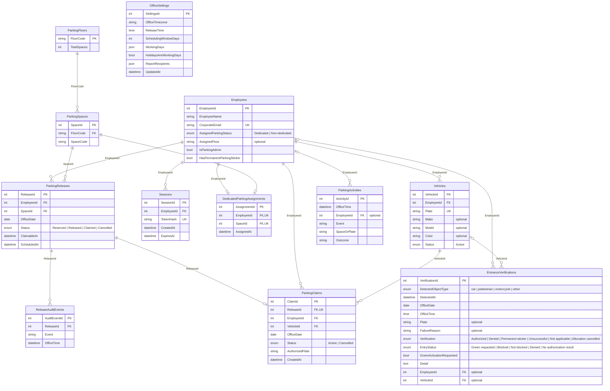

# Approval: Build every operation of the locked API contract in contracts/openapi.

Run 20261014-folio3-parking-app-introductio-c944 · risk **high** · feature · size L · cost so far $0.10

## Your request (word for word)
> Folio3 Parking App
> 
> Introduction
> 
> Folio3 has a fixed number of parking spaces available at its office premises, while the number of
> employees commuting to the office by car is greater than the available parking capacity.
> Dedicated parking spaces are currently assigned to employees based on defined organizational criteria,
> including seniority, designation, and other relevant factors. Employees with dedicated parking are issued
> a vehicle sticker, allowing security personnel to identify vehicles that are authorized to enter and use the
> office parking area.
> 
> However, dedicated parking spaces often remain unused when the assigned employee is on leave,
> working from home, travelling, or otherwise not visiting the office. At the same time, other employees
> who commute by car may be required to park outside the office despite parking spaces being
> temporarily available inside the premises.
> 
> To improve the utilization of available parking spaces, Folio3 plans to introduce a mobile application
> through which employees with dedicated parking can release their parking space when they do not
> intend to use it. The released spaces can then be made available to other eligible employees through a
> transparent and controlled process.
> 
> The application will be available on both iOS and Android platforms.
> 
> Problem Statement
> 
> The current parking allocation process does not provide visibility into whether an assigned
> parking space will be used on a particular day.
> 
> As a result:
> 
> ● Dedicated parking spaces may remain vacant for the entire day.
> ● Employees without dedicated parking may have to park on nearby roads.
> ● Security personnel do not have real-time information about released or temporarily
> reassigned parking spaces.
> ● Parking availability is managed through informal communication or is not managed at all.
> ● The organization is unable to measure parking demand, utilization, or recurring
> availability.
> 
> A centralized parking management application is required to enable parking holders to release
> unused spaces and allow those spaces to be allocated temporarily to other employees.
> 
> Solution Overview
> 
> The proposed solution will consist of a mobile application available for both iOS and Android,
> supported by a centralized backend system and a camera-based vehicle verification system at
> the office entrance.
> 
> Employees will log in using their Folio3 Google account (Gmail). The system will automatically
> identify the employee and retrieve their profile information using their corporate email address.
> 
> For employees with dedicated parking, the system will already maintain information such as:
> 
> ● Employee ID
> ● Employee Name
> ● Assigned Parking Status
> ● Registered Vehicle License Plate Number
> 
> Employees using the application for the first time who do not have a registered vehicle will be
> prompted to enter their vehicle's license plate number. This information will be stored for future
> parking requests.
> 
> By default, the system will assume that employees with dedicated parking will use their
> assigned parking space on each working day. If they do not intend to come to the office, they
> can release their parking space through a single action in the mobile application for the current
> day or schedule future releases using a calendar for up to 30 days.
> 
> Once a parking space is released, it becomes available to employees without dedicated
> parking. Eligible employees will receive a push notification and can claim the available space on
> a first-come, first-served basis.
> 
> At the office entrance, vehicles with permanent parking stickers will continue to follow the
> existing process. Vehicles without stickers will be verified using a license plate recognition
> camera. The system will validate the vehicle against the temporary parking allocation for that
> day and, if authorized, activate a green indicator for the security guard to allow entry.
> 
> User Roles
> 
> Dedicated Parking Holder
> 
> An employee with a permanently assigned parking space who can release their parking when it
> will not be used.
> 
> Temporary Parking User
> 
> An employee without a dedicated parking space who can claim an available parking spot on a
> first-come, first-served basis.
> 
> Security Guard
> 
> A security staff member responsible for verifying vehicle entry based on parking stickers or
> system authorization.
> 
> Parking Administrator
> 
> An authorized administrator responsible for managing parking assignments, employee records,
> system configuration, and parking reports.
> 
> User Stories
> 
> US-001: Login with Folio3 Account
> 
> User Story
> 
> As an employee, I want to sign in using my Folio3 Google account so that I can securely access
> the parking management application.
> 
> Description
> 
> The application shall support authentication using Folio3 Google Workspace accounts only.
> Personal Gmail accounts or other email providers shall not be permitted.
> 
> Upon successful login, the system shall identify the employee using their corporate email
> address and retrieve their profile information.
> 
> For employees with dedicated parking, the system shall automatically import and maintain the
> following information:
> 
> ● Employee ID
> ● Employee Name
> ● Assigned Parking Status
> ● One or more registered vehicle license plate numbers
> ● Assigned parking floor
> ● Vehicle make
> ● Vehicle model
> 
> ● Vehicle color
> 
> Employees without dedicated parking will be required to complete their vehicle profile during
> their first login by registering at least one license plate number. The remaining employee
> information shall be retrieved automatically from the corporate directory.
> 
> Acceptance Criteria
> 
> ● Employee can log in using a Folio3 Google account.
> ● Only authorized Folio3 employees can access the application.
> ● Employees with dedicated parking have their profile populated automatically after login.
> ● A dedicated parking holder may have one or more registered vehicles.
> ● Employees without dedicated parking are prompted to register at least one vehicle
> during their first login.
> ● A vehicle profile includes the license plate number and optionally the vehicle make,
> model, and color.
> ● Returning users are taken directly to the application dashboard after successful
> authentication.
> 
> S-002: Release Parking for Today
> 
> User Story
> 
> As an employee with a dedicated parking space, I want to release my parking for the current
> day with a single tap so that another employee can use it if I am not coming to the office.
> 
> Description
> 
> Employees with dedicated parking shall be able to release their assigned parking space for the
> current day directly from the home screen.
> 
> The action should require a single tap (with an optional confirmation prompt) to make the
> process quick and convenient. Once the parking is released, the space shall immediately
> become available for temporary allocation to other eligible employees on a first-come,
> first-served basis.
> 
> If the parking space has already been claimed by another employee, the dedicated parking
> holder will no longer have access to that parking space for the remainder of the day.
> 
> The application shall clearly display the current status of the parking space (e.g., Reserved,
> Released, or Claimed by Another Employee).
> 
> Acceptance Criteria
> 
> ● Only employees with dedicated parking can access this feature.
> ● The option to "Release Today's Parking" is available on the home screen.
> ● Releasing today's parking requires a single user action.
> ● Once released, the parking space is immediately made available to eligible employees.
> ● The parking status is updated in real time.
> ● The user receives a confirmation that the parking has been released successfully.
> ● The user cannot release the same parking space multiple times for the same day.
> ● If the parking has already been claimed by another employee, the user is informed that
> the parking cannot be reclaimed for that day without administrator intervention.
> 
> US-003: Schedule Future Parking Release
> 
> User Story
> 
> As an employee with a dedicated parking space, I want to schedule the release of my parking
> for future dates so that my parking space can be utilized by others when I know I will not be
> coming to the office.
> 
> Description
> 
> The application shall provide a calendar interface that allows dedicated parking holders to
> release their parking for future dates, up to 30 days in advance.
> 
> Users may select individual dates or multiple dates from the calendar. Once scheduled, the
> parking space will automatically become available for temporary allocation on the selected
> dates.
> 
> The user may cancel a scheduled parking release at any time, provided the parking space has
> not already been claimed by another employee. If the parking has already been allocated, the
> release cannot be reverted without administrator intervention.
> 
> Acceptance Criteria
> ● Only employees with dedicated parking can access this feature.
> ● A calendar view is available to schedule future parking releases.
> ● Users can release parking for any date within the next 30 days.
> ● Users can select one or multiple dates.
> ● Scheduled releases are saved and displayed on the calendar.
> ● Users can cancel a scheduled release if the parking has not yet been claimed.
> ● If the parking has already been claimed, the user is informed that the release cannot be
> reverted.
> ● The system maintains an audit trail of all scheduled releases and cancellations.
> 
> US-004: Claim Available Parking
> 
> User Story
> 
> As an employee without a dedicated parking space, I want to claim an available parking spot so
> that I can park inside the office premises when a space becomes available.
> 
> Description
> 
> Parking spaces shall be allocated on a first-come, first-served basis.
> 
> Parking spaces released in advance through the planning calendar shall become available for
> claiming at the Daily Parking Release Time (default: 8:00 AM, configurable by the
> administrator).
> 
> If a dedicated parking holder releases their parking on the same day:
> 
> ● If the release occurs before the Daily Parking Release Time, the parking space shall
> become available at the Daily Parking Release Time.
> ● If the release occurs after the Daily Parking Release Time, the parking space shall
> become available immediately.
> 
> Whenever one or more parking spaces become available, eligible employees without dedicated
> parking shall receive a push notification.
> 
> The application shall display the total number of available parking spaces (e.g., 5 Parking
> Spots Available). Employees will not select a specific parking space. Upon successfully
> claiming a parking spot, the system shall automatically allocate one of the available parking
> spaces and inform the employee of the assigned parking floor.
> 
> The application will not validate whether the employee actually parks on the assigned floor.
> Floor allocation is intended only to distribute vehicles evenly across available parking areas.
> 
> Acceptance Criteria
> 
> ● Only employees without dedicated parking can claim available parking.
> ● Parking spaces are allocated on a first-come, first-served basis.
> ● Pre-scheduled parking releases become available at the Daily Parking Release Time.
> ● Same-day releases made before the Daily Parking Release Time become available at
> the Daily Parking Release Time.
> ● Same-day releases made after the Daily Parking Release Time become available
> immediately.
> ● Eligible employees receive a push notification when parking becomes available.
> ● The application displays the number of currently available parking spaces.
> ● A parking space can only be claimed once.
> 
> ● Upon a successful claim, the system automatically assigns a parking space and displays
> the allocated parking floor.
> ● The application records the date, time, employee, and assigned parking for audit
> purposes.
> ● The application does not enforce or verify whether the employee parks on the assigned
> floor.
> 
> US-005: Verify Vehicle at Parking Entrance
> 
> User Story
> 
> As a security guard, I want the system to automatically verify vehicles entering the parking area
> so that only authorized vehicles are allowed to enter.
> 
> Description
> 
> The parking entrance shall be equipped with a License Plate Recognition (LPR) camera and a
> status indicator light.
> 
> The camera shall continuously monitor approaching vehicles and identify their license plate
> numbers. The system shall ignore pedestrians, motorcycles, and other non-car objects.
> 
> For each detected vehicle, the system shall verify whether it has a valid parking authorization for
> the current day.
> 
> The operational flow shall be as follows:
> 
> ● Vehicles displaying a permanent Folio3 parking sticker will continue to follow the existing
> process and will not be stopped by the security guard, even if the parking holder had
> previously released their parking through the application.
> ● Vehicles without a permanent parking sticker shall be stopped by the security guard.
> ● The system shall verify the detected license plate against the temporary parking
> allocation for the current day.
> ● If a valid parking authorization exists, the system shall activate the green indicator light.
> ● Upon seeing the green light, the security guard shall allow the vehicle to enter.
> ● If no valid authorization exists, the indicator light shall remain off and the vehicle shall not
> be permitted to enter.
> 
> All successful and unsuccessful verification attempts shall be recorded for audit and reporting
> purposes.
> 
> Acceptance Criteria
> 
> ● The camera detects approaching cars and reads their license plate numbers.
> ● The system ignores pedestrians, motorcycles, and other non-car objects.
> 
> ● Vehicles with permanent parking stickers are not required to undergo system verification.
> ● Vehicles without parking stickers are verified against the day's parking allocations.
> ● The green indicator light is activated only when a valid parking authorization exists.
> ● The indicator light remains off when no valid authorization is found.
> ● The system records the date, time, license plate number, verification result, and entry
> status for every verification attempt.
> 
> US-006: Track Parking Utilization and Generate Weekly Reports
> 
> User Story
> 
> As a Parking Administrator, I want the system to track parking utilization and identify unused
> parking allocations so that management can monitor parking usage and improve utilization.
> 
> Description
> 
> The system shall use vehicle entry records captured through the License
> Plate Recognition (LPR) camera to determine whether allocated parking
> spaces were actually utilized.
> 
> For Phase 1, the system shall only monitor, record, and report parking
> utilization. No automated penalties or policy enforcement shall be applied.
> 
> The system shall track the following scenarios:
> 
> Scenario 1 – Dedicated Parking Not Utilized
> 
> ● The employee has a dedicated parking space.
> ● The employee did not release their parking for the day.
> ● The employee's registered vehicle was not detected entering the parking facility.
> ● The parking shall be recorded as Unused Dedicated Parking.
> 
> Scenario 2 – Temporary Parking Not Utilized
> 
> ● The employee successfully claimed a temporary parking space.
> ● The employee's registered vehicle was not detected entering the parking facility on that
> day.
> ● The parking shall be recorded as Unused Temporary Parking.
> 
> The system shall maintain a history of these events for reporting and future policy
> implementation.
> 
> A weekly utilization report shall be generated automatically and emailed every Monday
> morning to designated stakeholders.
> 
> The report should include, at a minimum:
> 
> ● Employees with dedicated parking who did not release or utilize their parking.
> ● Employees who claimed temporary parking but did not utilize it.
> ● Daily and weekly parking utilization statistics.
> ● Total number of released parking spaces.
> ● Total number of temporary parking claims.
> ● Overall parking utilization percentage.
> 
> Acceptance Criteria
> 
> ● The system identifies unused dedicated parking based on the absence of a vehicle entry
> record.
> ● The system identifies unused temporary parking based on the absence of a vehicle entry
> record.
> ● All utilization events are stored with the corresponding employee, vehicle, and date.
> ● A weekly parking utilization report is generated automatically every Monday morning.
> ● The report is emailed to the configured stakeholders.
> ● No automated warning, suspension, or penalty is applied in Phase 1.
> 
> This run builds the API side of the product above, in an existing .NET API project. Build every operation of the locked API contract in contracts/openapi.yaml, exactly as it is written there. Keep the data in the project's PostgreSQL database (the connection string named App, which the project already reads), and write its sample data in App.Api/SeedData.cs: a few believable rows for each table, taken from the contract's examples, so each list has something to show. The app runs that file only when the setting Seed:Demo is true, so no test may count on those rows. The web app is built in its own repo; do not build screens here.

## Confirm these assumptions (high risk)
- [ ] ASM-1 How must the API establish that a session identity is an authorized Folio3 Google Workspace account? → assumed: Email and password, with a reset link by email; no social or single sign-on.
- [ ] ASM-2 What is the source for employee profile, parking assignment, and corporate-directory data that the API must populate or maintain after sign-in? → assumed: Use records already stored in the project's PostgreSQL database; administrators or API operations maintain them there.
- [ ] ASM-3 How are the four named roles assigned and mapped to API operations, beyond the contract's declared security requirements? → assumed: Two roles: an administrator and a standard user.
- [ ] ASM-4 For vehicle verification, does this API only implement the contract's request/response operations, or must it also connect to entrance hardware? → assumed: Implement the contract operations only; an external camera/controller calls the API and handles the indicator light.
- [ ] ASM-7 Where should the administrator-configurable Daily Parking Release Time (default 8:00 AM) be stored and changed? → assumed: Store it as an administrator-managed application setting in PostgreSQL, using the contract's configuration operations where provided.
- [ ] ASM-8 Which timezone defines 'today', the 30-day release window, and the Daily Parking Release Time? → assumed: Use the Folio3 office's local timezone for all parking dates and release-time calculations; identify the timezone.
- [ ] ASM-9 What should happen if Seed:Demo is enabled on multiple startups or against a database that already contains API data? → assumed: Insert the contract-example sample records only when their contract-defined identifiers are absent; do not overwrite or delete existing records.

Other assumptions: ASM-5 Should the API deliver push notifications when parking becomes available, or only expose the contract-defined notification behavior? → assumed: Email only, from fixed templates; no SMS or push.; ASM-6 Is the Monday-morning utilization report email part of this API build, or should this build expose only reporting operations declared in the contract? → assumed: On-screen lists with filters and CSV export; no custom report builder.

## Requirements
- **REQ-1** (MODIFIED) The Folio3 Parking API shall implement `POST /auth/sessions`, `GET /me/profile`, and `GET` and `POST /me/vehicles` with the request schemas, response schemas, security, and status behavior declared in the locked OpenAPI contract.
  - AC-1.1 [api] Given A valid Google identity token identifies an allowed Folio3 Google Workspace employee, and the session-creation operation has no bearer-token requirement.; when The client sends the token as `googleIdentityToken` to `POST /auth/sessions`.; then The response status is 201 and the returned session contains the contract-required access token, token type, expiry, employee identity, corporate email, and administrator flag.
  - AC-1.2 [api] Given A session request is malformed or has a missing token, or the identity token is invalid or unauthorized.; when The client sends the request to `POST /auth/sessions`.; then The response status is 400 for malformed or missing input, or 401 for an invalid or unauthorized identity, and the response body conforms to the contract `ApiError` schema for the applicable error.
  - AC-1.3 [api] Given An employee has a valid authenticated session and profile and vehicle records.; when The employee requests `GET /me/profile`.; then The response status is 200 and the returned profile conforms to `EmployeeProfile`, identifies the authenticated employee, and includes the contract-defined employee fields, assigned parking status, assigned floor, and vehicles; an unauthenticated request has response status 401 and an authenticated identity without permission has response status 403.
  - AC-1.4 [api] Given An employee has a valid authenticated session and registered vehicles.; when The employee requests `GET /me/vehicles`.; then The response status is 200 and the returned `vehicles` list conforms to `VehicleList` and contains only that employee's vehicles; a request without authentication has response status 401.
  - AC-1.5 [api] Given An employee has a valid authenticated session and submits a vehicle-registration request with a plate and optional vehicle details.; when The employee sends the request to `POST /me/vehicles`.; then The response status is 201 and the returned vehicle conforms to `Vehicle`, contains the submitted fields, and has status `Active`; invalid input has response status 400, missing authentication has response status 401, and a conflicting registration has response status 409, with each error response conforming to the contract `ApiError` schema.
- **REQ-2** (MODIFIED) The Folio3 Parking API shall implement `GET /parking/config` and `GET /parking/today` using the configured office-local date and time and contract-defined response schemas; initial office configuration uses `Asia/Karachi`, release time `08:00`, and a 30-day scheduling window.
  - AC-2.1 [api] Given An authenticated employee requests the office configuration and the office has its contract-example initial configuration.; when The employee requests `GET /parking/config`.; then The response status is 200 and the response body conforms to `ParkingConfig`, with `officeTimezone` `Asia/Karachi`, `releaseTime` `08:00`, `schedulingWindowDays` 30, working days, and the holiday setting; a request without authentication has response status 401.
  - AC-2.2 [api] Given An employee has a valid authenticated session and parking data for the current office-local date.; when The employee requests `GET /parking/today`.; then The response status is 200 and the response body conforms to `ParkingHome` and contains the office-local date and timezone, employee assignment and parking status, space status, release time, availability count, and contract-required vehicle and working-day fields; a request without authentication has response status 401.
- **REQ-3** (MODIFIED) The Folio3 Parking API shall implement `POST /parking/releases/today`, `GET` and `POST /parking/releases`, and `DELETE /parking/releases/{releaseId}` with contract-defined release eligibility, scheduling, filtering, cancellation, audit, and conflict behavior, calculated using the configured office-local timezone and release time.
  - AC-3.1 [api] Given An authenticated dedicated parking holder has a reserved space today that has not already been released or claimed.; when The holder sends `POST /parking/releases/today` before or after the configured release time.; then The response status is 201 and the returned release identifies the office date, `Released` status, floor, space code, and `claimableAt`; before release time `claimableAt` is the configured office-local release time, and after release time it makes the space immediately available.
  - AC-3.2 [api] Given A non-holder attempts a dedicated-holder release, or a holder attempts a release that conflicts with the current parking state.; when The employee sends `POST /parking/releases/today`.; then The response status is 403 for an ineligible employee or 409 for a conflicting state, and the response body conforms to the contract `ApiError` schema.
  - AC-3.3 [api] Given An authenticated dedicated holder has saved releases and supplies optional `from` and `through` date filters where applicable.; when The holder requests `GET /parking/releases`.; then The response status is 200 and the returned releases list conforms to `ParkingReleaseList` and contains only matching saved releases in office-local dates; a request without authentication has response status 401 and a non-holder receives response status 403.
  - AC-3.4 [api] Given An authenticated dedicated holder submits one or more valid dates within the configured scheduling window.; when The holder sends those dates to `POST /parking/releases`.; then The response status is 201 and the returned releases list contains one record for each accepted date with its release identifier, status, floor, space code, and `claimableAt` based on the configured office-local release time; invalid input has response status 400, a request without authentication has response status 401, a non-holder receives response status 403, and a conflicting release has response status 409.
  - AC-3.5 [api] Given An authenticated holder owns an existing unclaimed scheduled release.; when The holder sends `DELETE /parking/releases/{releaseId}`.; then The response status is 200 and the returned release has status `Cancelled` and includes audit events for scheduling and cancellation; missing authentication has response status 401, a non-holder receives response status 403, an unknown identifier has response status 404, and a claimed or otherwise conflicting release has response status 409.
  - AC-3.6 [api] Given A dedicated holder submits a malformed date or a date outside the configured scheduling window.; when The holder sends the date to `POST /parking/releases`.; then The response status is the contract-declared 400 for invalid input or 409 for the applicable state conflict, and the response body conforms to the contract `ApiError` schema.
- **REQ-4** (MODIFIED) The Folio3 Parking API shall implement `GET /parking/availability`, `POST /parking/claims`, `GET /parking/claims/today`, and `POST /parking/claims/{claimId}/cancel` with contract-defined eligibility, allocation, concurrency, response, and cancellation behavior.
  - AC-4.1 [api] Given An authenticated employee requests availability while released spaces are claimable.; when The employee requests `GET /parking/availability`.; then The response status is 200, the response body conforms to `ParkingAvailability`, and its `availableSpaceCount` equals the number of records in its spaces list, each with the contract-defined identifier, floor, and code; a request without authentication has response status 401.
  - AC-4.2 [api] Given An authenticated non-dedicated employee has a valid active registered vehicle and at least one claimable space.; when The employee sends the vehicle ID to `POST /parking/claims`.; then The response status is 201 and the returned claim conforms to `ParkingClaim` and identifies an active claim, allocated floor and space code, vehicle, authorized plate, entry status, floor capacities, and the contract allocation rule; invalid input has response status 400, a request without authentication has response status 401, an ineligible employee receives response status 403, and a conflicting or unavailable allocation has response status 409.
  - AC-4.3 [api] Given Two eligible employees request the last available space and one request is accepted first by the API.; when Both employees submit valid `POST /parking/claims` requests concurrently.; then The accepted response has status 201 and a returned active claim for the space, the other response has status 409, and the database contains exactly one active claim for that space.
  - AC-4.4 [api] Given An authenticated employee has a temporary claim for today, or has no temporary claim for today.; when The employee requests `GET /parking/claims/today`.; then For a claim, the response status is 200 and the returned claim conforms to `ParkingClaim` and contains its assigned space, vehicle, authorized plate, and entry status; with no claim, the response status is 404 and the response error code is `not_found`; a request without authentication has response status 401.
  - AC-4.5 [api] Given An authenticated employee requests cancellation of an existing active temporary claim.; when The employee sends `POST /parking/claims/{claimId}/cancel`.; then The response status is 409 and the returned claim remains `Active`; missing authentication has response status 401, an identity without permission receives response status 403, and an unknown claim has response status 404.
  - AC-4.6 [api] Given A dedicated holder requests a non-dedicated claim operation, or a non-dedicated employee requests a dedicated-holder release operation.; when The API receives the relevant claim or release request.; then The response status is 403 and the response body conforms to the contract `ApiError` schema.
- **REQ-5** (MODIFIED) The Folio3 Parking API shall implement the administrator list operations `GET /admin/roster`, `GET /admin/entry-checks`, and `GET /admin/activity` with their contract-defined query filters, pagination, response schemas, and administrator authorization.
  - AC-5.1 [api] Given An authenticated parking administrator has employee roster records.; when The administrator requests `GET /admin/roster` with optional search, assignment, page, and page-size parameters.; then The response status is 200 and the returned page conforms to `RosterPage`, contains matching employee records with contract-defined fields, and reports page and page-count fields; a request without authentication has response status 401 and a non-administrator receives response status 403.
  - AC-5.2 [api] Given An authenticated parking administrator has recorded entrance checks.; when The administrator requests `GET /admin/entry-checks` with optional search, result, and page parameters.; then The response status is 200 and the returned checks conform to `EntryCheckPage`, match the supplied filters, and contain the contract-defined verification date and time, plate, result, entry status, and detail; a request without authentication has response status 401 and a non-administrator receives response status 403.
  - AC-5.3 [api] Given An authenticated parking administrator has retained parking activity.; when The administrator requests `GET /admin/activity` with optional search, event type, and page parameters.; then The response status is 200 and the returned events conform to `ActivityPage`, match the supplied filters and pagination, and contain the contract-defined office time, employee name, event, space or plate, and outcome; a request without authentication has response status 401 and a non-administrator receives response status 403.
  - AC-5.4 [api] Given An authenticated standard employee requests an administrator-only list operation.; when The employee requests any of the roster, entry-check, or activity list routes.; then The response status is 403 and the response error code is `forbidden`.
- **REQ-6** (MODIFIED) The Folio3 Parking API shall implement `GET /admin/utilization` to return contract-defined office-local weekly statistics and unused dedicated and temporary parking records derived from retained parking and entrance data, with administrator authorization.
  - AC-6.1 [api] Given An authenticated parking administrator requests a week for which parking and entrance records are available.; when The administrator requests `GET /admin/utilization` with an optional `weekStart`.; then The response status is 200 and the returned report conforms to `UtilizationReport` and contains the requested week dates, generation time, office timezone, released-space and temporary-claim counts, utilization percentage, daily statistics, and unused dedicated and temporary parking lists; an invalid date has response status 400, a request without authentication has response status 401, and a non-administrator receives response status 403.
  - AC-6.2 [api] Given A dedicated holder did not release a space and has no registered-vehicle entry record for a date, and a temporary claimant has no registered-vehicle entry record for a date.; when An administrator requests the corresponding week through `GET /admin/utilization`.; then The response status is 200 and the returned report lists contain the corresponding `Unused Dedicated Parking` and `Unused Temporary Parking` events with employee, vehicle plate, and office-local date.
  - AC-6.3 [api] Given An authenticated standard employee requests a utilization report.; when The employee requests `GET /admin/utilization`.; then The response status is 403 and the response error code is `forbidden`.
- **REQ-7** (MODIFIED) The Folio3 Parking API shall implement `GET` and `PUT /admin/settings` to read and update administrator-managed office timezone, release time, and report recipients and to return contract-defined schedule fields.
  - AC-7.1 [api] Given An authenticated parking administrator has office settings stored in the application database.; when The administrator requests `GET /admin/settings`.; then The response status is 200 and the returned `OfficeSettings` contains office timezone, release time, scheduling-window days, report recipients, report schedule, and next delivery; a request without authentication has response status 401 and a non-administrator receives response status 403.
  - AC-7.2 [api] Given An authenticated parking administrator submits valid office timezone, release time, and report-recipient values.; when The administrator sends the values to `PUT /admin/settings` and then reads `GET /admin/settings`.; then Both response statuses are 200 and the returned settings preserve the submitted timezone, release time, and recipient values and include the contract-defined schedule fields; invalid values have response status 400, a request without authentication has response status 401, and a non-administrator receives response status 403.
  - AC-7.3 [api] Given An authenticated standard employee submits or reads office settings.; when The employee calls `PUT` or `GET /admin/settings`.; then The response status is 403 and the response error code is `forbidden`.
- **REQ-8** (MODIFIED) The Folio3 Parking API shall implement `POST /integrations/entrance/detections` with the contract-defined request, response, security, and status behavior, recording detections and returning verification decisions without operating physical entrance hardware.
  - AC-8.1 [api] Given An authorized integration request describes a car whose plate has an active temporary parking authorization for the office date.; when The integration sends the detection to `POST /integrations/entrance/detections`.; then The response status is 200 and the returned `EntranceVerification` identifies the plate as authorized, includes office date and time and contract-defined entry status, and sets `greenActivationRequested` to true.
  - AC-8.2 [api] Given An authorized integration request describes a car without a valid temporary allocation, a pedestrian, motorcycle, or other non-car object, or a vehicle with a permanent parking sticker.; when The integration sends the detection to `POST /integrations/entrance/detections`.; then The response status is 200 and the returned verification denies an unauthorized car, marks a non-car object as not applicable, or identifies a permanent sticker with entry status `Not blocked`; `greenActivationRequested` is false for each of these cases.
  - AC-8.3 [api] Given A detection request has valid `detectedObjectType` and `detectedAt` fields and, where applicable, a plate or failure reason.; when The integration sends the request to `POST /integrations/entrance/detections`.; then The response status is 200 and the response body contains the verification identifier, office date and time, plate, verification, entry status, `greenActivationRequested`, and detail; invalid input has response status 400.
  - AC-8.4 [api] Given A detection contains a failure reason or the verification service is unavailable.; when The integration sends the detection to `POST /integrations/entrance/detections`.; then The returned verification is fail-closed and requests no green activation; a verification-service outage has response status 503 and the response body conforms to `ApiError` with error code `service_unavailable`.
  - AC-8.5 [api] Given An integration client submits a successful or unsuccessful detection.; when The API processes the detection request.; then A corresponding database row records the office date and time, plate when present, verification result, and entry status.
  - AC-8.6 [api] Given An integration request lacks the required access token.; when The API receives the detection request.; then The response status is 401 and the response body conforms to `ApiError`.
- **REQ-9** (MODIFIED) The Folio3 Parking API shall persist contract-managed employee, vehicle, parking, entrance-verification, activity, audit, configuration, and utilization records in PostgreSQL using the configured `ConnectionStrings:App` connection.
  - AC-9.1 [api] Given The API is configured through `ConnectionStrings:App` with an isolated PostgreSQL database, and a test creates its own employee, vehicle, and parking fixtures with demo seeding disabled.; when The test registers a vehicle, schedules a release, claims a space, records an entrance detection, updates office settings, restarts the API, and reads the corresponding records through the API and database.; then The selected PostgreSQL database contains a row for each persisted operation, and the returned vehicle, release, claim, verification, and settings values remain available after restart.
  - AC-9.2 [api] Given A client successfully creates a vehicle or parking record through a contract operation using the configured PostgreSQL database.; when The API is restarted and the client reads the record using the corresponding API operation.; then The PostgreSQL database contains the corresponding row and the response returns the persisted record.
  - AC-9.3 [api] Given A client successfully updates settings, creates a claim, or submits an entrance detection.; when The corresponding API operation completes.; then A PostgreSQL row contains the saved configuration, claim, or verification record and its contract-defined identifiers and values.
- **REQ-10** (MODIFIED) When `Seed:Demo` is true, the API shall run demo seeding by inserting sample records using contract example values only when their contract-defined identifiers are absent and never overwriting or deleting existing records; when `Seed:Demo` is false, startup makes no demo inserts.
  - AC-10.1 [api] Given A fresh PostgreSQL database has `Seed:Demo=false` or the setting is unset.; when The API starts and a contract-backed table is inspected for demo sample identifiers.; then The database row count for demo sample identifiers is zero.
  - AC-10.2 [api] Given A PostgreSQL database contains a record whose contract-defined identifier matches a demo record and `Seed:Demo=true`.; when The API starts twice against that database.; then The existing row values remain unchanged and the database contains no duplicate demo identifier.
- **REQ-11** (MODIFIED) ⚠ only one draft had this When demo seeding is enabled, the API shall insert at least two sample rows in each contract-backed table using values from contract examples.
  - AC-11.1 [api] Given A fresh PostgreSQL database has `Seed:Demo=true` and contract examples are available as seed sources.; when The API starts and its contract-backed tables are inspected.; then Each contract-backed table contains at least two sample rows using values from contract examples.
- **REQ-12** (MODIFIED) ⚠ only one draft had this When demo seeding is enabled, the API shall insert three sample records in each repeatable contract-backed data table and one record in the singleton office-settings table, using business-field values based on contract examples.
  - AC-12.1 [unit] Given A fresh PostgreSQL database has demo configuration available.; when The public `SeedData.Run` method is called directly.; then The database row count is three for each repeatable contract-backed data table and one for the singleton office-settings table, and saved field values are based on contract examples.
  - AC-12.2 [api] Given The API starts with `Seed:Demo=true` and demo employee and administrator identities are authenticated.; when The clients call contract collection operations, including vehicles, releases, availability, roster, entry checks, utilization, and activity.; then Each response is successful and each returned collection or report list has a count of at least one.
- **REQ-13** (MODIFIED) ⚠ only one draft had this When `Seed:Demo` is true, the API shall insert between two and five contract-example-derived sample records for each contract-backed table.
  - AC-13.1 [api] Given A fresh PostgreSQL database has `Seed:Demo=true`.; when The API starts and its contract-backed tables are inspected.; then Each table has between two and five sample rows whose values are derived from the corresponding contract examples.
  - AC-13.2 [api] Given A fresh PostgreSQL database has `Seed:Demo=false` and no test fixtures are created.; when The API starts and an employee requests their releases.; then The response status is 200 with an empty returned release list, and the database contains no demo sample rows.
- **REQ-14** (MODIFIED) The API shall publish all 21 operations declared in `contracts/openapi.yaml` with their declared paths, methods, request and response schemas, security, parameters, and status behavior without implementing employee-facing parking-product screens in this API project.
  - AC-14.1 [api] Given The API is running with its published OpenAPI document enabled.; when A client requests `GET /openapi/v1.json`.; then The response status is 200 and the returned document lists all 21 contract paths and methods with declared request, response, and security metadata and no employee-facing parking-product screen route.
  - AC-14.2 [api] Given A client sends a request to any documented contract operation.; when The API processes the contract-defined request.; then The response content type is `application/json` and the response body conforms to that operation's declared response schema rather than a parking-product screen.

Not changing: Physical camera/LPR acquisition and physical indicator-light actuation; the API accepts detection requests and returns verification decisions only.; Push and SMS notification delivery beyond behavior expressly defined by the API contract.; Automated scheduled weekly or Monday report-email delivery and custom report-builder functionality; contract-defined reporting operations remain in scope.; External corporate-directory synchronization; employee profile, assignment, and directory-source records are maintained in PostgreSQL.; Email/password sign-in and reset-link flows, superseded by the locked OpenAPI contract's Google identity token and OAuth2 security.

## Files the plan will touch (31)
- App.Api/Admin/AdminReadEndpoints.cs  ← not found by grounding; check it
- App.Api/Admin/OfficeSettingsEndpoints.cs  ← not found by grounding; check it
- App.Api/Admin/UtilizationEndpoints.cs  ← not found by grounding; check it
- App.Api/AppDb.cs
- App.Api/Auth/ApiErrors.cs  ← not found by grounding; check it
- App.Api/Auth/GoogleIdentityTokenVerifier.cs  ← not found by grounding; check it
- App.Api/Auth/IGoogleIdentityTokenVerifier.cs  ← not found by grounding; check it
- App.Api/Auth/SessionAuthenticationHandler.cs  ← not found by grounding; check it
- App.Api/Auth/SessionEndpoints.cs  ← not found by grounding; check it
- App.Api/Claims/ClaimEndpoints.cs  ← not found by grounding; check it
- App.Api/Domain/DedicatedParkingAssignment.cs  ← not found by grounding; check it
- App.Api/Domain/Employee.cs  ← not found by grounding; check it
- App.Api/Domain/EntranceVerification.cs  ← not found by grounding; check it
- App.Api/Domain/OfficeSettings.cs  ← not found by grounding; check it
- App.Api/Domain/ParkingActivity.cs  ← not found by grounding; check it
- App.Api/Domain/ParkingClaim.cs  ← not found by grounding; check it
- App.Api/Domain/ParkingFloor.cs  ← not found by grounding; check it
- App.Api/Domain/ParkingRelease.cs  ← not found by grounding; check it
- App.Api/Domain/ParkingSpace.cs  ← not found by grounding; check it
- App.Api/Domain/ReleaseAuditEvent.cs  ← not found by grounding; check it
- App.Api/Domain/Session.cs  ← not found by grounding; check it
- App.Api/Domain/Vehicle.cs  ← not found by grounding; check it
- App.Api/EndpointModules/IEndpointModule.cs  ← not found by grounding; check it
- App.Api/Entrance/DetectionEndpoints.cs  ← not found by grounding; check it
- App.Api/Parking/OfficeClock.cs  ← not found by grounding; check it
- App.Api/Parking/ParkingOverviewEndpoints.cs  ← not found by grounding; check it
- App.Api/Program.cs
- App.Api/Releases/ReleaseEndpoints.cs  ← not found by grounding; check it
- App.Api/Releases/ReleaseRules.cs  ← not found by grounding; check it
- App.Api/SeedData.cs
- App.Api/appsettings.json  ← not found by grounding; check it

## Will also affect (found by code search, not in the plan)
- contracts/openapi.yaml (undefined): REQ-1 (MODIFIED) points at it

## Plan
Options: OPT-1 (chosen): Use convention-discovered endpoint modules and EF entity configurations, with Program.cs/AppDb.cs as the one-time composition point and each later feature adding its own wired module and entities. (simplest) | OPT-2: Use a central explicit route manifest and a central explicit entity registry, updated as each feature is added.
Decision: ADR-1: Use assembly-discovered internal endpoint modules and EF entity configurations, initialized once in Program.cs and AppDb.cs.
This allows each vertical slice to add its own wired routes and tables without later shared-file edits.
Keep the OpenAPI contract locked and publish operation metadata from the route modules.
Use PostgreSQL EnsureCreated and the existing project dependencies; add no package or migration changes.
- TASK-1 Authenticate employees and expose profile and vehicle routes → REQ-1; must pass AC-1.1, AC-1.2, AC-1.3, AC-1.4, AC-1.5
- TASK-2 Serve parking configuration and the employee’s parking home → REQ-2; must pass AC-2.1, AC-2.2
- TASK-3 Release dedicated parking spaces and manage saved releases → REQ-3; must pass AC-3.1, AC-3.2, AC-3.3, AC-3.4, AC-3.5, AC-3.6
- TASK-4 Expose released-space availability and temporary claims → REQ-4; must pass AC-4.1, AC-4.2, AC-4.3, AC-4.4, AC-4.5, AC-4.6
- TASK-5 Add administrator roster, entry-check, and activity lists → REQ-5; must pass AC-5.1, AC-5.2, AC-5.3, AC-5.4
- TASK-6 Generate weekly utilization reports from retained parking records → REQ-6; must pass AC-6.1, AC-6.2, AC-6.3
- TASK-7 Allow administrators to read and update office settings → REQ-7; must pass AC-7.1, AC-7.2, AC-7.3
- TASK-8 Process and persist entrance detections; complete contract operation coverage → REQ-8, REQ-9, REQ-14; must pass AC-8.1, AC-8.2, AC-8.3, AC-8.4, AC-8.5, AC-8.6, AC-9.1, AC-9.2, AC-9.3, AC-14.1, AC-14.2
- TASK-9 Seed idempotent contract-example demo records → REQ-10, REQ-11, REQ-12, REQ-13; must pass AC-10.1, AC-10.2, AC-11.1, AC-12.1, AC-12.2, AC-13.1, AC-13.2

Stub commit (throws NotImplemented until implemented): App.Api/Auth/IGoogleIdentityTokenVerifier.cs

## Data model (contracts/data-model.yaml; 12 tables, locked with the tests once you approve)
- **Employees**: EmployeeId int [PK], EmployeeName string, CorporateEmail string [UK], AssignedParkingStatus enum, AssignedFloor string?, IsParkingAdmin bool, HasPermanentParkingSticker bool
- **Vehicles**: VehicleId int [PK], EmployeeId int [FK], Plate string [UK], Make string?, Model string?, Color string?, Status enum
- **Sessions**: SessionId int [PK], EmployeeId int [FK], TokenHash string [UK], CreatedAt datetime, ExpiresAt datetime
- **OfficeSettings**: SettingsId int [PK], OfficeTimezone string, ReleaseTime time, SchedulingWindowDays int, WorkingDays json, HolidaysAreWorkingDays bool, ReportRecipients json, UpdatedAt datetime
- **ParkingFloors**: FloorCode string [PK], TotalSpaces int
- **ParkingSpaces**: SpaceId int [PK], FloorCode string [FK], SpaceCode string, unique (FloorCode, SpaceCode)
- **DedicatedParkingAssignments**: AssignmentId int [PK], EmployeeId int [FK, UK], SpaceId int [FK, UK], AssignedAt datetime
- **ParkingReleases**: ReleaseId int [PK], EmployeeId int [FK], SpaceId int [FK], OfficeDate date, Status enum, ClaimableAt datetime, ScheduledAt datetime, unique (EmployeeId, OfficeDate)
- **ReleaseAuditEvents**: AuditEventId int [PK], ReleaseId int [FK], Event string, OfficeTime datetime
- **ParkingClaims**: ClaimId int [PK], ReleaseId int [FK, UK], EmployeeId int [FK], VehicleId int [FK], OfficeDate date, Status enum, AuthorizedPlate string, CreatedAt datetime, unique (EmployeeId, OfficeDate)
- **EntranceVerifications**: VerificationId int [PK], DetectedObjectType enum, DetectedAt datetime, OfficeDate date, OfficeTime time, Plate string?, FailureReason string?, Verification enum, EntryStatus enum, GreenActivationRequested bool, Detail text, EmployeeId int [FK]?, VehicleId int [FK]?
- **ParkingActivities**: ActivityId int [PK], OfficeTime datetime, EmployeeId int [FK]?, Event string, SpaceOrPlate string, Outcome string
- Vehicles.EmployeeId → Employees.EmployeeId (many Vehicles to one Employees, on delete restrict)
- Sessions.EmployeeId → Employees.EmployeeId (many Sessions to one Employees, on delete cascade)
- ParkingSpaces.FloorCode → ParkingFloors.FloorCode (many ParkingSpaces to one ParkingFloors, on delete restrict)
- DedicatedParkingAssignments.EmployeeId → Employees.EmployeeId (one to one, on delete restrict)
- DedicatedParkingAssignments.SpaceId → ParkingSpaces.SpaceId (one to one, on delete restrict)
- ParkingReleases.EmployeeId → Employees.EmployeeId (many ParkingReleases to one Employees, on delete restrict)
- ParkingReleases.SpaceId → ParkingSpaces.SpaceId (many ParkingReleases to one ParkingSpaces, on delete restrict)
- ReleaseAuditEvents.ReleaseId → ParkingReleases.ReleaseId (many ReleaseAuditEvents to one ParkingReleases, on delete cascade)
- ParkingClaims.ReleaseId → ParkingReleases.ReleaseId (one to one, on delete restrict)
- ParkingClaims.EmployeeId → Employees.EmployeeId (many ParkingClaims to one Employees, on delete restrict)
- ParkingClaims.VehicleId → Vehicles.VehicleId (many ParkingClaims to one Vehicles, on delete restrict)
- EntranceVerifications.EmployeeId → Employees.EmployeeId (many EntranceVerifications to one Employees, optional, on delete set-null)
- EntranceVerifications.VehicleId → Vehicles.VehicleId (many EntranceVerifications to one Vehicles, optional, on delete set-null)
- ParkingActivities.EmployeeId → Employees.EmployeeId (many ParkingActivities to one Employees, optional, on delete set-null)

## Critic findings (0)
_The critic was off for this run: pick a model for the critic step at the start to turn it on._

## Settled by questions, and open risks
- Spec question Q-1: The spec has 14 requirements, flagged as about two runs of work. How should we handle its size? → Approve all 14 requirements as one run. (answered)

Round trip: the spec restated back matches your request (nothing dropped, nothing added).

**This spec has 14 requirements, about 2 runs' worth of work for a feature; approve it as one run or reject with which part to cut.**

## Decide
  factory approve 20261014-folio3-parking-app-introductio-c944 <hash> --note "your risk note"
  factory reject  20261014-folio3-parking-app-introductio-c944 <hash> --reason "why"

Card hash: 72e19f6a