# Approval: Build every operation of the locked API contract in contracts/openapi.

Run 20261014-hackathon-problem-statement-fe-5d51 · risk **medium** · feature · size L · cost so far $0.21

## Your request (word for word)
> Hackathon Problem Statement: Feedlot Management Solution
> 
> A feedlot is a specialized livestock operation focused on transforming young cattle (300–500 lbs)
> into market-ready livestock (1,200–1,400 lbs) over an 8- to 12-month cycle. The core business
> objective is to maximize the "feed-to-gain" ratio, as the operation's profitability is directly tied
> to how efficiently animals convert nutritional rations into body weight.
> 
> Management is split between two primary tiers: Lots and Pens. A "Lot" reflects the business
> unit (a specific group of cattle purchased and analyzed together for performance), while a "Pen"
> serves as the physical unit (where daily feeding and housing activities occur). Effective software
> must bridge these tiers, allowing for granular daily execution at the pen level while providing
> high-level performance metrics at the lot level.
> 
> Key Requirements
> ● Integrated Data Management
> ○ Procurement Ingestion: Seamlessly import animal data (weight, breed, age, and
> source) from the primary procurement system.
> ○ Lifecycle Forecasting: Automatically calculate projected market dates and target
> weights based on incoming data.
> ● Feed & Ration Management
> ○ Inventory Control & Projections: Monitor real-time ingredient levels and
> generate automated inventory forecasts across multiple time horizons—daily,
> weekly, monthly, quarterly, bi-annual, and annual.
> ○ Wastage Calibration: Integrate a configurable wastage ratio into all consumption
> estimates and inventory projections to account for feeding-loss and ensure
> procurement accuracy.
> ○ Ration & Cost Optimization: Manage complex nutritional recipes and perform
> cost-benefit analysis on different feed mixes to identify the most economical
> paths to weight gain.
> ○ Dynamic Bunk Management: Track daily bunk rates and consumption patterns at
> the pen level, allowing for real-time adjustments to feeding plans based on
> actual intake versus projections.
> ● Execution & Activity Tracking
> ○ Pen-Level Planning: Generate daily feeding schedules and plans for specific
> physical pens.
> ○ Activity Logging: Capture actual feeding data to identify variances between the
> plan and execution.
> ● Performance & Conversion Analytics
> 
> ○ Feed-to-Gain Ratio: Calculate the primary efficiency KPI (Total Feed Consumed vs.
> Total Weight Gained).
> ○ Lot-Level Profitability: Provide deep-dive analysis on specific groups to determine
> the financial ROI of each lot.
> ○ Predictive Insights: Suggest "next steps" for feeding adjustments or sale timing
> based on current weight-gain trends.
> 
> Additional Information & Requirements:
> 
> Create sample/mock data to support the system. Assume the following information is based on
> mock data fetched from other systems.
> 
> ● Automated Data Ingestion: Synchronize PO and Receiving data (Vendor, Costs, Head
> Count, Weights) to eliminate manual entry and establish the financial baseline for each
> lot.
> ● Dynamic Lot Mapping: Reflect complex upstream relationships where a single PO Line
> may split into multiple Lots, ensuring 1:1 or 1:N traceability.
> ● Entity Mapping (PO → Lot → Pen): Provide the foundation to link procurement data to
> physical locations. The system will reflect Pen ID, capacity, and current animal counts as
> fetched from the source.
> ● Centralized Operational Entities: Establish the Lot and Pen as the primary units for all
> downstream feeding and performance analytics.
> ● Lightweight Implementation: Focus on backend data connectivity rather than refined
> UI/UX, as these modules serve specifically to support the feed-to-gain engine.
> 
> The Feed-to-Gain Engine (The Core Challenge)
> 
> Inventory, Ration Module & Feed Plan per Pen
> 
> ● Allow users to maintain a feed Inventory with feed types, available quantities, and unit
> costs ($/lb or $/ton).
> ● Each inventory item may include:feed item name, feed category, quantity available, unit
> of measure, cost per unit, dry matter percentage, energy value, and storage location. It
> should also track stock movement by maintaining the opening stock, stock received,
> stock consumed, and closing stock for each feed item.
> 
> ● Allow users to create a Ration (a feed recipe) by combining multiple feed ingredients
> with specified proportions. Each ration has a calculated cost per pound based on its
> ingredient mix.
> ● A ration may include the Ration name, Ration type, Feed ingredients used, Quantity or
> percentage of each ingredient, Dry matter percentage, Energy value, Cost per unit, and
> Intended animal type or weight range.
> ● A feed plan per pen defines what ration needs to be fed to a specific pen, how much
> feed should be provided, and on which date it should be delivered. Since pens may
> contain animals from one or more lots, the feed plan helps operators manage feeding
> execution in a structured and organized way. The feed plan per pen may include the
> Feed plan date, Pen, Assigned lot, Number of animals in the pen, Selected ration,
> Planned feed quantity, Planned feeding time, Feed quantity per animal, Total feed cost,
> Expected energy intake, and Feed plan status, such as Planned, In progress, Completed,
> or Skipped. The system should allow users to generate a feed plan based on the daily
> bunk rate, selected ration, and number of animals in the pen.
> 
> Feeding Activity
> 
> ● Allow users to log a Feeding Activity against a specific Pen, capturing:
> ○ The feeding activity should capture the Feeding date, Pen, Lot, Ration, Planned
> feed quantity, Actual feed quantity delivered, Difference between planned and
> actual feed, Feed cost, Energy value, Inventory consumed, and Feeding status.
> ● On save, the system should:
> ○ Decrement the feed inventory based on the ration's ingredient mix
> ○ Calculate and store the total feed cost for that feeding event
> ○ Roll up cumulative feed consumption and feed cost at the lot level
> ● Suggested calculation: Feed Variance = Actual Feed Quantity - Planned Feed Quantity
> 
> Weight Measurement Activity
> 
> ● Allow users to log a Weight Measurement Activity against a Lot, capturing:
> ○ Lot
> ○ Measurement date
> ○ Number of animals weighed
> ○ Average animal weight
> ○ Total lot weight
> ○ Weight gain since last measurement
> ○ Notes
> ● Maintain a time-series of weight readings per lot to enable trend analysis.
> 
> Feed-to-Gain Calculation Engine
> 
> This is the most critical part. Build the calculation logic that derives the following metrics from
> feeding and weight data:
> 
> Feed-to-Gain Calculation Metrics
> 
> Metric Formula Why It Matters
> 
> Days on Feed (DOF) Current Date − Receiving Date Tracks how long the lot has
> been on feed
> 
> Total Weight Gain Current Avg Weight − Entry Avg Weight Total growth achieved so far
> 
> Average Daily Gain (ADG) Total Weight Gain ÷ DOF Primary performance
> benchmark
> 
> Total Feed Consumed Sum of all feeding events Total feed input
> 
> Feed Conversion Ratio
> (FCR)
> Total Feed Consumed (lbs) ÷ Total
> Weight Gain (lbs)
> Feed efficiency metric (lower
> is better)
> 
> Cost of Gain ($/lb) Total Feed Cost ÷ Total Weight Gain Core profitability indicator
> 
> Projected Ship Date DOF + ((Target Weight − Current Weight)
> ÷ ADG)
> Forecasted shipping readiness
> 
> These metrics should update automatically whenever a new feeding or weight event is
> recorded.
> 
> Dashboard & Reports (Visualization Layer)
> 
> Surface the engine's output in a way that helps a feedlot operator make decisions.
> 
> The dashboard should include:
> 
> ● Active lots
> ● Active pens
> ● Animals per lot and pen
> ● Feed inventory status
> ● Ration usage
> ● Daily bunk rate per pen
> ● Planned feed vs actual feed
> ● Total feed consumed
> ● Total feed cost
> ● Starting weight vs current weight
> ● Total weight gain
> ● Average Daily Gain
> ● Feed-to-gain ratio
> ● Feed cost per unit of gain
> ● Energy consumed
> ● Best and worst performing lots
> 
> The reports should help answer questions such as:
> 
> ● Which pen consumed the most feed?
> ● Which lot has the best feed-to-gain ratio?
> ● Which lot has the highest Average Daily Gain?
> ● Which ration is being used the most?
> ● Is actual feeding aligned with the feed plan?
> ● Which pens are being overfed or underfed?
> ● How much feed inventory is remaining?
> ● What is the feed cost per unit of weight gain?
> 
> Feed-to-Gain Report
> 
> A dedicated report screen that allows users to:
> 
> ● Compare ADG, FCR, and Cost of Gain across multiple lots
> ● Filter by date range, breed, sex, or pen
> 
> ● Export the report as a CSV or PDF
> 
> Yard-Level Summary (Stretch Goal)
> 
> A high-level dashboard showing aggregate metrics across all active lots — total head, average
> ADG, average Cost of Gain, total feed cost — to give the yard manager a single-glance overview.
> 
> Evaluation Criteria
> 
> Submissions will be evaluated on:
> 
> 1. Correctness of the Feed-to-Gain Calculations — Are the formulas implemented
> accurately? Do metrics update correctly as new data is entered?
> 2. Quality of the Dashboard & Visualizations — How effectively does the UI communicate
> performance to a non-technical operator?
> 3. Data Integrity — Are inventory decrements, feed cost calculations, and weight tracking
> consistent and reliable?
> 4. User Experience — Is the flow from PO → Lot → Daily Activities → Dashboard intuitive
> and frictionless?
> 5. Code Quality & Architecture — Is the solution modular and extensible for future
> activities (treatments, vaccinations, shipping, etc.)?
> 
> What to present and deliver:
> ● Proposed Solution (Approach) and Architectural Diagrams
> ● Demo of the App
> ● Overview Vibe Coding Super Prompt & Other prompts
> ● How was it tested and validated?
> ● What challenges did you face?
> ● How close is this to production readiness?
> ● Go to Market Strategy and Analysis (Extra Advantage) If you build a product based
> solution/offering & with a go-to-market insight.
> 
> This run builds the API side of the product above, in an existing .NET API project. Build every operation of the locked API contract in contracts/openapi.yaml, exactly as it is written there. Keep the data in the project's PostgreSQL database (the connection string named App, which the project already reads), and write its sample data in App.Api/SeedData.cs: a few believable rows for each table, taken from the contract's examples, so each list has something to show. The app runs that file only when the setting Seed:Demo is true, so no test may count on those rows. The web app is built in its own repo; do not build screens here.

## Your answers
- Q-1 How should authentication and authorization be applied to contract operations? → **Enforce authentication and authorization only where contracts/openapi.yaml explicitly declares them.**
- Q-2 What should happen if demo seeding runs more than once? → **Repeated runs may insert duplicate copies of the sample rows.**
- Q-3 A pen may contain animals from multiple lots, but a feeding activity identifies a lot. How should a pen-level delivery be attributed when it serves multiple lots? → **Record a separate activity per lot, with each activity containing only that lot's share of the delivered feed.**
- Q-4 What unit-conversion rule should be used when feed inventory, ration ingredients, and feeding quantities use different units? → **Convert quantities to pounds for calculations and inventory deductions, treating a ton as 2,000 pounds; retain the entered units for display.**
- Q-5 Should implementation preserve any records that may already exist in the PostgreSQL App database while adding the contract's data model? → **Preserve existing records and add the required model without resetting the database.**

## Confirm these assumptions (high risk)
- [ ] ASM-1 When a feeding activity would consume more inventory than is available, what should the API do? → assumed: Reject the activity, leave inventory unchanged, and return the contract-defined error response.

Other assumptions: ASM-2 How should calculated metrics be represented when their formulas are undefined, such as zero days on feed, zero ADG, or no positive weight gain? → assumed: Return the metric as unavailable/null and continue returning the other metrics.

## Requirements
- **REQ-1** (MODIFIED) The Feedlot API shall implement every HTTP operation declared in `contracts/openapi.yaml` at its declared path and method, with the declared request and response schemas, status codes, media types, and operation behavior.
  - AC-1.1 [api] Given A running API backed by a test database.; when A client requests GET /openapi/v1.json.; then The response document lists every contract path, method, operationId, schema, response status, and security declaration.
  - AC-1.2 [api] Given An isolated PostgreSQL App database contains contract-required fixtures and the test client has credentials for each contract-declared role.; when A black-box contract suite calls every path-and-method pair in `contracts/openapi.yaml` with valid requests and declared validation, authentication, and authorization cases.; then Each response status, media type, and body field value matches the corresponding contract operation, including its declared error responses.
  - AC-1.3 [api] Given A valid administrator-managed account, an authenticated client, and operational records exist.; when The client signs in and requests GET /api/v1/overview, GET /api/v1/lots, GET /api/v1/lots/{lotId}/lifecycle, GET /api/v1/lots/{lotId}/performance, and GET /api/v1/lots/{lotId}/financials for existing lots.; then The sign-in and operational response statuses are 200; the sign-in response contains user, accessToken, and availablePages; the overview response contains headline, activeLots, activePens, lots, inventory, rationFeeding, estimatedEnergyMcal, recentActivity, and recentSync; the list and lot responses contain their contract-defined procurement traceability, pen allocation, lifecycle milestones, weight history, projected market date, performance metrics, event history, cost breakdown, and recommendation fields.
  - AC-1.4 [api] Given An authenticated client requests the lifecycle of a lot that does not exist.; when The client calls GET /api/v1/lots/{lotId}/lifecycle with an unknown lot ID.; then The response status is 404 and the response contains the contract's error and code fields.
- **REQ-2** (ADDED) The Feedlot API shall implement the inventory and ration operations declared in `contracts/openapi.yaml`, normalizing quantities and unit costs to pounds-based values while retaining entered units for display and treating one ton as 2,000 pounds.
  - AC-2.1 [api] Given An authenticated client and inventory records with stock movements exist.; when The client requests GET /api/v1/inventory and GET /api/v1/inventory/projections.; then Each response status is 200; the inventory response list includes entered units, normalizedPounds, normalizedCostUsdPerLb, stock totals, and movements; and the projections response contains wastageRatio, remaining stock, daily, weekly, monthly, quarterly, six-month and annual projection fields, and movements.
  - AC-2.2 [api] Given An authenticated client submits the contract example receipt of 2 tons at USD 360 per ton.; when The client calls POST /api/v1/inventory/receipts.; then The response status is 201 and the response fields retain enteredQuantity 2 and enteredUnit ton while reporting normalizedPounds 4000 and normalizedCostUsdPerLb 0.18.
  - AC-2.3 [api] Given An authenticated client and saved rations exist.; when The client requests GET /api/v1/rations.; then The response status is 200 and the response list includes ration names, intended animal ranges, nutrition and cost values, ingredient entered units, normalized quantities, proportions, and ingredient pricing fields.
  - AC-2.4 [api] Given An authenticated client submits a valid ration with ingredients expressed in tons.; when The client calls POST /api/v1/rations.; then The response status is 201 and the returned ration retains each enteredUnit and includes normalized ingredient quantities, ingredient costs, dryMatterPercent, energyMcalPerLb, and costUsdPerLb.
  - AC-2.5 [api] Given An authenticated client submits valid nutrition or animal-range constraints.; when The client calls POST /api/v1/rations/optimization.; then The response status is 200 and the response candidates contain ingredient proportions, cost, nutrition values, tradeoff, and Candidate status.
  - AC-2.6 [api] Given An authenticated client explicitly accepts an existing optimization candidate.; when The client calls POST /api/v1/rations/candidates/{candidateId}/save and POST /api/v1/rations/candidates/{candidateId}/assign.; then Each response status is 200 and each response contains the requested candidateId and its Saved or Assigned status.
  - AC-2.7 [api] Given An authenticated client submits an invalid receipt.; when The client calls POST /api/v1/inventory/receipts.; then The response status is 422 and the response contains the contract's error, code, and field validation information.
- **REQ-3** (ADDED) The Feedlot API shall implement the feeding-plan and feeding-activity operations declared in `contracts/openapi.yaml`, calculating feeding quantities, variances, ingredient consumption, costs, energy, and inventory deductions in pounds.
  - AC-3.1 [api] Given An authenticated client and dated plans for a pen containing animals from two lots exist.; when The client requests GET /api/v1/feeding-plans and submits a valid plan to POST /api/v1/feeding-plans.; then The GET response status is 200 and its list includes delivery date, pen, ration, planned quantity, status, and lotAllocations; the POST response status is 201 and its returned plan contains planned quantity and a separate allocation for each lot whose quantities sum to the planned quantity.
  - AC-3.2 [api] Given An authenticated client and saved feeding activities exist.; when The client requests GET /api/v1/feeding-activities.; then The response status is 200 and the response list includes plannedQuantityLb, actualQuantityLb, varianceLb, inventoryConsumption, feedCostUsd, energyMcal, and lotAllocations.
  - AC-3.3 [api] Given A valid feeding request has a planned quantity of 900 lb, actual delivery of 950 lb, and serves two lots.; when The client calls POST /api/v1/feeding-activities.; then The response status is 201, the returned varianceLb is 50, and the response lotAllocations show a separate lot-specific delivered share for each lot with quantities summing to 950 lb.
  - AC-3.4 [api] Given A saved feeding activity exists.; when The client updates it with PATCH /api/v1/feeding-activities/{activityId} and then cancels it with DELETE /api/v1/feeding-activities/{activityId}.; then The update response status is 200 with recalculated variance and totals, the cancel response is 200 with status Canceled, and the inventoryTotals closingLb reflects the reversal.
  - AC-3.5 [api] Given A feeding activity would consume more inventory than is available and its closing stock and activity list are recorded before the request.; when The client posts the feeding activity through /api/v1/feeding-activities.; then The response status is 409 with the contract-defined insufficient-stock error, and the inventory row and feeding-activity list remain unchanged.
- **REQ-4** (ADDED) The Feedlot API shall implement the weight-measurement, yard-summary, feed-to-gain report, and report-export operations declared in `contracts/openapi.yaml`.
  - AC-4.1 [api] Given An authenticated client and weight records exist for the selected scope.; when The client requests GET /api/v1/weight-measurements with and without a lotId query parameter.; then Each response status is 200 and each response contains measurement records and a date/averageWeightLb trend list.
  - AC-4.2 [api] Given An authenticated client submits a valid measurement for an existing lot, or corrects a saved measurement.; when The client calls POST /api/v1/weight-measurements or PATCH /api/v1/weight-measurements/{measurementId}.; then The create response status is 201 and the correction response status is 200; each response contains the accepted or corrected measurement, updated or recalculated metrics, and trend fields.
  - AC-4.3 [api] Given An authenticated client and active lot and pen records exist.; when The client requests GET /api/v1/yard-summary.; then The response status is 200 and the response contains yard totals, active lot and pen counts, pen summaries, and lot summaries.
  - AC-4.4 [api] Given An authenticated client and matching and nonmatching lot performance records exist.; when The client requests GET /api/v1/reports/feed-to-gain with supported date, breed, sex, or penId filters.; then The response status is 200 and the rows list contains only matching lots while the filters field contains the known filter choices.
  - AC-4.5 [api] Given An authenticated client and feed-to-gain report data exist.; when The client requests GET /api/v1/reports/feed-to-gain/export with format=csv and format=pdf and report filters.; then Each response status is 200; the CSV response file has text/csv content and the PDF response file has application/pdf content; and each file contains the matching report data.
- **REQ-5** (ADDED) The Feedlot API shall implement the administrator account, synchronization, and demo operations declared in `contracts/openapi.yaml`, with the contract-defined request and response fields, status codes, and authorization rules.
  - AC-5.1 [api] Given An authenticated client with the role permitted by the contract and existing accounts.; when The client requests GET /api/v1/admin/accounts.; then The response status is 200 and the accounts list contains the documented account fields.
  - AC-5.2 [api] Given An authenticated client with the role permitted by the contract submits a valid new account or changes an existing account role or password.; when The client calls POST /api/v1/admin/accounts or PATCH /api/v1/admin/accounts/{accountId}.; then The create response status is 201 and the update response status is 200; each returned account and message field matches the contract and the updated account reflects the requested change.
  - AC-5.3 [api] Given An authenticated client calls synchronization and the configured mock procurement source returns record outcomes.; when The client calls POST /api/v1/admin/sync.; then The response status is 200 and the response contains the source, Completed or Partial status, and record-level results with targetLots and error fields.
  - AC-5.4 [api] Given An authenticated client requests demo materials or submits start=true.; when The client calls GET /api/v1/admin/demo and POST /api/v1/admin/demo/flow.; then Each response status is 200; the demo response contains operationalData, rules, and sections; and the flow response contains started, currentStep, stepTitle, and status fields.
  - AC-5.5 [api] Given A client without the role required by the contract calls an operation that declares administrator authorization.; when The client requests that operation.; then The response status is 403 and the response contains the contract's Forbidden error and code fields.
- **REQ-6** (ADDED) The API shall require bearer authentication for operations declaring it in the contract, leave sign-in unauthenticated, and enforce role authorization only where the contract declares role access.
  - AC-6.1 [api] Given A valid sign-in request and a protected contract operation are available.; when The client calls sign-in without a bearer token, then calls the protected operation without a token, and calls it with a role that is not authorized where the contract declares role restrictions.; then The sign-in response status is 200 for valid credentials, the protected response status is 401 without authentication, and the response status is 403 for a disallowed role where declared.
  - AC-6.2 [api] Given A client has no bearer token.; when The client calls GET /api/v1/overview.; then The response status is 401 and the response contains the contract's error and code fields.
  - AC-6.3 [api] Given A valid Operator bearer token and a valid Administrator bearer token are available.; when Each client requests GET /api/v1/admin/accounts.; then The Operator response status is 403 and its response error code is FORBIDDEN; the Administrator response status is 200 and its response contains an accounts list.
- **REQ-7** (MODIFIED) The Feedlot API shall persist contract-backed operational records in PostgreSQL through the configured `ConnectionStrings:App` connection and apply the required data model without deleting, resetting, or changing pre-existing records.
  - AC-7.1 [api] Given The configured PostgreSQL App database contains a pre-existing row and is isolated from other test databases.; when The API starts, applies its data model, and a client retrieves the corresponding record through its contract operation.; then The original database row and its field values remain present and unchanged.
  - AC-7.2 [api] Given An authenticated client creates or updates a contract record.; when The client repeats the corresponding list or detail API call after the operation and after an API restart using the same App connection string.; then The response contains the persisted record and its stored field values, and the database row persists across the restart.
- **REQ-8** (MODIFIED) The Feedlot Operations API shall execute `SeedData.Run` only when `Seed:Demo` is true and, on that run, populate every contract-backed data table with at least two believable rows derived from contract examples.
  - AC-8.1 [api] Given A fresh App database has `Seed:Demo` set to true.; when The API starts and its contract list operations are called.; then A database row count of at least two exists in every contract-backed data table, and each contract list response contains at least one record.
  - AC-8.2 [api] Given A fresh App database has `Seed:Demo` set to false or is unset.; when The API starts and a client calls contract list operations.; then The response lists reflect only records created independently of demo seeding and no demo row is required by the test.
  - AC-8.3 [api] Given Demo seeding is enabled and has already been run once.; when The demo-seeding run is repeated.; then The database row count may include duplicate sample rows because seed idempotency is not required.
- **REQ-9** (MODIFIED) When `Seed:Demo` is true, the Feedlot API shall insert two or three believable sample rows derived from contract examples into every contract domain table; repeated runs may insert duplicate sample rows.
  - AC-9.1 [api] Given A fresh PostgreSQL App database is configured with Seed:Demo true.; when The API starts and contract list operations are queried.; then Database row counts show two or three sample rows in every contract domain table, the seeded field values correspond to contract examples, and each supported list response contains sample data.
  - AC-9.2 [api] Given A fresh PostgreSQL App database is configured with Seed:Demo false or the setting is unset.; when The API starts and a client calls contract list operations.; then The database contains no demo rows and the response lists reflect only records created independently of demo seeding.
- **REQ-10** (MODIFIED) ⚠ only one draft had this When the test factory starts an application without an explicit demo-seed opt-in, the test factory shall configure `Seed:Demo` as false.
  - AC-10.1 [api] Given A fresh test-factory database and no explicit demo-seed opt-in.; when The factory starts the API and a client requests a contract list.; then The response contains no demo-seed rows and the database contains no rows inserted by SeedData.
- **REQ-11** (ADDED) When inventory, ration, or feeding calculations use quantities expressed in different units, the API shall convert quantities to pounds using 2,000 pounds per ton and retain entered units in returned display values.
  - AC-11.1 [api] Given The inventory contains Ground corn and a receipt is entered as 2 tons.; when The client records the receipt and retrieves inventory.; then The receipt response contains normalizedPounds of 4000 and retains enteredUnit as ton; the inventory response shows 2 in entered quantity, ton in enteredUnit, and 4000 in normalizedPounds and closingLb.
  - AC-11.2 [api] Given A ration ingredient or feeding quantity is entered in tons.; when The API calculates ration costs, feed consumption, and inventory deductions.; then The response shows quantities and deductions calculated using 2,000 pounds per ton while retaining the entered unit in returned display fields.
  - AC-11.3 [api] Given Inventory has a known closing stock in pounds and a ration whose ingredients include quantities entered in tons.; when The client records a feeding activity using that ration and retrieves inventory and activity responses.; then The inventory row reflects deductions calculated in pounds, and returned values for entered quantities retain their entered units.
- **REQ-12** (ADDED) When a pen-level delivery serves animals from multiple lots, the API shall represent each lot's share as a distinct, separately attributable lot allocation containing only that lot's share.
  - AC-12.1 [api] Given A pen has allocations for two lots and a 950-pound feeding activity allocates 570 pounds to one lot and 380 pounds to the other.; when The client records the activity and retrieves the activity response.; then The activity response contains one allocation per lot with delivered quantities of 570 and 380 pounds and lot totals attributed only to their respective shares.
  - AC-12.2 [api] Given A valid feeding request has a planned quantity of 900 lb, actual delivery of 950 lb, and serves two lots.; when The client calls POST /api/v1/feeding-activities.; then The response lotAllocations show a separate lot-specific delivered share for each lot with quantities summing to 950 lb.
- **REQ-13** (ADDED) ⚠ only one draft had this When a pen-level delivery serves animals from multiple lots, the API shall record a separate feeding activity per lot containing only that lot's share of the delivered feed.
  - AC-13.1 [api] Given A pen contains two lots and a valid delivery request allocates 600 lb to one lot and 400 lb to the other.; when The delivery is posted to POST /api/v1/feeding-activities and the feeding activities are then listed.; then The response contains a separate activity record for each lot, each record contains only its lot's allocated quantity, and the returned activity quantities total 1000 lb.
- **REQ-16** (ADDED) The Feedlot Operations API shall provide the contract functionality through HTTP operations without implementing separate feedlot product screens in this repository.
  - AC-16.1 [manual] Given The API is running in this repository.; when A person visits its available web routes.; then The screen shows API documentation or health information only and no feedlot product screen is displayed.
  - AC-16.2 [api] Given The API is running and its public OpenAPI document is available.; when A client reads the document's paths.; then The response path list contains API operations and no product web-app screen routes.
  - AC-16.3 [manual] Given The delivered API repository and a running application.; when A person reviews the application's exposed routes and browser-visible pages.; then No product web-app screen is present; the Swagger page is limited to API documentation and testing.

Checked by a person, not by a test: AC-16.1, AC-16.3 (each needs a person's sign-off before delivery)

Not changing: Connectivity to a live procurement vendor or production external system beyond the configured mock procurement source.; A separate web-app frontend implementation, visual design, or screen interaction flow.; Go-to-market strategy, pitch materials, and architecture diagrams outside the API contract.

## Files the plan will touch (18)
- App.Api/Administration/**  ← not found by grounding; check it
- App.Api/AppDb.cs
- App.Api/Auth/**  ← not found by grounding; check it
- App.Api/External/**  ← not found by grounding; check it
- App.Api/Feeding/**  ← not found by grounding; check it
- App.Api/Infrastructure/**  ← not found by grounding; check it
- App.Api/InventoryRations/**  ← not found by grounding; check it
- App.Api/Lots/**  ← not found by grounding; check it
- App.Api/Migrations/202610140001_Auth.cs  ← not found by grounding; check it  ← protected file
- App.Api/Migrations/202610140002_Lots.cs  ← not found by grounding; check it  ← protected file
- App.Api/Migrations/202610140003_InventoryRations.cs  ← not found by grounding; check it  ← protected file
- App.Api/Migrations/202610140004_Feeding.cs  ← not found by grounding; check it  ← protected file
- App.Api/Migrations/202610140005_WeightsReports.cs  ← not found by grounding; check it  ← protected file
- App.Api/Migrations/202610140006_Administration.cs  ← not found by grounding; check it  ← protected file
- App.Api/Program.cs
- App.Api/SeedData.cs
- App.Api/WeightsReports/**  ← not found by grounding; check it
- App.Api/appsettings.json  ← not found by grounding; check it

## Will also affect (found by code search, not in the plan)
- contracts/openapi.yaml (undefined): REQ-1 (MODIFIED) points at it
- App.Tests/AppFactory.cs (undefined): REQ-10 (MODIFIED) points at it

## Plan
Options: OPTION-1: Implement the contract operations as a single set of handlers in Program.cs with inferred OpenAPI metadata and shared persistence code. | OPTION-2 (chosen): Use discovered endpoint, service, and seed modules; each working slice owns its routes, entities, additive migration, and seed module, while a startup OpenAPI configuration enforces contract metadata.
Decision: Choose OPTION-2: discovered route/service/seed modules let each slice wire its own API and data without shared-file conflicts.
Use additive EF migrations and contract-shaped endpoint metadata; leave contracts/openapi.yaml locked and unchanged.
Persist one feeding-activity row per lot under a shared group, aggregating only the POST response to preserve the contract's singular activity shape.
Keep the existing API/Swagger surface; do not add product screens or external packages.
- TASK-1 Establish API conventions, authentication, and account operations → REQ-6, REQ-10, REQ-16; must pass AC-6.1, AC-6.2, AC-6.3, AC-10.1, AC-16.1, AC-16.2, AC-16.3
- TASK-2 Add lot traceability and pen allocation operations → ; builds towards a later task (no criteria of its own)
- TASK-3 Implement inventory, rations, and ration-candidate operations → REQ-2; must pass AC-2.1, AC-2.2, AC-2.3, AC-2.4, AC-2.5, AC-2.6, AC-2.7
- TASK-4 Implement feeding plans and per-lot feeding activities → REQ-3, REQ-11, REQ-12, REQ-13; must pass AC-3.1, AC-3.2, AC-3.3, AC-3.4, AC-3.5, AC-11.1, AC-11.2, AC-11.3, AC-12.1, AC-12.2, AC-13.1
- TASK-5 Implement weights, lot detail, yard summary, and Feed-to-Gain reports → REQ-4; must pass AC-4.1, AC-4.2, AC-4.3, AC-4.4, AC-4.5
- TASK-6 Complete overview, synchronization, demo operations, seeding, and contract coverage → REQ-1, REQ-5, REQ-7, REQ-8, REQ-9; must pass AC-1.1, AC-1.2, AC-1.3, AC-1.4, AC-5.1, AC-5.2, AC-5.3, AC-5.4, AC-5.5, AC-7.1, AC-7.2, AC-8.1, AC-8.2, AC-8.3, AC-9.1, AC-9.2

## Task order (6 waves for 6 tasks; the tasks run one after another today)
- Wave 1: TASK-1
- Wave 2: TASK-2 (after: planner)
- Wave 3: TASK-3 (after: planner)
- Wave 4: TASK-4 (after: planner)
- Wave 5: TASK-5 (after: planner)
- Wave 6: TASK-6 (after: planner)

Stub commit (throws NotImplemented until implemented): App.Api/External/IProcurementSource.cs

## Data model (contracts/data-model.yaml; 19 tables, locked with the tests once you approve)
- **Accounts**: id int [PK], name string, department string, email string [UK], passwordHash string, role enum, status enum
- **ApiSessions**: id uuid [PK], accountId int [FK], tokenHash string [UK], issuedAt datetime, expiresAt datetime, revoked bool
- **Pens**: id int [PK], name string [UK], capacity int
- **Lots**: id int [PK], lotCode string [UK], sourceId string, sourceRecordId string, supplier string, receivedDate date, breed string, sex string?, receivedHead int, purchaseCostAllocation decimal, receivedAverageWeightLb decimal, targetWeightLb decimal, ageMonths int?, status enum, unique (sourceId, sourceRecordId)
- **PenLotAllocations**: id int [PK], penId int [FK], lotId int [FK], headCount int, unique (penId, lotId)
- **InventoryItems**: id int [PK], item string [UK], category string, supplier string, enteredQuantity decimal, enteredUnit string, normalizedPounds decimal, cost decimal, costUnit string, normalizedCostUsdPerLb decimal, dryMatterPercent decimal, energyMcalPerLb decimal, crudeProteinPercent decimal, tdnPercent decimal, storageLocation string, openingLb decimal
- **InventoryMovements**: id int [PK], inventoryItemId int [FK], date date, type enum, quantityLb decimal, enteredQuantity decimal?, enteredUnit string?, activityGroupId uuid?
- **Rations**: id int [PK], name string [UK], rationType string, intendedAnimalRange string
- **RationIngredients**: id int [PK], rationId int [FK], inventoryItemId int [FK], name string, quantity decimal, enteredUnit string, proportionPercent decimal
- **RationCandidates**: id int [PK], name string, intendedAnimalRange string, costUsdPerLb decimal, crudeProteinPercent decimal, tdnPercent decimal, netEnergyMcalPerLb decimal, tradeoff string, status enum, savedRationId int [FK]?
- **CandidateIngredients**: id int [PK], candidateId int [FK], inventoryItemId int [FK], name string, proportionPercent decimal, unique (candidateId, inventoryItemId)
- **CandidateAssignments**: id int [PK], candidateId int [FK], penId int [FK], effectiveDate date
- **FeedingPlans**: id int [PK], date date, penId int [FK], rationId int [FK], bunkRateLbPerHeadPerDay decimal, plannedHeadCount int, feedingTime time?, status enum
- **PlanLotAllocations**: id int [PK], planId int [FK], lotId int [FK], plannedQuantityLb decimal, unique (planId, lotId)
- **FeedingActivities**: id int [PK], activityGroupId uuid, planId int [FK]?, date date, penId int [FK], rationId int [FK], lotId int [FK], bunkRateLbPerHeadPerDay decimal, headCount int, plannedQuantityLb decimal?, actualQuantityLb decimal, status enum, planMismatch bool, unique (activityGroupId, lotId)
- **WeightMeasurements**: id int [PK], lotId int [FK], date date, animalsWeighed int, averageWeightLb decimal, totalLotWeightLb decimal, gainSincePriorLb decimal, notes text, recorder string, result enum
- **SyncBatches**: id uuid [PK], source string, status enum, createdAt datetime
- **SyncRecords**: id int [PK], syncBatchId uuid [FK], sourceId string, sourceRecordId string, vendor string?, costUsd decimal?, headCount int?, averageWeightLb decimal?, breed string?, ageMonths int?, sex string?, result enum, error text?
- **SyncRecordLots**: id int [PK], syncRecordId int [FK], lotId int [FK], unique (syncRecordId, lotId)
- ApiSessions.accountId → Accounts.id (many ApiSessions to one Accounts, on delete cascade)
- PenLotAllocations.penId → Pens.id (many PenLotAllocations to one Pens, on delete restrict)
- PenLotAllocations.lotId → Lots.id (many PenLotAllocations to one Lots, on delete restrict)
- InventoryMovements.inventoryItemId → InventoryItems.id (many InventoryMovements to one InventoryItems, on delete cascade)
- RationIngredients.rationId → Rations.id (many RationIngredients to one Rations, on delete cascade)
- RationIngredients.inventoryItemId → InventoryItems.id (many RationIngredients to one InventoryItems, on delete restrict)
- RationCandidates.savedRationId → Rations.id (many RationCandidates to one Rations, optional, on delete set-null)
- CandidateIngredients.candidateId → RationCandidates.id (many CandidateIngredients to one RationCandidates, on delete cascade)
- CandidateIngredients.inventoryItemId → InventoryItems.id (many CandidateIngredients to one InventoryItems, on delete restrict)
- CandidateAssignments.candidateId → RationCandidates.id (many CandidateAssignments to one RationCandidates, on delete cascade)
- CandidateAssignments.penId → Pens.id (many CandidateAssignments to one Pens, on delete restrict)
- FeedingPlans.penId → Pens.id (many FeedingPlans to one Pens, on delete restrict)
- FeedingPlans.rationId → Rations.id (many FeedingPlans to one Rations, on delete restrict)
- PlanLotAllocations.planId → FeedingPlans.id (many PlanLotAllocations to one FeedingPlans, on delete cascade)
- PlanLotAllocations.lotId → Lots.id (many PlanLotAllocations to one Lots, on delete restrict)
- FeedingActivities.planId → FeedingPlans.id (many FeedingActivities to one FeedingPlans, optional, on delete set-null)
- FeedingActivities.penId → Pens.id (many FeedingActivities to one Pens, on delete restrict)
- FeedingActivities.rationId → Rations.id (many FeedingActivities to one Rations, on delete restrict)
- FeedingActivities.lotId → Lots.id (many FeedingActivities to one Lots, on delete restrict)
- WeightMeasurements.lotId → Lots.id (many WeightMeasurements to one Lots, on delete restrict)
- SyncRecords.syncBatchId → SyncBatches.id (many SyncRecords to one SyncBatches, on delete cascade)
- SyncRecordLots.syncRecordId → SyncRecords.id (many SyncRecordLots to one SyncRecords, on delete cascade)
- SyncRecordLots.lotId → Lots.id (many SyncRecordLots to one Lots, on delete restrict)

```mermaid
erDiagram
  Accounts ||--o{ ApiSessions : "accountId"
  Pens ||--o{ PenLotAllocations : "penId"
  Lots ||--o{ PenLotAllocations : "lotId"
  InventoryItems ||--o{ InventoryMovements : "inventoryItemId"
  Rations ||--o{ RationIngredients : "rationId"
  InventoryItems ||--o{ RationIngredients : "inventoryItemId"
  Rations |o--o{ RationCandidates : "savedRationId"
  RationCandidates ||--o{ CandidateIngredients : "candidateId"
  InventoryItems ||--o{ CandidateIngredients : "inventoryItemId"
  RationCandidates ||--o{ CandidateAssignments : "candidateId"
  Pens ||--o{ CandidateAssignments : "penId"
  Pens ||--o{ FeedingPlans : "penId"
  Rations ||--o{ FeedingPlans : "rationId"
  FeedingPlans ||--o{ PlanLotAllocations : "planId"
  Lots ||--o{ PlanLotAllocations : "lotId"
  FeedingPlans |o--o{ FeedingActivities : "planId"
  Pens ||--o{ FeedingActivities : "penId"
  Rations ||--o{ FeedingActivities : "rationId"
  Lots ||--o{ FeedingActivities : "lotId"
  Lots ||--o{ WeightMeasurements : "lotId"
  SyncBatches ||--o{ SyncRecords : "syncBatchId"
  SyncRecords ||--o{ SyncRecordLots : "syncRecordId"
  Lots ||--o{ SyncRecordLots : "lotId"
  Accounts {
    int id PK
    string name
    string department
    string email UK
    string passwordHash
    enum role "Administrator | Operator"
    enum status "Active | Inactive"
  }
  ApiSessions {
    uuid id PK
    int accountId FK
    string tokenHash UK
    datetime issuedAt
    datetime expiresAt
    bool revoked
  }
  Pens {
    int id PK
    string name UK
    int capacity
  }
  Lots {
    int id PK
    string lotCode UK
    string sourceId
    string sourceRecordId
    string supplier
    date receivedDate
    string breed
    string sex "optional"
    int receivedHead
    decimal purchaseCostAllocation
    decimal receivedAverageWeightLb
    decimal targetWeightLb
    int ageMonths "optional"
    enum status "Active | Closed"
  }
  PenLotAllocations {
    int id PK
    int penId FK
    int lotId FK
    int headCount
  }
  InventoryItems {
    int id PK
    string item UK
    string category
    string supplier
    decimal enteredQuantity
    string enteredUnit
    decimal normalizedPounds
    decimal cost
    string costUnit
    decimal normalizedCostUsdPerLb
    decimal dryMatterPercent
    decimal energyMcalPerLb
    decimal crudeProteinPercent
    decimal tdnPercent
    string storageLocation
    decimal openingLb
  }
  InventoryMovements {
    int id PK
    int inventoryItemId FK
    date date
    enum type "Receipt | Feed consumption"
    decimal quantityLb
    decimal enteredQuantity "optional"
    string enteredUnit "optional"
    uuid activityGroupId "optional"
  }
  Rations {
    int id PK
    string name UK
    string rationType
    string intendedAnimalRange
  }
  RationIngredients {
    int id PK
    int rationId FK
    int inventoryItemId FK
    string name
    decimal quantity
    string enteredUnit
    decimal proportionPercent
  }
  RationCandidates {
    int id PK
    string name
    string intendedAnimalRange
    decimal costUsdPerLb
    decimal crudeProteinPercent
    decimal tdnPercent
    decimal netEnergyMcalPerLb
    string tradeoff
    enum status "Candidate | Saved | Assigned"
    int savedRationId FK "optional"
  }
  CandidateIngredients {
    int id PK
    int candidateId FK
    int inventoryItemId FK
    string name
    decimal proportionPercent
  }
  CandidateAssignments {
    int id PK
    int candidateId FK
    int penId FK
    date effectiveDate
  }
  FeedingPlans {
    int id PK
    date date
    int penId FK
    int rationId FK
    decimal bunkRateLbPerHeadPerDay
    int plannedHeadCount
    time feedingTime "optional"
    enum status "Planned | In progress | Completed | Skipped"
  }
  PlanLotAllocations {
    int id PK
    int planId FK
    int lotId FK
    decimal plannedQuantityLb
  }
  FeedingActivities {
    int id PK
    uuid activityGroupId
    int planId FK "optional"
    date date
    int penId FK
    int rationId FK
    int lotId FK
    decimal bunkRateLbPerHeadPerDay
    int headCount
    decimal plannedQuantityLb "optional"
    decimal actualQuantityLb
    enum status "Completed | Canceled"
    bool planMismatch
  }
  WeightMeasurements {
    int id PK
    int lotId FK
    date date
    int animalsWeighed
    decimal averageWeightLb
    decimal totalLotWeightLb
    decimal gainSincePriorLb
    text notes
    string recorder
    enum result "Accepted | Corrected"
  }
  SyncBatches {
    uuid id PK
    string source
    enum status "Completed | Partial"
    datetime createdAt
  }
  SyncRecords {
    int id PK
    uuid syncBatchId FK
    string sourceId
    string sourceRecordId
    string vendor "optional"
    decimal costUsd "optional"
    int headCount "optional"
    decimal averageWeightLb "optional"
    string breed "optional"
    int ageMonths "optional"
    string sex "optional"
    enum result "Imported | Updated | Failed"
    text error "optional"
  }
  SyncRecordLots {
    int id PK
    int syncRecordId FK
    int lotId FK
  }
```

## Critic findings (0)
_The critic was off for this run: pick a model for the critic step at the start to turn it on._

## Settled by questions, and open risks
- Spec question Q-6: The spec contains 14 requirements, estimated at about two runs of work. Should all 14 remain in this run, or should some scope be deferred? → Approve all 14 requirements in one run. (answered)

Round trip: the spec restated back matches your request (nothing dropped, nothing added).

**This spec has 14 requirements, about 2 runs' worth of work for a feature; approve it as one run or reject with which part to cut.**

## Decide
  factory approve 20261014-hackathon-problem-statement-fe-5d51 <hash> --note "your risk note"
  factory reject  20261014-hackathon-problem-statement-fe-5d51 <hash> --reason "why"

Card hash: cddb34c9