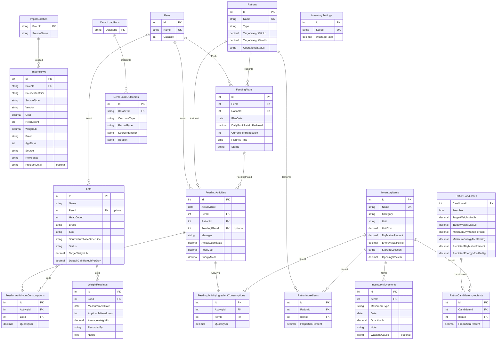

# Approval: Build every operation of the locked API contract in contracts/openapi.

Run 20261014-hackathon-problem-statement-fe-768d · risk **high** · feature · size L · cost so far $0.09

## Your request (word for word)
> Hackathon Problem Statement: Feedlot Management Solution
> 
> A feedlot is a specialized livestock operation focused on transforming young cattle (300–500 lbs)
> into market-ready livestock (1,200–1,400 lbs) over an 8- to 12-month cycle. The core business
> objective is to maximize the "feed-to-gain" ratio, as the operation's profitability is directly tied
> to how efficiently animals convert nutritional rations into body weight.
> 
> Management is split between two primary tiers: Lots and Pens. A "Lot" reflects the business
> unit (a specific group of cattle purchased and analyzed together for performance), while a "Pen"
> serves as the physical unit (where daily feeding and housing activities occur). Effective software
> must bridge these tiers, allowing for granular daily execution at the pen level while providing
> high-level performance metrics at the lot level.
> 
> Key Requirements
> ● Integrated Data Management
> ○ Procurement Ingestion: Seamlessly import animal data (weight, breed, age, and
> source) from the primary procurement system.
> ○ Lifecycle Forecasting: Automatically calculate projected market dates and target
> weights based on incoming data.
> ● Feed & Ration Management
> ○ Inventory Control & Projections: Monitor real-time ingredient levels and
> generate automated inventory forecasts across multiple time horizons—daily,
> weekly, monthly, quarterly, bi-annual, and annual.
> ○ Wastage Calibration: Integrate a configurable wastage ratio into all consumption
> estimates and inventory projections to account for feeding-loss and ensure
> procurement accuracy.
> ○ Ration & Cost Optimization: Manage complex nutritional recipes and perform
> cost-benefit analysis on different feed mixes to identify the most economical
> paths to weight gain.
> ○ Dynamic Bunk Management: Track daily bunk rates and consumption patterns at
> the pen level, allowing for real-time adjustments to feeding plans based on
> actual intake versus projections.
> ● Execution & Activity Tracking
> ○ Pen-Level Planning: Generate daily feeding schedules and plans for specific
> physical pens.
> ○ Activity Logging: Capture actual feeding data to identify variances between the
> plan and execution.
> ● Performance & Conversion Analytics
> 
> ○ Feed-to-Gain Ratio: Calculate the primary efficiency KPI (Total Feed Consumed vs.
> Total Weight Gained).
> ○ Lot-Level Profitability: Provide deep-dive analysis on specific groups to determine
> the financial ROI of each lot.
> ○ Predictive Insights: Suggest "next steps" for feeding adjustments or sale timing
> based on current weight-gain trends.
> 
> Additional Information & Requirements:
> 
> Create sample/mock data to support the system. Assume the following information is based on
> mock data fetched from other systems.
> 
> ● Automated Data Ingestion: Synchronize PO and Receiving data (Vendor, Costs, Head
> Count, Weights) to eliminate manual entry and establish the financial baseline for each
> lot.
> ● Dynamic Lot Mapping: Reflect complex upstream relationships where a single PO Line
> may split into multiple Lots, ensuring 1:1 or 1:N traceability.
> ● Entity Mapping (PO → Lot → Pen): Provide the foundation to link procurement data to
> physical locations. The system will reflect Pen ID, capacity, and current animal counts as
> fetched from the source.
> ● Centralized Operational Entities: Establish the Lot and Pen as the primary units for all
> downstream feeding and performance analytics.
> ● Lightweight Implementation: Focus on backend data connectivity rather than refined
> UI/UX, as these modules serve specifically to support the feed-to-gain engine.
> 
> The Feed-to-Gain Engine (The Core Challenge)
> 
> Inventory, Ration Module & Feed Plan per Pen
> 
> ● Allow users to maintain a feed Inventory with feed types, available quantities, and unit
> costs ($/lb or $/ton).
> ● Each inventory item may include:feed item name, feed category, quantity available, unit
> of measure, cost per unit, dry matter percentage, energy value, and storage location. It
> should also track stock movement by maintaining the opening stock, stock received,
> stock consumed, and closing stock for each feed item.
> 
> ● Allow users to create a Ration (a feed recipe) by combining multiple feed ingredients
> with specified proportions. Each ration has a calculated cost per pound based on its
> ingredient mix.
> ● A ration may include the Ration name, Ration type, Feed ingredients used, Quantity or
> percentage of each ingredient, Dry matter percentage, Energy value, Cost per unit, and
> Intended animal type or weight range.
> ● A feed plan per pen defines what ration needs to be fed to a specific pen, how much
> feed should be provided, and on which date it should be delivered. Since pens may
> contain animals from one or more lots, the feed plan helps operators manage feeding
> execution in a structured and organized way. The feed plan per pen may include the
> Feed plan date, Pen, Assigned lot, Number of animals in the pen, Selected ration,
> Planned feed quantity, Planned feeding time, Feed quantity per animal, Total feed cost,
> Expected energy intake, and Feed plan status, such as Planned, In progress, Completed,
> or Skipped. The system should allow users to generate a feed plan based on the daily
> bunk rate, selected ration, and number of animals in the pen.
> 
> Feeding Activity
> 
> ● Allow users to log a Feeding Activity against a specific Pen, capturing:
> ○ The feeding activity should capture the Feeding date, Pen, Lot, Ration, Planned
> feed quantity, Actual feed quantity delivered, Difference between planned and
> actual feed, Feed cost, Energy value, Inventory consumed, and Feeding status.
> ● On save, the system should:
> ○ Decrement the feed inventory based on the ration's ingredient mix
> ○ Calculate and store the total feed cost for that feeding event
> ○ Roll up cumulative feed consumption and feed cost at the lot level
> ● Suggested calculation: Feed Variance = Actual Feed Quantity - Planned Feed Quantity
> 
> Weight Measurement Activity
> 
> ● Allow users to log a Weight Measurement Activity against a Lot, capturing:
> ○ Lot
> ○ Measurement date
> ○ Number of animals weighed
> ○ Average animal weight
> ○ Total lot weight
> ○ Weight gain since last measurement
> ○ Notes
> ● Maintain a time-series of weight readings per lot to enable trend analysis.
> 
> Feed-to-Gain Calculation Engine
> 
> This is the most critical part. Build the calculation logic that derives the following metrics from
> feeding and weight data:
> 
> Feed-to-Gain Calculation Metrics
> 
> Metric Formula Why It Matters
> 
> Days on Feed (DOF) Current Date − Receiving Date Tracks how long the lot has
> been on feed
> 
> Total Weight Gain Current Avg Weight − Entry Avg Weight Total growth achieved so far
> 
> Average Daily Gain (ADG) Total Weight Gain ÷ DOF Primary performance
> benchmark
> 
> Total Feed Consumed Sum of all feeding events Total feed input
> 
> Feed Conversion Ratio
> (FCR)
> Total Feed Consumed (lbs) ÷ Total
> Weight Gain (lbs)
> Feed efficiency metric (lower
> is better)
> 
> Cost of Gain ($/lb) Total Feed Cost ÷ Total Weight Gain Core profitability indicator
> 
> Projected Ship Date DOF + ((Target Weight − Current Weight)
> ÷ ADG)
> Forecasted shipping readiness
> 
> These metrics should update automatically whenever a new feeding or weight event is
> recorded.
> 
> Dashboard & Reports (Visualization Layer)
> 
> Surface the engine's output in a way that helps a feedlot operator make decisions.
> 
> The dashboard should include:
> 
> ● Active lots
> ● Active pens
> ● Animals per lot and pen
> ● Feed inventory status
> ● Ration usage
> ● Daily bunk rate per pen
> ● Planned feed vs actual feed
> ● Total feed consumed
> ● Total feed cost
> ● Starting weight vs current weight
> ● Total weight gain
> ● Average Daily Gain
> ● Feed-to-gain ratio
> ● Feed cost per unit of gain
> ● Energy consumed
> ● Best and worst performing lots
> 
> The reports should help answer questions such as:
> 
> ● Which pen consumed the most feed?
> ● Which lot has the best feed-to-gain ratio?
> ● Which lot has the highest Average Daily Gain?
> ● Which ration is being used the most?
> ● Is actual feeding aligned with the feed plan?
> ● Which pens are being overfed or underfed?
> ● How much feed inventory is remaining?
> ● What is the feed cost per unit of weight gain?
> 
> Feed-to-Gain Report
> 
> A dedicated report screen that allows users to:
> 
> ● Compare ADG, FCR, and Cost of Gain across multiple lots
> ● Filter by date range, breed, sex, or pen
> 
> ● Export the report as a CSV or PDF
> 
> Yard-Level Summary (Stretch Goal)
> 
> A high-level dashboard showing aggregate metrics across all active lots — total head, average
> ADG, average Cost of Gain, total feed cost — to give the yard manager a single-glance overview.
> 
> Evaluation Criteria
> 
> Submissions will be evaluated on:
> 
> 1. Correctness of the Feed-to-Gain Calculations — Are the formulas implemented
> accurately? Do metrics update correctly as new data is entered?
> 2. Quality of the Dashboard & Visualizations — How effectively does the UI communicate
> performance to a non-technical operator?
> 3. Data Integrity — Are inventory decrements, feed cost calculations, and weight tracking
> consistent and reliable?
> 4. User Experience — Is the flow from PO → Lot → Daily Activities → Dashboard intuitive
> and frictionless?
> 5. Code Quality & Architecture — Is the solution modular and extensible for future
> activities (treatments, vaccinations, shipping, etc.)?
> 
> What to present and deliver:
> ● Proposed Solution (Approach) and Architectural Diagrams
> ● Demo of the App
> ● Overview Vibe Coding Super Prompt & Other prompts
> ● How was it tested and validated?
> ● What challenges did you face?
> ● How close is this to production readiness?
> ● Go to Market Strategy and Analysis (Extra Advantage) If you build a product based
> solution/offering & with a go-to-market insight.
> 
> This run builds the API side of the product above, in an existing .NET API project. Build every operation of the locked API contract in contracts/openapi.yaml, exactly as it is written there. Keep the data in the project's PostgreSQL database (the connection string named App, which the project already reads), and write its sample data in App.Api/SeedData.cs: a few believable rows for each table, taken from the contract's examples, so each list has something to show. The app runs that file only when the setting Seed:Demo is true, so no test may count on those rows. The web app is built in its own repo; do not build screens here.

## Confirm these assumptions (high risk)
- [ ] ASM-1 If `Seed:Demo` is true on repeated startups, how should the seeder behave when demo or operational rows already exist? → assumed: Idempotently add missing demo rows while preserving existing rows and avoiding duplicates.

## Requirements
- **REQ-1** (MODIFIED) The Feedlot API shall implement every HTTP operation, request and response schema, parameter, and documented status in contracts/openapi.yaml, retain its API documentation page, and omit product-facing screens.
  - AC-1.1 [api] Given Operational data is available.; when A client sends GET /overview.; then The response status is 200 and the response fields include active lot and pen counts, total animals, pens, lot performance, inventory status, ration usage, bunk rates, planned and actual feed, feed quantities and cost, weights, gains, efficiency, energy, and best and worst lots.
  - AC-1.2 [api] Given Import batches are available.; when A client sends GET /imports/batches.; then The response status is 200 and the returned batches list contains records with batchId, sourceName, and recordCount fields.
  - AC-1.3 [api] Given A known import batch is available for preview.; when A client sends POST /imports/preview with the contract request body.; then The response status is 200 and the returned preview contains batchId, rows, readyCount, duplicateCount, pendingMappingCount, and failedCount fields.
  - AC-1.4 [api] Given A known import batch is available for synchronization.; when A client sends POST /imports/synchronize with the contract request body.; then The response status is 200 and the returned sync response contains the documented outcome counts, partial value, and row outcomes.
  - AC-1.5 [api] Given Lot and pen records are available.; when A client sends GET /lots.; then The response status is 200 and the returned lots and pens lists contain records matching the contract Lot and Pen schemas.
  - AC-1.6 [api] Given The source purchase-order line, lots, and pens in a mapping request exist.; when A client sends POST /lots/mappings with valid assignments.; then The response status is 200 and the returned assignments include the source line, requested head count, capacity, current animal count, status, and problem detail for each requested assignment.
  - AC-1.7 [api] Given The requested lot exists and the assumption values are valid.; when A client sends PATCH /lots/{lotId}/assumptions with targetWeightLb and defaultGainRateLbPerDay.; then The response status is 200 and the returned forecast contains the updated target weight and gain rate, gain-rate basis, projected market date, and recommendations.
  - AC-1.8 [api] Given The requested lot exists.; when A client sends GET /lots/{lotId}/forecast.; then The response status is 200 and the returned forecast contains targetWeightLb, gainRateLbPerDay, gainRateBasis, projectedMarketDate, and recommendations.
  - AC-1.9 [api] Given Feed inventory records exist.; when A client sends GET /inventory/items.; then The response status is 200 and the returned inventory response contains wastageRatio and item records with contract stock totals, item properties, and movement history.
  - AC-1.10 [api] Given The inventory item exists and a received or adjustment movement is valid.; when A client sends POST /inventory/movements.; then The response status is 201 and the returned movement and item reflect the submitted itemId, movementType, date, quantityLb, and note, including updated stock fields.
  - AC-1.11 [api] Given The inventory item exists and the actual-wastage request is valid.; when A client sends POST /inventory/wastage.; then The response status is 201 and the returned movement and item include the actual_wastage quantity, date, wastage cause, and updated stock fields.
  - AC-1.12 [api] Given The requested wastageRatio is valid.; when A client sends PATCH /inventory/settings.; then The response status is 200 and the returned wastageRatio value equals the saved submitted value.
  - AC-1.13 [api] Given Inventory data exists and a supported horizon and valid wastageRatio are supplied.; when A client sends GET /inventory/outlook for each supported horizon: daily, weekly, monthly, quarterly, bi-annual, and annual.; then Each response status is 200 and each returned outlook contains the requested horizon, wastageRatio, and per-item current stock, daily estimated consumption, and projected balance fields.
  - AC-1.14 [api] Given Ration records exist or the ration list is empty.; when A client sends GET /rations.; then The response status is 200 and the returned rations list contains records with the contract ration and ingredient fields, including identity, type, target weight range, operational status, costPerLb, and ingredients.
  - AC-1.15 [api] Given Every ingredient item exists and the ration request is valid.; when A client sends POST /rations.; then The response status is 201 and the returned ration record includes its identity, type, target weight range, operational status, ingredients, and calculated costPerLb.
  - AC-1.16 [api] Given Inventory ingredients are available and the optimization constraints are valid.; when A client sends POST /rations/optimize.; then The response status is 200 and the returned feasibleCandidates and infeasibleCandidates contain feasibility, ingredient mix, costPerLb, predicted dry matter, and predicted energy fields in the contract cost order.
  - AC-1.17 [api] Given The requested candidateId exists and is available for selection.; when A client sends POST /rations/selection.; then The response status is 200 and the returned selectedCandidate matches the requested candidate and the applied field is false.
  - AC-1.18 [api] Given Feeding plans exist for the requested date and pen.; when A client sends GET /feeding/plans with optional date and penId filters.; then The response status is 200 and the returned plans list contains FeedingPlan records matching the filters and contract schema fields.
  - AC-1.19 [api] Given The requested pen and ration exist and the feeding-plan request is valid.; when A client sends POST /feeding/plans.; then The response status is 201 and the returned plan contains date, pen and lot details, animal count, ration, planned quantity and time, quantity per animal, total feed cost, expected energy, status, actual quantity, and variance fields.
  - AC-1.20 [api] Given Feeding activities exist for the requested date and pen.; when A client sends GET /feeding/activities with optional date and penId filters.; then The response status is 200 and the returned activities list contains FeedingActivity records matching the filters and contract schema fields.
  - AC-1.21 [api] Given The requested pen, ration, optional feeding plan, and lot quantities are valid and inventory is sufficient.; when A client sends POST /feeding/activities.; then The response status is 201 and the returned activity includes planned and actual quantities, variance, status, feed cost, energy, ingredient consumption, and lot consumption.
  - AC-1.22 [api] Given The requested lot exists and has weight readings.; when A client sends GET /lots/{lotId}/weight-readings.; then The response status is 200 and the returned readings list contains the lot's WeightReading fields in date order.
  - AC-1.23 [api] Given The requested lot exists and the weight-reading request is valid.; when A client sends POST /lots/{lotId}/weight-readings.; then The response status is 201 and the returned WeightMutationResponse contains the reading series and refreshed performance metrics.
  - AC-1.24 [api] Given The requested lot and reading exist and the replacement request is valid.; when A client sends PUT /lots/{lotId}/weight-readings/{readingId}.; then The response status is 200 and the returned WeightMutationResponse contains the updated reading series and refreshed performance metrics.
  - AC-1.25 [api] Given The requested lot and reading exist and deletion is permitted.; when A client sends DELETE /lots/{lotId}/weight-readings/{readingId}.; then The response status is 200 and the returned WeightMutationResponse contains the remaining reading series and refreshed performance metrics.
  - AC-1.26 [api] Given The requested lot exists and has controlled weight and feeding records.; when A client sends GET /lots/{lotId}/performance.; then The response status is 200 and the returned metrics contain daysOnFeed, totalWeightGainLb, averageDailyGainLbPerDay, totalFeedConsumedAsFedLb, feedConversionRatio, feedCostPerPoundOfGain, and projectedShipDate.
  - AC-1.27 [api] Given Operational records exist and startDate and endDate are valid.; when A client sends GET /reports/operations with the required date range.; then The response status is 200 and the returned report contains the requested dates and pens, lots, inventory, planAlignment, and rationUsage lists.
  - AC-1.28 [api] Given Weight and feeding records exist and the date range and optional breed, sex, and penId filters are valid.; when A client sends GET /reports/feed-to-gain.; then The response status is 200 and the returned report contains its filters, weightSelectionRule, and rows with the required lot, weight, ADG, feed, FCR, and feed-cost fields; the latest in-range weight and feeding events through that reading determine each row.
  - AC-1.29 [api] Given The API is running and project-demo content is available.; when A client sends GET /project-demo.; then The response status is 200 and the returned ProjectDemoResponse contains solutionSummary, architectureDiagram, demonstrationSteps, validationCoverage, challenges, productionReadiness, and goToMarket.
  - AC-1.30 [api] Given The requested datasetId is supported and the DemoLoadRequest is valid.; when A client sends POST /demo-data/load.; then The response status is 200 and the returned DemoLoadResponse contains datasetId, addedCount, alreadyPresentCount, failedCount, partial, and the three record-outcome lists.
  - AC-1.31 [api] Given A documented operation receives malformed input, a missing record, a conflict, invalid fields, or a service failure for which the contract documents an error response.; when A client sends the request to that documented operation.; then The response status is the operation's documented error status and the response body contains the ErrorResponse code and message fields, with details when present in the contract.
  - AC-1.32 [api] Given A lotId or batchId does not exist and the corresponding operation declares a 404 response.; when A client sends the applicable forecast, assumption, preview, synchronization, or mapping request.; then The response status is 404 and the response body contains the ErrorResponse code and message fields.
  - AC-1.33 [api] Given A nonexistent import batch is requested for preview.; when A client sends POST /imports/preview with that batchId.; then The response status is 404 and the response code field is not_found.
  - AC-1.34 [api] Given An inventory movement request references a nonexistent item.; when A client sends POST /inventory/movements.; then The response status is 404 and the response code field is not_found.
  - AC-1.35 [api] Given A horizon outside daily, weekly, monthly, quarterly, bi-annual, or annual is supplied.; when A client sends GET /inventory/outlook.; then The response status is 422 and the response body contains the ErrorResponse code and message fields.
  - AC-1.36 [api] Given A DemoLoadRequest body is invalid.; when A client sends POST /demo-data/load.; then The response status is 422 and the response body contains the ErrorResponse code and message fields.
  - AC-1.37 [manual] Given The API project is built and running with its documentation page available.; when A reviewer opens the available browser pages.; then No product-facing feedlot screen is displayed and the available Swagger page is API documentation.
  - AC-1.38 [api] Given A feeding activity has been recorded and consumed ingredients are tracked in inventory.; when A client reads GET /inventory/items after that feeding activity.; then The response contains reduced stock for each consumed ingredient and the activity response's feedCost and lotConsumption values are available for the recorded event.
- **REQ-2** (MODIFIED) The Feedlot API shall store persistent contract data in the PostgreSQL database configured by the existing App connection string and make saved records available after an application restart.
  - AC-2.1 [api] Given A PostgreSQL database configured using ConnectionStrings:App initially contains no application records.; when A client creates, changes, or deletes persistent data using contract operations, the API process is restarted, and the corresponding list or detail operation is called again.; then The response status is successful for the documented operation, each persisted row is returned with the saved field values, and a deleted row is absent from the response.
  - AC-2.2 [api] Given The application starts with a valid App PostgreSQL connection string.; when The application initializes its database schema.; then A database inspection finds row-capable persistent tables for the entities and relationships required by contract operations.
  - AC-2.3 [api] Given The App PostgreSQL database contains an inventory item used by a ration.; when A client creates a ration referencing that item, the API restarts against the same database, and a client calls GET /rations.; then The response contains the created ration record after restart.
- **REQ-3** (MODIFIED) When Seed:Demo is true, the Feedlot API shall populate each persistent contract entity table with believable sample rows based on contracts/openapi.yaml examples, so collection operations have sample data.
  - AC-3.1 [api] Given A fresh PostgreSQL database is configured and Seed:Demo is true.; when The application starts and the contract collection operations are called.; then Each persistent contract entity table contains at least three sample rows and each corresponding response list contains seeded records.
  - AC-3.2 [api] Given Seed:Demo is true and example records are available through the API.; when A client reads the relevant import, lot, pen, inventory, and ration collections.; then The response contains sample values modeled on contract examples, including spring-po-2026, PO-8041-L1, Lot 24-A, Pen 01, Yellow corn, and Grower 1.
- **REQ-5** (MODIFIED) When Seed:Demo is false or absent, the Feedlot API shall operate without inserting demo rows or requiring demo data.
  - AC-5.1 [api] Given PostgreSQL is empty and Seed:Demo is false or absent.; when The application starts and contract API tests create prerequisite records through their own requests.; then The database contains zero rows inserted by demo seeding and each response status and returned value in the tests is supported by test-created records.
  - AC-5.2 [api] Given The API is configured with Seed:Demo=false and an empty test database.; when The application starts and a contract collection endpoint is called.; then The response status is 200 and the returned list is empty without requiring demo rows.

Checked by a person, not by a test: AC-1.37 (each needs a person's sign-off before delivery)

Not changing: Product-facing web application screens and refined UI/UX in this API repository; those belong to the separate web-app repository.; Capabilities with no corresponding operation or response field in the locked OpenAPI contract, including CSV/PDF export and live connectivity to external procurement systems.

## Files the plan will touch (16)
- App.Api/ApiErrors.cs  ← not found by grounding; check it
- App.Api/AppDb.cs
- App.Api/Data/CoreEntities.cs  ← not found by grounding; check it
- App.Api/Data/DemoEntities.cs  ← not found by grounding; check it
- App.Api/Data/FeedingEntities.cs  ← not found by grounding; check it
- App.Api/Data/InventoryEntities.cs  ← not found by grounding; check it
- App.Api/Data/RationEntities.cs  ← not found by grounding; check it
- App.Api/Data/WeightEntities.cs  ← not found by grounding; check it
- App.Api/Endpoints/CoreEndpoints.cs  ← not found by grounding; check it
- App.Api/Endpoints/DemoEndpoints.cs  ← not found by grounding; check it
- App.Api/Endpoints/FeedingEndpoints.cs  ← not found by grounding; check it
- App.Api/Endpoints/InventoryEndpoints.cs  ← not found by grounding; check it
- App.Api/Endpoints/RationEndpoints.cs  ← not found by grounding; check it
- App.Api/Endpoints/WeightReportEndpoints.cs  ← not found by grounding; check it
- App.Api/Program.cs
- App.Api/SeedData.cs

## Will also affect (found by code search, not in the plan)
- contracts/openapi.yaml (undefined): REQ-1 (MODIFIED) points at it
- App.Tests/HealthTests.cs (undefined): REQ-5 (MODIFIED) points at it

## Plan
Options: OPT-1: Simplest: implement every route and persistence concern together in the existing Program.cs and AppDb.cs. | OPT-2 (chosen): Use small internal minimal-API endpoint modules discovered by a convention installed in the first slice, with EF Core entity/configuration discovery and domain slices.
Decision: Decision: implement exactly the operations in the locked OpenAPI document (30 operations; the 29-operation narrative is not authority) and leave the document unchanged.
Use internally discovered minimal-API domain modules so each slice adds its routes and logic without later edits to startup.
Persist domain inputs and outcomes in the existing EF Core/Npgsql App database; derive response aggregates rather than duplicating them.
Seed example records only behind the existing Seed:Demo startup gate; retain Swagger and the health route, with no product screens.
Tradeoff: one small discovery convention buys independently wired slices; no new packages are required.
- TASK-1 Wire the API and deliver overview, imports, lots, forecasts, and project demo → REQ-1, REQ-1 criteria delivered here: AC-1.1 through AC-1.8 pass for their exact OpenAPI operations, including documented request/response fields and success statuses; AC-1.29 passes for GET /project-demo; AC-1.37 confirms API documentation remains available and no product-facing screen is introduced; AC-1.32 and AC-1.33 pass for missing import batches and lots on the operations implemented in this slice. AC-1.31's documented error cases are covered for this slice's operations., REQ-2, REQ-2 contribution delivered here: AC-2.1's restart-persistence check passes for import batches, import rows, pens, and lots created or changed through this slice's operations.; builds towards a later task (no criteria of its own)
- TASK-2 Deliver inventory and ration operations → REQ-1, REQ-1 criteria delivered here: AC-1.9 through AC-1.17 pass for inventory, outlook, ration CRUD, optimization, and selection using the contract paths, query names, fields, and statuses; AC-1.34 and AC-1.35 pass for unknown inventory items and unsupported outlook horizons. AC-1.31's documented error cases are covered for this slice's operations., REQ-2, REQ-2 contribution delivered here: AC-2.1's restart-persistence check passes for inventory and ration records created or changed through this slice; AC-2.3 passes for a ration referencing an inventory item after restart.; builds towards a later task (no criteria of its own)
- TASK-3 Deliver feeding plans and recorded feeding activities → REQ-1, REQ-1 criteria delivered here: AC-1.18 through AC-1.21 pass for filtered plans, plan generation, filtered activity logs, and activity recording with documented response shapes/statuses; AC-1.38 passes because recording an activity reduces inventory for consumed ingredients and exposes feed cost and lot consumption. AC-1.31's documented error cases are covered for this slice's operations., REQ-2, REQ-2 contribution delivered here: AC-2.1's restart-persistence check passes for feeding plans, activities, lot consumption, and ingredient consumption created or changed through this slice.; builds towards a later task (no criteria of its own)
- TASK-4 Deliver weight readings, performance, and operational reports → REQ-1, REQ-1 criteria delivered here: AC-1.22 through AC-1.28 pass for weight-reading list/create/update/delete, lot performance, operational reports, and filtered feed-to-gain reports. AC-1.31's documented error cases are covered for this slice's operations., REQ-2, REQ-2 contribution delivered here: AC-2.1's restart-persistence check passes for weight-reading records created, updated, or deleted through this slice; performance and report values are derived from persisted operational records.; builds towards a later task (no criteria of its own)
- TASK-5 Deliver demo-data loading and conditional sample seeding → REQ-1, REQ-1 criteria delivered here: AC-1.30 and AC-1.36 pass for POST /demo-data/load and its invalid-request response; AC-1.31's documented error cases are covered for this operation. Error cases for earlier operations are covered by their route-owning slices., REQ-2, REQ-2 contribution delivered here: AC-2.1's restart-persistence check passes for demo-load outcomes; AC-2.2 passes for the complete row-capable schema after this slice adds its tables., REQ-3, REQ-3 criteria delivered here: AC-3.1 and AC-3.2 pass when Seed:Demo=true, with at least three example-based rows in each persistent entity table and named sample values available through collection operations., REQ-5, REQ-5 criteria delivered here: AC-5.1 and AC-5.2 pass; absent/false Seed:Demo inserts no sample data and collection operations succeed against empty tables.; must pass AC-1.1, AC-1.2, AC-1.3, AC-1.4, AC-1.5, AC-1.6, AC-1.7, AC-1.8, AC-1.9, AC-1.10, AC-1.11, AC-1.12, AC-1.13, AC-1.14, AC-1.15, AC-1.16, AC-1.17, AC-1.18, AC-1.19, AC-1.20, AC-1.21, AC-1.22, AC-1.23, AC-1.24, AC-1.25, AC-1.26, AC-1.27, AC-1.28, AC-1.29, AC-1.30, AC-1.31, AC-1.32, AC-1.33, AC-1.34, AC-1.35, AC-1.36, AC-1.37, AC-1.38, AC-2.1, AC-2.2, AC-2.3, AC-3.1, AC-3.2, AC-5.1, AC-5.2

## Data model (contracts/data-model.yaml; 18 tables, locked with the tests once you approve)
- **ImportBatches**: BatchId string [PK], SourceName string
- **ImportRows**: Id int [PK], BatchId string [FK], SourceIdentifier string, SourceType string, Vendor string, Cost decimal, HeadCount int, WeightLb decimal, Breed string, AgeDays int, Source string, RowStatus string, ProblemDetail string?
- **Pens**: Id int [PK], Name string [UK], Capacity int
- **Lots**: Id int [PK], Name string, PenId int [FK]?, HeadCount int, Breed string, Sex string, SourcePurchaseOrderLine string, Status string, TargetWeightLb decimal, DefaultGainRateLbPerDay decimal
- **InventoryItems**: Id int [PK], Name string [UK], Category string, Unit string, UnitCost decimal, DryMatterPercent decimal, EnergyMcalPerKg decimal, StorageLocation string, OpeningStockLb decimal
- **InventoryMovements**: Id int [PK], ItemId int [FK], MovementType string, Date date, QuantityLb decimal, Note string, WastageCause string?
- **InventorySettings**: Id int [PK], Scope string [UK], WastageRatio decimal
- **Rations**: Id int [PK], Name string [UK], Type string, TargetWeightMinLb decimal, TargetWeightMaxLb decimal, OperationalStatus string
- **RationIngredients**: Id int [PK], RationId int [FK], ItemId int [FK], ProportionPercent decimal, unique (RationId, ItemId)
- **RationCandidates**: CandidateId int [PK], Feasible bool, TargetWeightMinLb decimal, TargetWeightMaxLb decimal, MinimumDryMatterPercent decimal, MinimumEnergyMcalPerKg decimal, PredictedDryMatterPercent decimal, PredictedEnergyMcalPerKg decimal
- **RationCandidateIngredients**: Id int [PK], CandidateId int [FK], ItemId int [FK], ProportionPercent decimal, unique (CandidateId, ItemId)
- **FeedingPlans**: Id int [PK], PenId int [FK], RationId int [FK], PlanDate date, DailyBunkRateLbPerHead decimal, CurrentPenHeadcount int, PlannedTime time, Status string
- **FeedingActivities**: Id int [PK], ActivityDate date, PenId int [FK], RationId int [FK], FeedingPlanId int [FK]?, Manager string, ActualQuantityLb decimal, FeedCost decimal, EnergyMcal decimal
- **FeedingActivityLotConsumptions**: Id int [PK], ActivityId int [FK], LotId int [FK], QuantityLb decimal, unique (ActivityId, LotId)
- **FeedingActivityIngredientConsumptions**: Id int [PK], ActivityId int [FK], ItemId int [FK], QuantityLb decimal, unique (ActivityId, ItemId)
- **WeightReadings**: Id int [PK], LotId int [FK], MeasurementDate date, ApplicableHeadcount int, AverageWeightLb decimal, RecordedBy string, Notes text
- **DemoLoadRuns**: DatasetId string [PK]
- **DemoLoadOutcomes**: Id int [PK], DatasetId string [FK], OutcomeType string, RecordType string, SourceIdentifier string, Reason string
- ImportRows.BatchId → ImportBatches.BatchId (many ImportRows to one ImportBatches, on delete cascade)
- Lots.PenId → Pens.Id (many Lots to one Pens, optional, on delete set-null)
- InventoryMovements.ItemId → InventoryItems.Id (many InventoryMovements to one InventoryItems, on delete restrict)
- RationIngredients.RationId → Rations.Id (many RationIngredients to one Rations, on delete cascade)
- RationIngredients.ItemId → InventoryItems.Id (many RationIngredients to one InventoryItems, on delete restrict)
- RationCandidateIngredients.CandidateId → RationCandidates.CandidateId (many RationCandidateIngredients to one RationCandidates, on delete cascade)
- RationCandidateIngredients.ItemId → InventoryItems.Id (many RationCandidateIngredients to one InventoryItems, on delete restrict)
- FeedingPlans.PenId → Pens.Id (many FeedingPlans to one Pens, on delete restrict)
- FeedingPlans.RationId → Rations.Id (many FeedingPlans to one Rations, on delete restrict)
- FeedingActivities.PenId → Pens.Id (many FeedingActivities to one Pens, on delete restrict)
- FeedingActivities.RationId → Rations.Id (many FeedingActivities to one Rations, on delete restrict)
- FeedingActivities.FeedingPlanId → FeedingPlans.Id (many FeedingActivities to one FeedingPlans, optional, on delete set-null)
- FeedingActivityLotConsumptions.ActivityId → FeedingActivities.Id (many FeedingActivityLotConsumptions to one FeedingActivities, on delete cascade)
- FeedingActivityLotConsumptions.LotId → Lots.Id (many FeedingActivityLotConsumptions to one Lots, on delete restrict)
- FeedingActivityIngredientConsumptions.ActivityId → FeedingActivities.Id (many FeedingActivityIngredientConsumptions to one FeedingActivities, on delete cascade)
- FeedingActivityIngredientConsumptions.ItemId → InventoryItems.Id (many FeedingActivityIngredientConsumptions to one InventoryItems, on delete restrict)
- WeightReadings.LotId → Lots.Id (many WeightReadings to one Lots, on delete cascade)
- DemoLoadOutcomes.DatasetId → DemoLoadRuns.DatasetId (many DemoLoadOutcomes to one DemoLoadRuns, on delete cascade)

## Critic findings (0)
_The critic was off for this run: pick a model for the critic step at the start to turn it on._

## Settled by questions, and open risks
- Spec question Q-1: Should the four requirements be approved as one run, or should the scope be rejected with a requirement cut? → Approve all four requirements as one run. (answered)

Round trip: the spec restated back matches your request (nothing dropped, nothing added).

**This spec has 4 requirements, about 2 runs' worth of work for a feature; approve it as one run or reject with which part to cut.**

## Decide
  factory approve 20261014-hackathon-problem-statement-fe-768d <hash> --note "your risk note"
  factory reject  20261014-hackathon-problem-statement-fe-768d <hash> --reason "why"

Card hash: a291939d